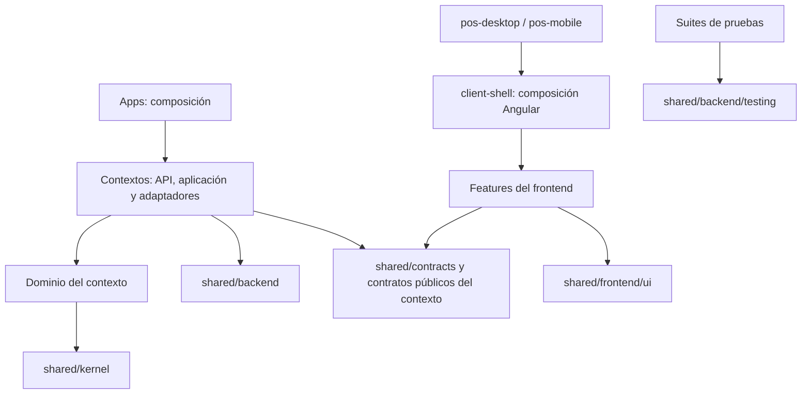

# Decisiones de arquitectura

**Alcance:** esta guía describe la base de código revisada y distingue las capacidades implementadas del diseño objetivo. La estructura de producto agrupa lo transversal en `libs/shared/`, según la [guía del monorepo](monorepo.md). Los ejemplos ejecutables corresponden al snapshot identificado del producto; la estructura propuesta no acredita por sí sola su implementación. Core es únicamente referencia de organización, sin dependencia de código, paquetes o servicios.

## 1. Monorepo Nx con límites de dependencia

Un producto multipaís con siete aplicaciones objetivo: `pos-desktop`, `pos-mobile`, `branch-api`, `branch-sync-worker`, `country-api`, `erp-worker` y `device-agent`. Las apps componen librerías por responsabilidad; seis tienen proyecto en la revisión del producto y `device-agent` está pendiente de implementación. La documentación Starlight pertenece al repositorio editorial [POS Docs](https://github.com/developer-implementos/pos-docs), separado del código operativo. La [guía del monorepo](monorepo.md) detalla el scaffold, su propiedad de datos y la evidencia del legado que orienta las fronteras.

Las aplicaciones cliente `pos-desktop` y `pos-mobile` tienen entradas independientes. Cada una incluye un frontend Angular/PrimeNG alojado en una shell nativa (host): Tauri en escritorio y Capacitor en Android/iOS. Comparten `libs/client-shell`, la composición Angular de raíz, configuración, rutas, guards y layout, y `shared/frontend/ui`, que concentra componentes, activos y estilos. La [decisión de clientes nativos](decisions/native-clients.md) fija sus límites. Vercel publica el portal, la documentación y las presentaciones desde POS Docs.

El perfil demo conserva `domain`, que no importa Angular, y `data-access`, que implementa las mutaciones mock. El perfil conectado utiliza `data-access/branch-api` y `features/branch-operation`, con contratos puros y sin importar el store demo. Las features no se importan entre sí; `libs/client-shell` compone sus rutas y no es el host nativo. `ui` contiene presentación y formatos, sin acceso a persistencia ni reglas de operación. El backend dispone de contextos en `libs/backend`, contratos y políticas puras en `shared/contracts`, `shared/kernel` y `country-policies`, y reutiliza la infraestructura técnica de `shared/backend/runtime`. ESLint verifica las direcciones de importación y Nx conoce los proyectos.

Las aplicaciones Node se empaquetan con Rspack/SWC y el plugin oficial de Nx para incluir las librerías fuente internas; TSC conserva la comprobación de tipos. Las dependencias externas se instalan desde el manifiesto y lockfile de cada artefacto, cuya ejecución se verifica fuera del workspace. Las bibliotecas internas se consumen desde el monorepo y no requieren publicación como paquetes independientes.

Prime-showcase aporta la referencia visual. Los formularios utilizan componentes PrimeNG nativos y las capacidades de Angular; no hay modificaciones a paquetes de terceros.

### Organización compartida objetivo

`shared/backend` agrupa mecanismos del servidor; `shared/frontend/ui`, presentación; `shared/kernel`, el modelo mínimo acordado; `shared/contracts`, sobres y metadatos comunes; `shared/backend/testing`, soporte exclusivamente de pruebas. Los contratos de ventas, pagos o caja pertenecen a su contexto. No existe un barrel universal ni se centralizan entidades de negocio.

El diagrama expresa **dependencias objetivo de código**. No representa nuevas conexiones de red ni reglas ya instaladas.

Las dependencias de servidor se limitan a adaptación/composición; el dominio permanece puro. Estos límites requieren reglas Nx/ESLint y pruebas negativas que rechacen imports prohibidos. El diseño incluye `tests/pos-clients-e2e` como proyecto de pruebas vinculado a ambas aplicaciones cliente; no amplía las siete aplicaciones objetivo. Su estado se detalla en la [guía de pruebas](testing.md).

## 2. Estado y puertos

`PosStore` expone un snapshot signal de solo lectura y comandos que retornan `Result<T>`. Los fallos esperados se muestran como mensajes accionables. Las features nunca alteran las colecciones directamente. El reloj, la generación de identificadores y las esperas de simulación son sustituibles para probar casos deterministas.

`POS_REPOSITORY` permite sustituir el adaptador local. El formato se valida al cargar y tiene una versión explícita. Cada mutación se construye sobre una copia; la aplicación solo anuncia éxito después de persistirla. El almacenamiento web es suficiente para una demostración, pero tiene límites de tamaño, concurrencia y seguridad. No tiene las garantías de una base de datos.

La dirección de producto propone un backend de sucursal NestJS/Fastify compartido por las cajas y conectado a PostgreSQL de sucursal. Ambas aplicaciones cliente consumen su API, sin acceso SQL directo ni una base transaccional por terminal en el perfil de continuidad ante caída de WAN. La LAN y el servidor de sucursal siguen siendo dependencias de ese perfil. La sincronización duradera y el planificador pasarían a procesos supervisados que no dependan de la pestaña abierta. SQLite por terminal es una alternativa del perfil adicional sin LAN/servidor, pendiente de validación; no es la persistencia seleccionada por defecto. Esta dirección sigue la [propuesta de arquitectura](propuesta-arquitectura.md) y sus [opciones tecnológicas](opciones-tecnologicas.md).

`apps/branch-api` compone la [API F01](api.md) con identidad de laboratorio, configuración, caja, catálogo, clientes, cestas, precios y confirmación en efectivo en PostgreSQL. `branch-lab` conecta Angular con esos contratos; `demo` conserva sus adaptadores sintéticos. La [guía F01](phase-1-laboratory.md) delimita el recorrido en revisión y la recuperación; la producción permanece cerrada.

El [ADR-18](decisions/job-processing.md) selecciona BullMQ con Redis exclusivo para programación breve en `country-api` y ejecución, preparación de lotes y conciliación en `erp-worker`. Son dominios de cola aislados; PostgreSQL conserva solicitudes/resultados y permite reconstruir jobs. No añade Redis a sucursal ni cambia el protocolo PostgreSQL/HTTPS de `branch-sync-worker`. Colas, relay, consumidores y recuperación están pendientes de implementación.

`country-api` tiene base HTTP, PostgreSQL y comprobación de ámbito/esquema, sin recepción comercial; `branch-sync-worker` y `erp-worker` preparan procesos separados para entrega y adaptadores. Son puntos de implementación, no sincronizadores reales. Los contextos scaffold no exponen fachadas que simulen una operación exitosa: deben incorporar casos de uso y pruebas antes de habilitar endpoints o jobs comerciales.

## 3. Cuatro estados distintos

- **Venta local:** se guardan documento, líneas, pagos y eventos pendientes.
- **Pago:** confirmado, rechazado o desconocido. Un resultado desconocido exige conciliación; no se cobra de nuevo automáticamente.
- **Fiscal:** documento pendiente, emitido o fallido. Una impresión no demuestra emisión.
- **ERP:** pendiente, sincronizado o fallido. Una venta local no demuestra registro en Dynamics AX.

Una nota de crédito conserva las cantidades y valores del documento original. Emitirla y devolver el pago son acciones distintas. Los pagos con crédito de cliente y con NC no deben confundirse con tarjetas de crédito.

## 4. Sincronización

Los flujos tienen dirección, entidades, programación, siguiente ejecución y ejecuciones históricas. Admiten manual, intervalo y hora diaria con selección de días en `America/Santiago`. Las ejecuciones en curso no se duplican. Un cierre interrumpido se recupera como error revisable.

Ese comportamiento sigue siendo el mock del frontend. La arquitectura asigna la ejecución supervisada a `branch-sync-worker` y los contratos/progreso a `libs/backend/sync`. Persistencia durable, locks, transportes, programación fuera de la pestaña y conciliación entre aplicaciones quedan pendientes.

La cola de salida conserva la identidad de la operación y del evento durante los reintentos. Fiscal y ERP tienen confirmación independiente. El modo offline conserva el trabajo local autorizado y bloquea acciones que exigen un proveedor. En el producto real, la deduplicación debe existir también en el receptor; el mock no prueba garantías de servicios externos.

## 5. Permisos y módulos

Los perfiles Administrador, Supervisor, Cajero y Auditor tienen políticas explícitas. La navegación, las rutas y los comandos verifican permiso y disponibilidad del módulo. Deshabilitar una capacidad conserva su historial. Los registros de auditoría incluyen actor, rol, acción y entidad.

En `demo`, el selector de perfil es una herramienta de demostración. No constituye autenticación ni una barrera contra alguien que controle el navegador. En producción se necesita identidad verificable, sesiones y autorización de servidor por empresa/sucursal/caja. La auditoría local mock tampoco sustituye un registro remoto inmutable.

## 6. Multisucursal y producto comercial

La interfaz separa operación de caja, gestión comercial y plataforma. Los maestros y políticas son compartidos, con filtros de sucursal en análisis y asignaciones en usuarios. El diseño debe evolucionar a configuración corporativa con herencia por sucursal, aprobaciones de cambios, despliegue gradual y contratos versionados. Esa administración remota no se simula como si hubiera dispositivos reales conectados.

`country-policies` concentra la variación nacional y `fiscal` delimita emisión/proveedores; las reglas comunes no se duplican en una app distinta por país. Los perfiles iniciales y contratos no acreditan homologación fiscal, pagos o reglas comerciales fuera de la demostración chilena. Una app de backoffice separada se evaluará si existe una experiencia o ciclo de despliegue que la requiera.

## 7. Escritorio seguro

La shell nativa Tauri aloja el build estático del frontend de `pos-desktop`. La navegación por hash funciona sin un servidor de rutas. La CSP limita conexiones y recursos; los assets y fuentes son locales. No se habilitan plugins de shell, filesystem o HTTP para la maqueta. Las futuras integraciones nativas necesitan comandos y capacidades específicas, cancelación y límites de tiempo, sin exponer credenciales al frontend.

La actualización del producto requiere firma de instaladores, firma de manifiestos, protección contra downgrade, canales y validación de compatibilidad de la base local. La pantalla actual ilustra el recorrido y conserva su estado mock; no instala binarios.

## 8. Calidad

Pruebas unitarias para dinero, permisos, eventos, calendario y recuperación; pruebas de navegador para recorridos; compilación estricta y límites Nx; CI en Linux y Windows. No se comunica “listo para producción” por tener una interfaz completa: pagos, fiscalidad, operación sin red y recuperación requieren pruebas de integración y operación real antes de habilitar una caja.

## Agente de periféricos

`apps/device-agent` es una aplicación C#/.NET para Windows, independiente de la ventana de los clientes. Su primera entrega F02 se instala en cada puesto de caja y controla sus periféricos locales; F05 pilota ese perfil. F06 añade después dispositivos de red y estación compartida, con aceptación propia antes del uso móvil compartido. Obtiene trabajos y reporta evidencia mediante HTTPS LAN iniciado hacia `branch-api`; conserva un diario técnico SQLite, sin autoridad sobre ventas. El [ADR-17](decisions/device-agent.md) define tecnología, conexiones, acceso móvil y recuperación. El host y cada adaptador requieren homologación de SDK, arquitectura y sesión Windows; no se migra `PrintDocument` sin revisar su incompatibilidad con servicios.
