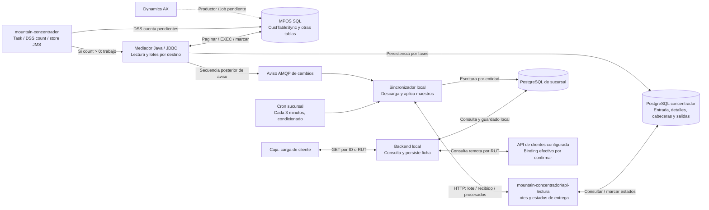

# Apuntes de operación de Chile y contraste con el código

Reúne los apuntes del usuario y su contraste con fuentes identificadas. Los cortes estáticos de octubre conservan sus revisiones; el [contraste del 9 de noviembre](#10-contraste-de-reunión-y-lectura-del-9-de-noviembre-de-2026) incorpora lectura autorizada de sistemas y código de otras ramas. Las afirmaciones de reunión, hipótesis, configuración observada y comportamiento probado se mantienen diferenciados. No se recibió el video ni su transcripción.

## 1. Resultado por apunte

| ID | Apunte recibido | Resultado del contraste | Cómo se incorpora |
| --- | --- | --- | --- |
| AP-01 | La caja no maneja stock. | **Aclaración operativa del usuario.** El repositorio contiene funciones de inventario, pero su presencia no demuestra uso en caja ni autoridad sobre existencias. No se identificó una llamada equivalente de reserva/decremento local en el flujo de venta inspeccionado. | No imponer un módulo de stock ni movimientos de inventario local como parte obligatoria de la venta. Identificar quién realiza la reserva externa mencionada anteriormente. |
| AP-02 | Hay una base SQL MPOS con tablas de cambios de clientes, direcciones y contactos. | **Nombre y lectores corroborados.** BOAX fija MPOS y adaptadores Java identifican CustTableSync, LogisticsPostalAddressSync y LogisticsElectronicAddressSync. DDL, cuerpos SP y productor siguen pendientes. | Registrar MPOS comprobado en el lector, separado de AX y PostgreSQL; no inferir ubicación ni replicación. |
| AP-03 | Esos procesos corren una vez al día; MPOS estaría en el mismo servidor de AX. | **Hipótesis, expresada con duda por el usuario.** No hay evidencia suficiente del job central ni de su ubicación. El cron de sucursal revisado busca maestros cada tres minutos, con condiciones; es otra etapa. | Separar cadencia AX → MPOS, generación de lotes y descarga/aplicación en sucursal. No afirmar servidor compartido ni sincronización global diaria. |
| AP-04 | Al ingresar el RUT se actualiza el cliente, por lo que quizás no necesita sincronización. | **Confirmado parcialmente.** Seleccionar/cargar un cliente dispara una consulta remota y persistencia local; no todo tecleo del RUT equivale a ese recorrido. El mecanismo evita esperar al lote de ese cliente, pero complementa la sincronización masiva. | Documentar ambos caminos y las reglas de frescura/conflicto. La llamada observada consulta datos; no demuestra una modificación del cliente en AX. |
| AP-05 | Los cambios de AX se pasan a MPOS; algunos procesos consultan tablas continuamente, posiblemente WSO2. | **Lectores centrales corroborados.** Task WSO2 llama DSS count; una secuencia encola trabajo y Java consulta MPOS por JDBC. Productor AX→MPOS y tareas activas siguen pendientes; los CAR difieren de fuentes. | Separar polling configurado de calendario real y conservar AX→MPOS como productor por verificar. |
| AP-06 | Otro proceso genera el lote y lo pasa a las bases locales. | **Generador y consumidor corroborados.** Java crea lotes PostgreSQL por destino; api-lectura los entrega y sync escribe localmente. Se conocen tablas y estados en ambos lados. | Mostrar descarga/aplicación local y fronteras de persistencia; no dibujar escritura SQL central directa hacia sucursal. |
| AP-07 | Instacheck ya no funciona como integrador; Orsan continúa vigente. | **Actualización operativa del usuario, 2026-10-02.** El código conserva variantes de ambos proveedores; la continuidad de Orsan y la retirada de Instacheck fueron informadas por el usuario. | Mostrar Orsan como proveedor vigente de verificación de cheques. Conservar la diapositiva y las ramas de Instacheck como evidencia histórica; solicitar configuración y contrato de Orsan por sucursal. |
| AP-08 | Ventana L–V 07:00–22:00 y sábado 07:00–16:00; fuera de ella la tienda no sincroniza. | **Regla operativa informada; diferencias con código.** El snapshot permite domingo 07:00–22:00 y no aplica la misma compuerta a AMQP, rutas manuales y trabajos ya iniciados. | Confirmar el artefacto desplegado, zona horaria, domingos/festivos y política por flujo. No presentar el código como prueba de la operación real ni el relato como descripción de todas las rutas. |
| AP-09 | Los sábados fuera de esa ventana se mantienen las bases. | **Informado y compatible parcialmente con el cron revisado.** Falta inventario de bases intervenidas y procedimiento productivo. | Diseñar mantenimiento con admisión, drenaje y checkpoints; distinguir servidor local de bases centrales/ERP. |

## 2. Alcance de esta verificación

Se revisaron los snapshots ya usados en el proyecto, sin actualizar ramas ni modificar código:

| Repositorio | Referencia principal | Commit |
| --- | --- | --- |
| Mountain, frontend/backend/concentrador | `master` | `711f97fd7948c696bf45c992c5b121683bdbacd7` |
| Sincronizador de sucursal | `master`, consultado por Git; el checkout conserva `desarrollo` | `540ab9a70e7befbca27a2f7eb88b87b25109e4d1` |
| APIs corporativas | `master` | `8fbe2f1b4d4e464a403aa3daca63ffe712a9dd70` |
| Mountain concentrador, WSO2/DSS/Java y api-lectura | Predeterminada `Pablo`, checkout detached; no `main` | `b2fd1ec266d131abb54b7076d41acce30f045119` |

La revisión de esta sección es estática: no ejecutó aplicaciones, jobs, consultas SQL, APIs ni pruebas contra servicios de la empresa. Los commits y configuraciones productivos siguen pendientes de vincular a los binarios instalados. No se reproducen credenciales ni direcciones de infraestructura.

## 3. Stock: alcance operativo frente a funciones presentes

El antecedente actual es que **la caja no gestiona stock**. El desfase previamente informado —inventario reservado antes de que aparezca la deuda en AX— no demuestra que la caja sea quien reserva. Hay que identificar el proceso y sistema responsables de esa reserva, su relación con la orden de venta y el momento de consumo/liberación.

Mountain contiene rutas `documento-ingresos`; al guardar un ingreso se invoca un servicio que suma stock en una bodega. `BodegasService` modifica `bodegas_has_productos.stock` y registra logs; también contempla una acción de resta. Esto demuestra código disponible, no habilitación o utilización productiva de esas funciones por caja. [Rutas de ingreso](https://github.com/developer-implementos/mountain-implementos/blob/711f97fd7948c696bf45c992c5b121683bdbacd7/backend/start/routes.js#L237-L238), [llamada de ingreso](https://github.com/developer-implementos/mountain-implementos/blob/711f97fd7948c696bf45c992c5b121683bdbacd7/backend/app/Controllers/Http/DocumentoIngresosController.js#L193-L208), [servicio de bodega](https://github.com/developer-implementos/mountain-implementos/blob/711f97fd7948c696bf45c992c5b121683bdbacd7/backend/app/Services/BodegasService.js#L9-L41).

**Efecto en la arquitectura objetivo:** mantener la autoridad de stock en el sistema responsable y conservar las referencias necesarias en la venta. Solo incorporar proyecciones, reservas o cupos locales si se acuerdan como requisitos del nuevo POS. Una base local de ventas y catálogo no implica una base autoritativa de inventario.

## 4. AX, MPOS y distribución de maestros

### Tres etapas y tres cadencias posibles

La auditoría de `mountain-concentrador` completa el tramo central. **MPOS está comprobado como base usada por Java**, con `MPOS.dbo.CustTableSync`, `LogisticsPostalAddressSync` y `LogisticsElectronicAddressSync` como tablas de cambios de clientes, direcciones y contactos. Los lectores indican sus SP; no se recibió el productor que llena esas tablas desde AX, el DDL ni los cuerpos de los procedimientos. [MPOS, datasource y estados de origen](https://github.com/developer-implementos/mountain-concentrador/blob/b2fd1ec266d131abb54b7076d41acce30f045119/ClassRegistraMensajeDetalle/src/main/java/cl/implementos/BO/AX/BOAX.java#L45-L69); [Tabla de clientes, SP y lectura JDBC](https://github.com/developer-implementos/mountain-concentrador/blob/b2fd1ec266d131abb54b7076d41acce30f045119/ClassRegistraMensajeDetalle/src/main/java/cl/implementos/BO/AX/tables/BOCliente.java#L26-L83); [Tabla y SP de direcciones](https://github.com/developer-implementos/mountain-concentrador/blob/b2fd1ec266d131abb54b7076d41acce30f045119/ClassRegistraMensajeDetalle/src/main/java/cl/implementos/BO/AX/tables/BODireccion.java#L26-L33); [Tabla y SP de contactos](https://github.com/developer-implementos/mountain-concentrador/blob/b2fd1ec266d131abb54b7076d41acce30f045119/ClassRegistraMensajeDetalle/src/main/java/cl/implementos/BO/AX/tables/BOContacto.java#L26-L33).

| Etapa | Qué se sabe | Qué falta |
| --- | --- | --- |
| AX → MPOS | El usuario informa el traspaso; BOAX fija MPOS y sus lectores identifican tablas/SP. | Productor real, detección de cambios/bajas, cuerpos SP, job diario y ubicación física. |
| MPOS → lotes por sucursal | Tarea WSO2 llama DSS count; si hay pendientes encola trabajo. Java consulta directamente por JDBC y genera tablas PostgreSQL de entrada, detalles, cabeceras y salidas por destino. | Artefactos activos, datasource DSS, DDL, retención, reconciliación y latencia real. |
| Lotes → base local | api-lectura expone cambios/recibido/procesados/sin-procesar; sync consume por nombreEntidad y aplica maestros localmente. | Binding instalado, cobertura de sucursales y pruebas de reentrega, deduplicación y restore. |

No debe equipararse “proceso diario” con “la caja sincroniza una vez al día”. La tarea **fuente** de clientes declara `interval=10`; contactos 20 y direcciones 25. Los XML dentro de los CAR etiquetados PROD/QA/DESA contienen diferencias, incluido `count=0` en algunas variantes. Estos archivos no acreditan las tareas efectivamente activas ni el horario del productor AX→MPOS. El [informe central](analisis-repositorios/mountain-concentrador-maestros.md) conserva inventario y límites. [Task de clientes](https://github.com/developer-implementos/mountain-concentrador/blob/b2fd1ec266d131abb54b7076d41acce30f045119/ESBImplementos/src/main/synapse-config/tasks/Task_SincronizaClientes.xml#L1-L9); [Trigger fuente Contactos](https://github.com/developer-implementos/mountain-concentrador/blob/b2fd1ec266d131abb54b7076d41acce30f045119/ESBImplementos/src/main/synapse-config/tasks/Task_SincronizaContactos.xml#L2-L3); [Trigger fuente Direcciones](https://github.com/developer-implementos/mountain-concentrador/blob/b2fd1ec266d131abb54b7076d41acce30f045119/ESBImplementos/src/main/synapse-config/tasks/Task_SincronizaDirecciones.xml#L2-L3); [Archivo CAR etiquetado PROD, inspección ZIP estática](https://github.com/developer-implementos/mountain-concentrador/blob/b2fd1ec266d131abb54b7076d41acce30f045119/CAR/PROD_E_Task_1.0.0.car); [Archivo CAR etiquetado QA, inspección ZIP estática](https://github.com/developer-implementos/mountain-concentrador/blob/b2fd1ec266d131abb54b7076d41acce30f045119/CAR/QA_E_Task_1.0.6.car); [Archivo CAR etiquetado DESA, inspección ZIP estática](https://github.com/developer-implementos/mountain-concentrador/blob/b2fd1ec266d131abb54b7076d41acce30f045119/CAR/DESA_E_Task_1.0.3.car).

En sucursal hay un cron cada tres minutos que, después de tareas de reenvío, busca maestros si lo permiten la ventana y `CRON_BUSCAR_CAMBIOS`. Incluye clientes, saldos, direcciones y contactos, entre otros. La ejecución puede demorar: el intervalo no garantiza frescura de tres minutos. También se buscan cambios por aviso AMQP de salida. [Búsqueda cada tres minutos, condiciones](https://github.com/developer-implementos/mountain-sync-sucursal/blob/540ab9a70e7befbca27a2f7eb88b87b25109e4d1/start/cronHooks.js#L117-L151); [aviso y búsqueda](https://github.com/developer-implementos/mountain-sync-sucursal/blob/540ab9a70e7befbca27a2f7eb88b87b25109e4d1/app/Services/ColaMensajeService.js#L97-L114).

### Generación, descarga y acuses son fronteras distintas

DSS cuenta registros con `Procesado=0`. El payload lo obtiene el mediador Java directamente por JDBC, mediante paginación y SP: **DSS no transporta necesariamente todo el lote**. `BOGuardarData` persiste detalles, marca MPOS procesado y después crea cabeceras/salidas por sucursal. Esas fases no comparten una transacción global SQL Server/PostgreSQL; `Procesado=1` en MPOS no significa aplicado en todas las sucursales. [DSS: count, SP y actualización](https://github.com/developer-implementos/mountain-concentrador/blob/b2fd1ec266d131abb54b7076d41acce30f045119/DSConcentrador/dataservice/DSS_AX_Clientes.dbs#L1-L83); [SOAPAction opGetCountClientesAX](https://github.com/developer-implementos/mountain-concentrador/blob/b2fd1ec266d131abb54b7076d41acce30f045119/ESBImplementos/src/main/synapse-config/templates/TP_DSS_AX_Clientes.xml#L9-L22); [Procesar cambios AX y seleccionar camino](https://github.com/developer-implementos/mountain-concentrador/blob/b2fd1ec266d131abb54b7076d41acce30f045119/ClassRegistraMensajeDetalle/src/main/java/cl/implementos/RegistraMensajeDetalle.java#L962-L1062); [Tabla de clientes, SP y lectura JDBC](https://github.com/developer-implementos/mountain-concentrador/blob/b2fd1ec266d131abb54b7076d41acce30f045119/ClassRegistraMensajeDetalle/src/main/java/cl/implementos/BO/AX/tables/BOCliente.java#L26-L83); [Generar detalles, marcar origen y guardar salidas](https://github.com/developer-implementos/mountain-concentrador/blob/b2fd1ec266d131abb54b7076d41acce30f045119/ClassRegistraMensajeDetalle/src/main/java/cl/implementos/BO/BOGuardarData.java#L56-L208); [Bulk de salidas con conexión compartida](https://github.com/developer-implementos/mountain-concentrador/blob/b2fd1ec266d131abb54b7076d41acce30f045119/ClassRegistraMensajeDetalle/src/main/java/cl/implementos/BO/BOMensajeSalida.java#L47-L96).

El repositorio contiene ahora el **receptor api-lectura**, con contrato compatible con los GET/POST de sync y parámetro `nombreEntidad`. `GET cambios` selecciona una salida y marca `enviado=true` antes de responder; sync acusa `recibido` antes de persistir el sobre local. La consulta `sin-procesar` filtra `enviado=true/procesado=false`, **sin filtrar recibido_sucursal**, de modo que un lote acusado sin copia local sigue siendo elegible. Esto corrige la incertidumbre anterior sobre esa selección, pero no prueba retención o recuperación exitosa en producción. [Cuatro rutas API lectura](https://github.com/developer-implementos/mountain-concentrador/blob/b2fd1ec266d131abb54b7076d41acce30f045119/api-lectura/start/routes.js#L19-L26); [GET cambios modifica estado y confirma trx](https://github.com/developer-implementos/mountain-concentrador/blob/b2fd1ec266d131abb54b7076d41acce30f045119/api-lectura/app/Controllers/Http/MensajeSalidasController.js#L19-L109); [Elegibilidad, selección, enviado y recuperación](https://github.com/developer-implementos/mountain-concentrador/blob/b2fd1ec266d131abb54b7076d41acce30f045119/api-lectura/app/Services/MensajeSalidaService.js#L9-L134); [Sin procesar y recibido](https://github.com/developer-implementos/mountain-concentrador/blob/b2fd1ec266d131abb54b7076d41acce30f045119/api-lectura/app/Controllers/Http/MensajeSalidasController.js#L112-L191); [Sync acusa antes de guardar](https://github.com/developer-implementos/mountain-sync-sucursal/blob/540ab9a70e7befbca27a2f7eb88b87b25109e4d1/app/Services/LlamadaApis/CambiosConcentradorService.js#L79-L111); [Relectura de pendientes](https://github.com/developer-implementos/mountain-sync-sucursal/blob/540ab9a70e7befbca27a2f7eb88b87b25109e4d1/app/Services/LlamadaApis/CambiosConcentradorService.js#L118-L164); [GET y POST hacia API lectura](https://github.com/developer-implementos/mountain-sync-sucursal/blob/540ab9a70e7befbca27a2f7eb88b87b25109e4d1/app/Services/LlamadaApis/CambiosConcentradorService.js#L164-L287).

Sync conserva el sobre en `sincronizador.mensajes` y `sincronizador.mensaje_detalles`, aplica por detalle y transmite resultados, incluidos errores. Central marca detalles/salida e incrementa contadores: repetir `POST procesados` vuelve a sumarlos, y `total_sincronizados` incluye resultados con error. No es una medición de éxitos ni un acuse idempotente demostrado. [Persistir entrada y detalles en transacción local](https://github.com/developer-implementos/mountain-sync-sucursal/blob/540ab9a70e7befbca27a2f7eb88b87b25109e4d1/app/Services/MensajeService.js#L15-L74); [sincronizador.mensajes explícita](https://github.com/developer-implementos/mountain-sync-sucursal/blob/540ab9a70e7befbca27a2f7eb88b87b25109e4d1/app/Models/Mensaje.js#L6-L14); [sincronizador.mensaje_detalles explícita](https://github.com/developer-implementos/mountain-sync-sucursal/blob/540ab9a70e7befbca27a2f7eb88b87b25109e4d1/app/Models/MensajeDetalle.js#L6-L14); [Transacción por detalle y resultados](https://github.com/developer-implementos/mountain-sync-sucursal/blob/540ab9a70e7befbca27a2f7eb88b87b25109e4d1/app/Services/MensajeDetalleService.js#L113-L335); [Procesados, contadores y estado de lote](https://github.com/developer-implementos/mountain-concentrador/blob/b2fd1ec266d131abb54b7076d41acce30f045119/api-lectura/app/Controllers/Http/MensajeSalidasController.js#L194-L277).

El cliente distingue configuración `API_LECTURA_*` y fallback `ESB_*`. Además existe una API WSO2 paralela con `codigoEntidad`, distinta del contrato Node `nombreEntidad`, y diferencias de elegibilidad. Deben identificarse prefijos y artefactos instalados; no se presume una misma instancia por compartir nombres. [Cliente HTTP](https://github.com/developer-implementos/mountain-sync-sucursal/blob/540ab9a70e7befbca27a2f7eb88b87b25109e4d1/app/Utils/Axios.js#L23-L43); [API WSO2 paralela: contrato diferente](https://github.com/developer-implementos/mountain-concentrador/blob/b2fd1ec266d131abb54b7076d41acce30f045119/ESBImplementos/src/main/synapse-config/api/API_mensajeSalidas.xml#L2-L101); [Variante Java exige cero pendientes enviados](https://github.com/developer-implementos/mountain-concentrador/blob/b2fd1ec266d131abb54b7076d41acce30f045119/ClassRegistraMensajeDetalle/src/main/java/cl/implementos/BO/BOMensajeSalida.java#L145-L164).

### Vista combinada con incertidumbre explícita

Solo AX→MPOS sigue punteado como productor no recibido. Los lectores centrales, persistencia y receptores se apoyan en código; su presencia no acredita ubicación física, versión instalada ni tarea activa. El aviso transporta una señal de búsqueda, no todos los maestros.

El posible job diario se mantiene **solo** en el tramo AX→MPOS pendiente. No se asume que MPOS comparta servidor con AX ni que sea el concentrador PostgreSQL. La existencia de una ruta de recuperación no reemplaza ensayos de corte entre marca de origen, distribución, respuesta HTTP, acuse, commit local y notificación final.

## 5. Qué sucede al buscar o cargar un cliente por RUT

### Búsqueda local y refresco remoto son caminos complementarios

1. El selector consulta `GET empresas?formato=simple&buscar=…`; el backend busca en `personas` y `empresas` locales. [Servicio frontend](https://github.com/developer-implementos/mountain-implementos/blob/711f97fd7948c696bf45c992c5b121683bdbacd7/frontend/src/app/services/empresas.service.ts#L24-L35), [consulta local](https://github.com/developer-implementos/mountain-implementos/blob/711f97fd7948c696bf45c992c5b121683bdbacd7/backend/app/Controllers/Http/EmpresaController.js#L546-L583).
2. Seleccionar un cliente lleva a cargar `GET empresas/{id}`. `EmpresaController.view` intenta `buscarClienteEnLinea` antes de devolver la ficha local. [Selección](https://github.com/developer-implementos/mountain-implementos/blob/711f97fd7948c696bf45c992c5b121683bdbacd7/frontend/src/app/modules/pos/components/pos-detalle-venta-actual/pos-detalle-venta-actual.component.ts#L401-L425), [controlador](https://github.com/developer-implementos/mountain-implementos/blob/711f97fd7948c696bf45c992c5b121683bdbacd7/backend/app/Controllers/Http/EmpresaController.js#L66-L92).
3. El servicio obtiene el RUT y consulta el endpoint configurado `cliente` con `_rutCliente`, con timeout de 30 segundos. Si recibe datos válidos, llama a `guardaClienteAX`. [Consulta remota](https://github.com/developer-implementos/mountain-implementos/blob/711f97fd7948c696bf45c992c5b121683bdbacd7/backend/app/Services/EmpresaService.js#L30-L88).
4. Se guardan persona, empresa, clasificaciones, bloqueo, giro, direcciones y datos de cupo/plazo del estado de cuenta dentro de una transacción local. Después se lee la ficha local para la respuesta. [Persistencia](https://github.com/developer-implementos/mountain-implementos/blob/711f97fd7948c696bf45c992c5b121683bdbacd7/backend/app/Services/EmpresaService.js#L130-L249).
5. Para un cliente que no aparece localmente existe la ruta `empresas/null?rut=…`; puede crear la copia local si la API lo devuelve. [Alta de copia por RUT](https://github.com/developer-implementos/mountain-implementos/blob/711f97fd7948c696bf45c992c5b121683bdbacd7/frontend/src/app/modules/pos/components/pos-detalle-venta-actual/pos-detalle-venta-actual.component.ts#L603-L628).

**Conclusión:** el refresco bajo demanda permite obtener ese cliente sin esperar al próximo lote. No reemplaza la distribución de maestros a otras cajas ni la sincronización de cambios originados localmente. La ruta observada hace un GET y actualiza la copia local; no prueba una escritura del cliente en AX por el hecho de ingresar el RUT. El nombre `guardaClienteAX` tampoco identifica por sí solo el servidor que atiende la API: no se localizó el contrato exacto en las APIs corporativas examinadas.

### Los contactos tienen un tratamiento distinto

El guardado de la ficha anterior no llama a `guardarContactos`. Existe una consulta separada de contacto de compra del cliente express: el servicio devuelve datos sin persistirlos en ese método, y el formulario los aplica tras cambios del RUT con debounce de 500 ms. No afirmar que toda consulta de RUT sincroniza todos los contactos. La sincronización masiva sí tiene un tratamiento específico de contactos. [Consulta express](https://github.com/developer-implementos/mountain-implementos/blob/711f97fd7948c696bf45c992c5b121683bdbacd7/backend/app/Services/EmpresaService.js#L92-L127), [formulario](https://github.com/developer-implementos/mountain-implementos/blob/711f97fd7948c696bf45c992c5b121683bdbacd7/frontend/src/app/modules/pos/components/pos-detalle-venta-actual/pos-detalle-venta-actual.component.ts#L451-L487).

### Qué ocurre con la copia local si falla el refresco

Si falla la consulta remota, el backend puede devolver el cliente local en `data` junto con `error: true`. La selección habitual del cliente navega a `?cliente=<id>`; la página principal carga esa ficha, comprueba el error y limpia la venta en pantalla. La copia local sigue existiendo. [Respuesta del backend](https://github.com/developer-implementos/mountain-implementos/blob/711f97fd7948c696bf45c992c5b121683bdbacd7/backend/app/Controllers/Http/EmpresaController.js#L169-L182), [selección desde el modal](https://github.com/developer-implementos/mountain-implementos/blob/711f97fd7948c696bf45c992c5b121683bdbacd7/frontend/src/app/modules/pos/components/modals/modal-buscar-cliente/modal-buscar-cliente.component.ts#L66-L80), [recepción del parámetro](https://github.com/developer-implementos/mountain-implementos/blob/711f97fd7948c696bf45c992c5b121683bdbacd7/frontend/src/app/modules/pos/pages/punto-de-venta/punto-de-venta.component.ts#L152-L161), [tratamiento del error](https://github.com/developer-implementos/mountain-implementos/blob/711f97fd7948c696bf45c992c5b121683bdbacd7/frontend/src/app/modules/pos/pages/punto-de-venta/punto-de-venta.component.ts#L410-L444).

Existen métodos auxiliares que aceptan `data` sin comprobar `error`, como `actualizarEmpresa`. Eso no demuestra que la selección habitual tenga esa alternativa: importa qué método llama realmente la pantalla. [Actualización auxiliar](https://github.com/developer-implementos/mountain-implementos/blob/711f97fd7948c696bf45c992c5b121683bdbacd7/frontend/src/app/services/punto-de-venta.service.ts#L368-L380), [uso después del comprobante](https://github.com/developer-implementos/mountain-implementos/blob/711f97fd7948c696bf45c992c5b121683bdbacd7/frontend/src/app/modules/pos/pages/punto-de-venta/punto-de-venta.component.ts#L375-L390).

La arquitectura objetivo necesita distinguir “cliente local disponible”, “refresco pendiente/fallido”, “cliente no conocido localmente” y “operación autorizada con esta versión de datos”. Leer una copia local no concede crédito ni elimina un bloqueo: esas decisiones requieren políticas de vigencia y riesgo. Probar los recorridos completos de selección/carga con la API caída, incluyendo preservación de la venta en curso.

## 6. Orsan vigente e Instacheck retirado

El usuario confirmó el **2026-10-02 que Orsan continúa vigente e Instacheck ya no funciona como integrador**. La arquitectura actual muestra Orsan como proveedor de verificación de cheques. La imagen y las tablas originales que agrupan ambos nombres se conservan como fuentes históricas.

La interfaz envía la solicitud a `POST cheque/verificar/:id` en el backend. Cuando la configuración selecciona Orsan, el servicio prepara la evaluación del cheque y envía JSON mediante HTTP POST al proveedor. Esto identifica una dependencia de comunicación para esa evaluación; no acredita una autorización offline. [Petición de la interfaz](https://github.com/developer-implementos/mountain-implementos/blob/711f97fd7948c696bf45c992c5b121683bdbacd7/frontend/src/app/services/pos-cheques.service.ts#L101-L105), [rama Orsan](https://github.com/developer-implementos/mountain-implementos/blob/711f97fd7948c696bf45c992c5b121683bdbacd7/backend/app/Services/Cheque/ChequeVerificacionService.js#L185-L240), [petición al proveedor](https://github.com/developer-implementos/mountain-implementos/blob/711f97fd7948c696bf45c992c5b121683bdbacd7/backend/app/Services/Cheque/OrsanService.js#L234-L283).

Mountain conserva casos `instacheck` e `instacheck-api` en `ChequeVerificacionService`, junto con una variante Orsan. El controller pasa el tipo recibido al servicio; la interfaz usa configuración para seleccionar el verificador. El modelo frontend incluso contiene un valor inicial Instacheck. Estas huellas permiten localizar el componente para inventario/retirada, pero no demuestran la configuración efectiva de las tiendas. [Despacho por tipo](https://github.com/developer-implementos/mountain-implementos/blob/711f97fd7948c696bf45c992c5b121683bdbacd7/backend/app/Services/Cheque/ChequeVerificacionService.js#L57-L161), [controller](https://github.com/developer-implementos/mountain-implementos/blob/711f97fd7948c696bf45c992c5b121683bdbacd7/backend/app/Controllers/Http/ChequesController.js#L10-L21), [configuración inicial](https://github.com/developer-implementos/mountain-implementos/blob/711f97fd7948c696bf45c992c5b121683bdbacd7/frontend/src/app/models/configuraciones.model.ts#L70-L80), [selección en interfaz](https://github.com/developer-implementos/mountain-implementos/blob/711f97fd7948c696bf45c992c5b121683bdbacd7/frontend/src/app/modules/pos/components/modals/modal-pagar/modal-pagar.component.ts#L110-L123).

Pedir al equipo la configuración de Orsan por sucursal, su contrato de integración y el procedimiento ante rechazos o falta de conexión, además de las configuraciones residuales de Instacheck que deban retirarse. No es necesario realizar validaciones reales de cheques para organizar esta información.

## 7. Horarios de sincronización y mantenimiento

Se registra el horario aportado: **lunes a viernes de 07:00 a 22:00; sábado de 07:00 a 16:00**. El usuario indica que fuera de esas ventanas la tienda no sincroniza y que el sábado se aprovecha para mantenimiento de bases. Domingos, festivos, excepciones y zona efectiva deben quedar explícitos en el procedimiento.

El `master` inspeccionado tiene sábado `07:00 ≤ hora < 16:00` y otros días —incluido domingo— `07:00 ≤ hora < 22:00`. La configuración horaria del cron no garantiza que `new Date().getHours()/getDay()` use esa zona. La recepción AMQP, rutas manuales y búsquedas encadenadas no comparten necesariamente el control; un trabajo iniciado puede continuar después del cierre. Esto es una **discrepancia por resolver**, no evidencia de incumplimiento ocurrido en producción. [Informe y referencias del sincronizador](analisis-repositorios/mountain-sync-sucursal.md#4-calendario-y-reintentos-reales-del-código).

La [revisión de resiliencia](revision-resiliencia-datos-pos.md) detalla el mantenimiento encontrado y propone controles por clase de trabajo. El nuevo POS debe distinguir estar sin red, diferido por horario, detenido por mantenimiento, en reintento y en cuarentena. Un ACK exige persistencia durable, también durante cambios de ventana. La [revisión corporativa](revision-arquitectura-corporativa.md) evalúa recibir ventas centralmente aunque su publicación al ERP espere su ventana.

## 8. Evidencia pendiente y efecto sobre la propuesta

| Evidencia concreta a solicitar | Qué permite resolver |
| --- | --- |
| DDL e inventario lógico de MPOS; jobs o productores de cambios de AX, sin datos ni credenciales | Confirmar nombre, función, ubicación y cómo llegan altas, cambios y bajas. |
| Cadencia de cada etapa por entidad, con hora/zona, última ejecución y volumen | Separar el recuerdo del proceso diario del polling central y del cron de sucursal. |
| Artefactos WSO2/SQL/API de lectura y generador de lotes | Contrastar el código localizado con los artefactos desplegados y verificar retención, checkpoints y recuperación después de acuses. |
| Componente que atiende la API de clientes y contrato desplegado | Determinar origen efectivo, campos refrescados, controles de acceso y comportamiento ante error. |
| Reglas de convivencia entre lotes, refresco por RUT y cambios locales pendientes | Evitar que un dato atrasado reemplace uno nuevo o borre una modificación pendiente; definir versión y dueño por atributo. |
| Proceso que crea/consume/libera la reserva de inventario | Aclarar el desfase reserva/deuda sin atribuir inventario a la caja. |
| Configuración, contrato y procedimiento de verificación de cheques con Orsan por sucursal | Precisar el flujo del proveedor vigente y su comportamiento ante fallos; identificar configuraciones residuales de Instacheck. |
| Calendario efectivo, TZ del proceso/SO, excepciones y procedimiento de mantenimiento por base | Resolver la diferencia dominical, comprobar qué rutas se detienen y dimensionar acumulación/reconexión. |

Estos elementos amplían E02/E03/E05/E08 y se reúnen en E12 de la [solicitud al equipo](solicitud-informacion-equipo.md). La [propuesta](propuesta-arquitectura.md) se ajusta para no imponer stock local, mantener el doble camino de actualización de maestros y exigir continuidad explícita al fallar el refresco de cliente. La futura transcripción podrá precisar el tramo central sin reemplazar la evidencia de implementación.

## 9. Datos locales y conexiones de clientes, pagos y facturación

Revisión del 2 de octubre de 2026, motivada por la observación del usuario sobre la ficha «Si no hay conexión». **Los clientes sí tienen una copia en PostgreSQL de la sucursal. Los pagos también se registran localmente.** La frase anterior agrupaba demasiadas operaciones bajo una supuesta dependencia remota.

En esta revisión, «sin Internet» supone que el PC todavía puede acceder al backend y a PostgreSQL de la sucursal por la red interna. Tener datos locales y poder completar una operación son cuestiones que deben comprobarse por separado.

| Operación | Parte local comprobada | Conexión o límite concreto |
| --- | --- | --- |
| Buscar cliente | El buscador consulta `personas` y `empresas` en PostgreSQL. | Este método no consulta la API de clientes. Cargar la ficha seleccionada tiene otro recorrido, descrito en la sección 5. [Consulta local][offline-cliente-local]. |
| Actualizar la copia de clientes | El sincronizador inserta o actualiza `personas` y `empresas`; también procesa lotes de direcciones y contactos. | La copia se actualiza mediante procesos de aplicación. No se ha demostrado una réplica completa de toda la base ERP. [Personas][offline-sync-personas], [empresas][offline-sync-empresas]. |
| Registrar un pago | Se guarda `Pago` con la transacción local. La venta se confirma en la base antes de solicitar facturación. | Guardar el registro no ejecuta ni demuestra por sí solo una autorización de tarjeta. [Guardado][offline-pago-local], [orden de guardado y facturación][offline-venta-fiscal]. |
| Efectivo | El formulario valida el importe y genera los datos de un pago manual aprobado. | En ese componente no hay llamada a un autorizador externo. Esto no garantiza que los demás pasos de la venta —por ejemplo, precio o facturación— funcionen sin conexión. [Formulario de efectivo][offline-efectivo]. |
| Tarjeta Transbank | La aplicación se comunica con el terminal y solicita `POS.doSale`. | Espera resultado y código de autorización. Los repositorios no identifican la red del terminal hacia el adquirente ni prueban si usa una conexión independiente de la tienda. [Solicitud al terminal][offline-transbank]. |
| Crédito del cliente | Al guardar se valida contra el estado de cuenta local. | Al cargar el cliente puede intentarse un refresco remoto de saldo. Si esa consulta falla, el servicio continúa con la lectura local; su tratamiento es distinto del error al refrescar la ficha del cliente. [Validación al guardar][offline-cupo], [saldo remoto y lectura local][offline-saldo]. |
| Notas de crédito | Se combinan registros locales de pagos con datos de otras sucursales y estados de NC. | Se consumen APIs para buscar NC, pagos sin sincronizar y estados. La caché temporal no demuestra disponibilidad ni control de uso seguro durante una desconexión. [Búsqueda de NC][offline-nc-busqueda], [otras consultas][offline-nc-consultas]. |
| Emitir boleta o factura | La venta y el seguimiento del documento se guardan localmente; el backend prepara la solicitud fiscal. | El adaptador seleccionado llama a Acepta por HTTP o a Ingydev por SOAP. Una llamada de red no demuestra que el facturador esté fuera de la tienda ni que toda modalidad necesite Internet. [Acepta][offline-acepta], [Ingydev][offline-ingydev]. |

La rama revisada de Acepta devuelve un error de comunicación si falla su llamada. Ingydev solicita el envío y, después, consulta la representación PDF. No se encontró en esos métodos una alternativa que complete la emisión sin comunicarse con el facturador. Esto deja pendiente comprobar la instalación y las capacidades de contingencia del producto fiscal; no equivale a afirmar que el proveedor carezca de ellas. Una respuesta perdida tampoco prueba que el documento no se haya emitido. [Error de Acepta][offline-acepta], [secuencia Ingydev][offline-ingydev-secuencia].

Para cerrar los puntos pendientes de Q03 con el equipo basta pedir evidencias concretas:

- Dónde corre el facturador de cada tienda y qué sucede ante pérdida de Internet manteniendo la red interna.
- Cómo se conecta el terminal al adquirente y si esa conexión depende de la red de la sucursal.
- Resultado de probar un cliente ya sincronizado con la API de clientes inaccesible: búsqueda, selección, actualización del saldo y conservación de la venta en pantalla.

Las fuentes de Mountain corresponden a `711f97fd7948c696bf45c992c5b121683bdbacd7`. Para las escrituras del sincronizador se mantiene el `master` ya auditado, `540ab9a70e7befbca27a2f7eb88b87b25109e4d1`; los dos archivos citados son idénticos en el checkout `97e6d59bfe5e529c941baafa351507a93715d712`. No se ejecutaron aplicaciones ni servicios corporativos.

## 10. Contraste de reunión y lectura del 9 de noviembre de 2026

La investigación [TASK-258](https://github.com/developer-implementos/pos-platform/issues/258) contrasta las nuevas notas con producto integrado `2985aa799165af300f8a522349803548d4415c7b`, referencias legacy y lectura autorizada de QA, bus y la base de una sucursal productiva. No acredita toda la flota, homologación ni disponibilidad futura. Contratos, escenarios por ficha y acciones pertenecen a POS Platform; los [seguimientos](https://pos-docs-starlight.vercel.app/project/attention/) publicados son una instantánea con su propia fecha.

### Qué se pudo comprobar

Se autenticaron SSH en QA/bus y PostgreSQL de QA/producción. Se inspeccionaron procesos, archivos, catálogos y agregados técnicos; las consultas SQL usaron transacciones de sólo lectura y límites de tiempo. No se emitieron documentos, cobraron pagos, abrieron/cerraron cajas, consumieron colas ni ejecutaron sincronizaciones. No se publican destinos, credenciales, identidades de usuarios ni filas de negocio.

En el corte del 9 de noviembre, la web QA devolvió HTTP 200, pero el navegador integrado bloqueó la navegación. Las claves aportadas para dos cuentas coinciden con sus hashes locales; eso no prueba login UI ni autorización de acciones. Las consolas WSO2 respondieron 400 por HTTP y fallaron la validación de certificado por HTTPS: sus credenciales quedaron sin probar, sin desactivar TLS. No hay evidencia de credenciales rechazadas en las fronteras que sí se autenticaron.

La lectura directa continuó el **10 de noviembre**: ambos servidores SSH y las seis bases indicadas autenticaron nuevamente; todas las transacciones SQL confirmaron modo de sólo lectura y terminaron con rollback. Se contrastaron esquema, índices y catálogos de configuración de QA y de la sucursal productiva. No basta con que una base tenga el mismo número de tablas para considerarla equivalente.

La inspección por SSH identificó la causa del fallo TLS de las consolas: ambos listeners presentan el mismo certificado autofirmado, vencido el **25 de enero de 2022** y emitido para `localhost`. El acceso VPN funciona; eso no valida la identidad HTTPS del servicio. También se comprobó que el índice HTTP de la caja QA coincide byte a byte con el archivo servido por Nginx y se registraron hashes de sus bundles en la investigación del producto. Esta evidencia identifica archivos desplegados, sin vincularlos todavía a un commit de compilación ni acreditar navegación o efectos de negocio.

El contraste SQL encuentra iguales los indicadores revisados de cierre y control de medios de pago, incluida la validación de cheque y transferencia. Difieren las asociaciones de medios a cajas y partes del esquema: tablas auxiliares/de archivo, índices de cobranza/sincronización y longitud de una referencia documental. F03/F05 deben contrastar el esquema efectivo antes de migrar; F04-03 debe reproducir el recorrido con configuración y artefacto identificados. No se confirma una excepción global de validaciones por ser QA, ni se infiere rendimiento o paridad funcional a partir de metadatos. Las solicitudes normales de login QA cuentan con persistencia reciente de sesiones compatible con su ejecución, pero se mantiene sin acreditar su resultado HTTP/UI.

| Apunte | Resultado del contraste | Consecuencia para POS Platform |
| --- | --- | --- |
| Todos los puestos usan Epson TM-H6000V y terminal Transbank equivalente | TM-H6000V es default del código de impresión; los registros SQL inspeccionados identifican servicios, sin acreditar modelo/firmware físico. No se confirmó uniformidad de terminales. | F02-03/07/10/11/14 conservan inventario y homologación por perfil; modelo de código no acredita MICR instalado ni compatibilidad del driver. |
| Los seis repositorios usan las ramas indicadas | Impresión y pagos exponen `main`, no `master`. QA usa también `dev-promo`, `Pablo` y `desarrollo-mpos`; tres checkouts contienen archivos versionados modificados. | Identificar rama remota, árbol en disco y artefacto ejecutado por separado. No reatribuir auditorías antiguas ni declarar desplegado el HEAD remoto. |
| El concentrador tiene dos backends y varias bases | Configuración leída separa backend general/administración, backend concentrador/mensajes y API de lectura. El bus usa WSO2 EI y contiene CAR con prefijos QA/PROD. | F03 y F05-10 conservan propietarios, consumidores y contratos; el nombre del archivo no demuestra destino ni activación efectiva. |
| Los usuarios vienen de AX sin contraseña | La sincronización importa identidad/perfil/sucursal/correo; al crear usuario genera credencial local. Login verifica hash local. | Separar maestro externo, autenticación y autorización; F01 mantiene identidad propia POS y F03-07 exige homologar la federación. |
| El administrador no sincroniza ventas por carecer de RecId | La cuenta inspeccionada carece de ID externo, pero el sincronizador contempla Worker de reserva y otros filtros. No se enviaron ventas. | F03-03 debe acordar atribución ERP explícita y conciliación; la falta de RecId no demuestra por sí sola la causa de un pendiente. |
| El cajero no tiene acceso al módulo NC | La configuración permite consultar NC emitidas y devolver NC, pero no emitir. El control de menú observado no prueba permisos efectivos del servidor. | Distinguir consultar, emitir, consumir saldo y devolver dinero en F04-01/02/06; verificar denegaciones por acción, objeto y ámbito en API. |
| El cupón de batería se prohíbe en OV | La regla de campaña no está confirmada; el legacy tiene un camino de cupón asociado a OV. | No prohibir todos los cupones OV. Comercial debe precisar campaña, origen directo/OV/mixto y cupón preasociado; la implementación actual de pricing no acredita esa regla. |
| Cliente: buscar local y acudir a AX sólo si no existe | El buscador simple es local; cargar la ficha intenta refresco remoto incluso para cliente existente y puede persistir datos. | Probar fuente caída, ficha existente/ausente, conflicto y conservación de cesta. Una consulta GET o visual no garantiza ausencia de escrituras. |
| Búsqueda avanzada externa con imágenes | La revisión QA consulta OMNI/Algolia, cruza SKU con catálogo local y aporta imagen; ante error sigue por SQL local. | Conservar fuente/frescura y fallback; resultado externo sin referencia local no autoriza venta ni precio. Imagen ausente no equivale a producto inválido. |
| QA omite validaciones de cierre que producción sí aplica | En los caminos revisados no hay una excepción global por QA; hay condiciones por medio de pago y desglose de efectivo desactivado en ese código. «Validar cierre» además libera OVs en AX. | F04-03 requiere política y escenarios aprobados; no utilizar esa ruta como sonda ni copiar omisiones legacy como reglas del piloto. |
| apifact simula Acepta con folios | El archivo observado incrementa un contador SQLite. Acepta aparece seleccionado en ambas bases consultadas; no se probó emisión. | F02 separa simulador, proveedor seleccionado, contrato efectivo y autoridad fiscal. Contador o PDF no acreditan folios autorizados. |

### Fuentes y límites de las conclusiones

La caja QA tiene HEAD `2fe799196305e7eb4f5845c34e8fabd1076b31f8`, con manifiesto y entorno frontend modificados. Los caminos examinados proceden de [EmpresaController](https://github.com/developer-implementos/mountain-implementos/blob/2fe799196305e7eb4f5845c34e8fabd1076b31f8/backend/app/Controllers/Http/EmpresaController.js#L66-L90), [ProductoController](https://github.com/developer-implementos/mountain-implementos/blob/2fe799196305e7eb4f5845c34e8fabd1076b31f8/backend/app/Controllers/Http/ProductoController.js#L280-L367), [cierre](https://github.com/developer-implementos/mountain-implementos/blob/2fe799196305e7eb4f5845c34e8fabd1076b31f8/backend/app/Controllers/Http/CajasUsuarioController.js#L234-L256) y [control de navegación](https://github.com/developer-implementos/mountain-implementos/blob/2fe799196305e7eb4f5845c34e8fabd1076b31f8/frontend/src/app/shared/security/auth.guard.ts#L50-L83). No vinculan el bundle servido a ese commit ni acreditan el binario productivo. La brecha estática de permisos examinada no se comprobó mediante una operación indebida.

[EmpleadosSyncService](https://github.com/developer-implementos/mountain-sync-sucursal/blob/540ab9a70e7befbca27a2f7eb88b87b25109e4d1/app/Services/Sync/EmpleadosSyncService.js#L44-L89) y [LoginController](https://github.com/developer-implementos/mountain-implementos/blob/f57d5900b081f930672e584c119d62a15f991861/backend/app/Controllers/Http/LoginController.js#L59-L107) separan maestro y credencial. El [Worker de reserva](https://github.com/developer-implementos/mountain-sync-sucursal/blob/540ab9a70e7befbca27a2f7eb88b87b25109e4d1/app/Services/SyncUpload/VentasSyncUploadService.js#L113-L168) también aparece en el archivo modificado observado en QA; su efecto AX no se ensayó. El [camino de cupón OV](https://github.com/developer-implementos/mountain-implementos/blob/f57d5900b081f930672e584c119d62a15f991861/frontend/src/app/modules/pos/components/pos-listado-productos/pos-listado-productos.component.ts#L1167-L1195) no resuelve la política particular de baterías.

La rama corporativa `feature-mpos-prod`, revisión `14a6cb499a13a402bd83ddc67706d59acb2648a7`, añade contratos y reglas frente al master auditado. Entre los contrastes está el límite de NC: [API MPOS](https://github.com/developer-implementos/apis-implementos/blob/14a6cb499a13a402bd83ddc67706d59acb2648a7/ServiciosAX/mountainPosCajaServices/NotaVenta.cs#L1028-L1039) y [Mountain](https://github.com/developer-implementos/mountain-implementos/blob/2fe799196305e7eb4f5845c34e8fabd1076b31f8/backend/app/Controllers/Http/NotaCreditoController.js#L57-L64) difieren en el caso 1.000.000. Es una diferencia de implementación que requiere acuerdo de autoridad y pruebas de frontera; no una regla fiscal inferida. La rama no se ha vinculado al binario productivo.

### Conservar funciones exige verificar recorridos

El [inventario de Chile](audit-chile-for-product.md) y las fichas del producto cubren venta suspendida/cancelada, deudas y abonos, NC como medio, devolución, OVs por cliente/vendedor/sucursal, reportes y cierre. La demo no acredita esos flujos conectados. F01-09 aporta recuperación de borradores; F04-01/02/03/05/08 conservan la implementación y comprobación completas de la jornada. F03 conserva integración y maestros; F05 exige conciliación y retorno; F06 exige inventario de flota y retiro controlado de consumidores.

La pregunta de migración se resuelve por recorrido, permiso, origen de datos, fallo y recuperación. Que no falte una familia en el roadmap no demuestra paridad del producto actual ni cobertura exhaustiva de casos límite. El [recorrido de migración](flows/migration.md) conecta esa evidencia con la aceptación del corte; TASK-258 registra los escenarios revisados y sus límites, sin alterar el denominador ni aceptar entregables.

[offline-cliente-local]: https://github.com/developer-implementos/mountain-implementos/blob/711f97fd7948c696bf45c992c5b121683bdbacd7/backend/app/Controllers/Http/EmpresaController.js#L546-L583
[offline-sync-personas]: https://github.com/developer-implementos/mountain-sync-sucursal/blob/540ab9a70e7befbca27a2f7eb88b87b25109e4d1/app/Services/PersonaService.js#L13-L61
[offline-sync-empresas]: https://github.com/developer-implementos/mountain-sync-sucursal/blob/540ab9a70e7befbca27a2f7eb88b87b25109e4d1/app/Services/Sync/ClientesSyncService.js#L118-L144
[offline-pago-local]: https://github.com/developer-implementos/mountain-implementos/blob/711f97fd7948c696bf45c992c5b121683bdbacd7/backend/app/Services/PagoService.js#L75-L95
[offline-venta-fiscal]: https://github.com/developer-implementos/mountain-implementos/blob/711f97fd7948c696bf45c992c5b121683bdbacd7/backend/app/Controllers/Http/PuntoDeVentaController.js#L151-L185
[offline-efectivo]: https://github.com/developer-implementos/mountain-implementos/blob/711f97fd7948c696bf45c992c5b121683bdbacd7/frontend/src/app/shared/components/formas-de-pago/efectivo/efectivo.component.ts#L147-L190
[offline-transbank]: https://github.com/developer-implementos/mountain-implementos/blob/711f97fd7948c696bf45c992c5b121683bdbacd7/frontend/src/app/services/pos-integraciones/pos-transbank.service.ts#L293-L326
[offline-cupo]: https://github.com/developer-implementos/mountain-implementos/blob/711f97fd7948c696bf45c992c5b121683bdbacd7/backend/app/Controllers/Http/PuntoDeVentaController.js#L262-L293
[offline-saldo]: https://github.com/developer-implementos/mountain-implementos/blob/711f97fd7948c696bf45c992c5b121683bdbacd7/backend/app/Services/Cobranzas/AcuerdoCobranzaService.js#L917-L1015
[offline-nc-busqueda]: https://github.com/developer-implementos/mountain-implementos/blob/711f97fd7948c696bf45c992c5b121683bdbacd7/backend/app/Controllers/Http/NotaDeCreditoAxController.js#L30-L70
[offline-nc-consultas]: https://github.com/developer-implementos/mountain-implementos/blob/711f97fd7948c696bf45c992c5b121683bdbacd7/backend/app/Controllers/Http/NotaDeCreditoAxController.js#L450-L499
[offline-acepta]: https://github.com/developer-implementos/mountain-implementos/blob/711f97fd7948c696bf45c992c5b121683bdbacd7/backend/app/Services/Facturacion/FacturacionAceptaService.js#L672-L730
[offline-ingydev]: https://github.com/developer-implementos/mountain-implementos/blob/711f97fd7948c696bf45c992c5b121683bdbacd7/backend/app/Services/Facturacion/FacturacionIngydevService.js#L402-L421
[offline-ingydev-secuencia]: https://github.com/developer-implementos/mountain-implementos/blob/711f97fd7948c696bf45c992c5b121683bdbacd7/backend/app/Services/Facturacion/FacturacionIngydevService.js#L45-L89
