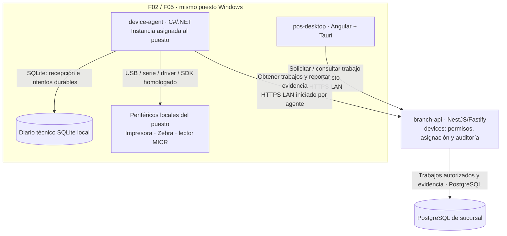
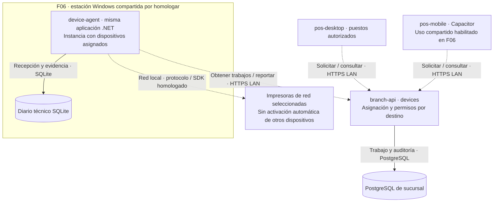

# ADR-17 · Agente autónomo de periféricos

**Decisión acordada; implementación pendiente.** `apps/device-agent` es la séptima aplicación de la arquitectura objetivo de POS Platform. Se desarrolla en **C#/.NET para Windows**, con ciclo de vida independiente de `pos-desktop` y `pos-mobile`. La revisión de producto contiene seis aplicaciones con interfaz mock o base técnica; todavía no contiene este agente, su protocolo ni sus adaptadores homologados.

## Responsabilidad y ubicación

**El primer perfil es por puesto de caja.** En F02, `device-agent` se instala en el mismo PC Windows que `pos-desktop` y controla los periféricos locales asignados a ese puesto: impresión térmica, etiquetas y lectura/impresión de cheques según el hardware homologado. Esta ubicación sigue el modelo local del legacy; el protocolo nuevo conserva autorización, identidad y auditoría en `branch-api`. El agente no se instala por defecto en el servidor de sucursal.

F05 valida este perfil en el piloto. **Los dispositivos de red y la estación compartida se incorporan después, en F06**, mediante la misma aplicación y contratos, con homologación propia. Cada dispositivo físico conserva un único agente controlador activo; sus capacidades de recibos, cheques, endoso o MICR pueden requerir exclusión mutua aunque tengan colas lógicas diferentes.

El agente recibe trabajo de `branch-api`, conserva recepción e intentos, ejecuta adaptadores y entrega evidencia. El backend conserva permisos, documentos y autoridad de negocio. Imprimir un documento existente no emite otro DTE, no confirma una venta ni vuelve a cobrar. La migración de `api-impresion-caja` no acredita integración con Transbank u otro terminal de pago. Un futuro adaptador de pagos requiere su contrato y homologación propios.

| Pieza | Tecnología y ubicación | Propiedad |
| --- | --- | --- |
| `pos-desktop` | Angular/PrimeNG dentro de Tauri; puesto | Presentación, solicitud y consulta del trabajo |
| `pos-mobile` | Angular/PrimeNG dentro de Capacitor; Android/iOS | Acceso a periféricos compartidos previsto para F06, con destinos permitidos y aceptación propia |
| `branch-api` / `libs/backend/devices` | NestJS/Fastify; servidor de sucursal | Autorización, registro de dispositivos, asignación, trabajo y auditoría en PostgreSQL |
| `device-agent` | C#/.NET; PC Windows de cada puesto en F02/F05 | Recepción durable, ejecución exclusiva, adaptadores locales y evidencia; estación compartida como perfil posterior en F06 |
| Diario técnico del agente | SQLite local, privado del agente | Identidades, hashes, intentos y resultados pendientes; sin tablas de ventas, precios o credenciales SQL de sucursal |
| Periférico | Driver/SDK/protocolo del modelo homologado | Efecto físico y capacidades de consulta realmente disponibles |

El backend usa su módulo `devices` para coordinar. Ese módulo no es otro proceso ni contiene los drivers Windows. La aplicación C# conserva sus adaptadores privados; se extraen bibliotecas cuando exista reutilización comprobada. Los contratos públicos de `devices` usan esquemas versionados y fixtures para validar TypeScript y C#; compartir repositorio no permite importar tipos TypeScript desde .NET. Los sobres técnicos comunes pertenecen a `shared/contracts` en la estructura objetivo. Cambiar de perfil o instalar varias instancias no crea otra aplicación del monorepo.

## Tecnología y ejecución nativa

La base del agente será .NET en una versión soportada, seleccionada junto con la matriz de SDK, sistema operativo y arquitectura del dispositivo. El host supervisado conserva el trabajo aunque se cierre la ventana del POS. Su compilación y pruebas nativas se ejecutan en Windows; Nx coordina las tareas .NET sin convertirlas en proyectos NestJS. El artefacto firmado se instala en los equipos autorizados de sucursal.

El legacy depende de .NET Framework 4.7.2, Microsoft POS for .NET, APIs Win32 y una referencia x86. Esto no demuestra compatibilidad con .NET moderno, x64 o un servicio sin sesión de usuario. En particular, **Microsoft no soporta `System.Drawing.Printing` dentro de servicios Windows/ASP.NET**. No se traslada `PrintDocument` al nuevo host sin cambiar y validar la vía de impresión.

Se selecciona una API/SDK compatible con servicio para cada adaptador. Si un fabricante exige otro runtime, arquitectura o sesión interactiva, se aísla en un ejecutor supervisado con IPC privado y permisos restringidos. Su presencia depende de esa evidencia; no constituye otra aplicación de negocio por defecto. La indisponibilidad de la sesión o driver se informa como capacidad no disponible.

NestJS permanece en la coordinación de `branch-api`. El agente .NET evita añadir un segundo host Node para envolver los mismos SDK Windows. Tauri y Capacitor siguen siendo las shells de los clientes; no son el dueño del ciclo de vida del agente. Cerrar la ventana del puesto no detiene los trabajos admitidos cuya ejecución siga autorizada.

## Conexiones y recorrido de un trabajo

| Iniciador → destino | Propósito | Transporte y garantía |
| --- | --- | --- |
| `pos-desktop` → `branch-api` | Solicitar impresión/lectura del puesto y consultar estado | HTTPS autenticado por LAN; backend valida operador, puesto, ámbito, destino y capacidad; F02 no habilita uso compartido entre puestos |
| `branch-api` → PostgreSQL de sucursal | Guardar trabajo, autorización y auditoría | SQL/PostgreSQL; commit anterior a declarar aceptada la solicitud |
| `device-agent` → `branch-api` | Obtener trabajos asignados | HTTPS LAN saliente, inicialmente consulta prolongada; respuesta contiene el comando autorizado, no una nueva conexión entrante al puesto |
| `device-agent` → SQLite | Guardar recepción, intento y evidencia | Transacción local antes del acuse durable; no hay transacción distribuida con PostgreSQL o hardware |
| `device-agent` → periférico | Ejecutar capacidad física | Driver/SDK del modelo; serialización por dispositivo físico y grupos excluyentes |
| `device-agent` → `branch-api` | Reportar recepción y resultado identificado | HTTPS LAN autenticado; agente conserva evidencia hasta acuse posterior a persistencia del backend |

1. El cliente solicita imprimir un documento existente en un destino asignado a su puesto. El backend deriva identidad y ámbito de la sesión autenticada; F02 rechaza destinos de otro puesto, aunque su agente esté conectado a la misma LAN.
2. `branch-api` guarda `jobId`, documento/versión, hash, capacidad, agente/dispositivo asignados y autorización. Una copia intencional requiere permiso y motivo propios.
3. El agente solicita trabajo con su identidad de instalación. Guarda recepción y hash antes de acusar; un duplicado idéntico obtiene el estado existente, un contenido distinto con el mismo ID se rechaza.
4. El agente registra el intento antes de ejecutar el adaptador. Conserva identificador del spooler, bytes/resultado y evidencia que ofrezca el dispositivo, sin inferir salida física por aceptación de software.
5. El backend persiste el resultado y confirma su recepción. El cliente consulta ese estado aunque se haya cerrado la ventana que originó el trabajo.

## F06 · Dispositivos de red y estación compartida

Esta evolución se habilita **después de aceptar el piloto F05**. El primer alcance candidato son impresoras de recibos o etiquetas accesibles por Ethernet/Wi-Fi mediante un protocolo o SDK comprobado. Que un equipo tenga dirección IP no acredita su compatibilidad ni que admita uso compartido. Lectores MICR, cajones y terminales de pago requieren aceptación específica; no quedan incluidos por homologar una impresora.

La estación puede ser un equipo Windows dedicado o, si es compatible y se acepta compartir su riesgo de falla/mantenimiento, el servidor de sucursal. La primera entrega por puesto no depende de esta decisión. Agentes locales y compartidos pueden coexistir con dispositivos distintos; ningún dispositivo tiene dos dueños activos. Dirección de red y configuración del adaptador se resuelven desde un registro autorizado, no desde una URL arbitraria enviada por el cliente.

El móvil utilizará la LAN y el contrato de `branch-api`, con enrolamiento, permisos nativos de red, confianza TLS y selección de destino homologados; no llama al `localhost` del PC. Si el dispositivo exige interacción humana exclusiva, se debe identificar el operador/sesión y evitar que una solicitud remota capture la interacción de otro puesto. Bluetooth/USB conectado directamente al móvil requiere plugin Capacitor y SDK específicos y sigue fuera de este perfil de red.

F06 exige comprobar concurrencia entre puestos, orden y exclusión por dispositivo, pérdida de conexión después del envío, recuperación del agente, cambio de dirección, permisos cruzados y actualización compatible. Cambiar de controlador no repite un efecto incierto. La habilitación se hace por sucursal/modelo mediante configuración aprobada, con métricas y un procedimiento para suspender nuevas solicitudes sin perder pendientes. El entregable detallado es [F06-05](/guide/roadmap/phase-06/#work-f06-05).

## Estados, duplicados e incertidumbre

| Estado | Significado y siguiente acción |
| --- | --- |
| Pendiente | Backend registró el trabajo; el agente aún no acredita recepción durable |
| Recibido | Agente conservó el comando y su hash; todavía no afirma efecto físico |
| En ejecución | Intento registrado; el adaptador puede estar produciendo un efecto |
| Enviado al spooler | Cola de Windows aceptó el trabajo; no demuestra papel impreso |
| Confirmado | Existe evidencia compatible con el contrato del dispositivo; se indica qué confirma |
| Fallido | Fallo conocido y clasificado; reintento sólo si el contrato acredita que es seguro |
| Incierto | El efecto pudo ocurrir; consultar/conciliar o resolver autorizadamente, sin repetición ciega |
| Cancelado / vencido | Se impidió la ejecución antes del efecto; cancelar una solicitud no deshace un efecto ya iniciado |

La recepción, la entrega al spooler y la salida física son hitos diferentes. Un registro local no puede hacer atómica una llamada al hardware. Si se pierde energía después del envío y antes de guardar su resultado, se recupera evidencia del dispositivo/spooler cuando sea posible; si no alcanza, se conserva incertidumbre. Una reimpresión es otro trabajo autorizado que referencia el documento y trabajo originales, sin nuevo pago o emisión fiscal.

La asignación a otro agente requiere excluir al dueño anterior y resolver intentos en curso. El vencimiento de un lease no prueba que el proceso anterior dejó de imprimir. Las lecturas de cheque requieren sesión de interacción acotada, cancelación, liberación de recursos y exclusión compatible con la impresión/endoso del mismo equipo; no se ejecutan lecturas antiguas al reaparecer un agente.

SQLite conserva un diario técnico recuperable y acotado. Los payloads necesarios para el trabajo tienen retención y acceso restringidos; los resultados MICR no se vuelcan en logs. Después del acuse de backend se aplica la retención acordada, conservando deduplicación durante toda la ventana de reentrega. PostgreSQL es la autoridad de trabajos y auditoría de sucursal; el agente no modifica ventas por SQL ni mantiene un espejo de negocio.

El recorrido de periféricos utiliza SQLite y HTTPS LAN; no utiliza BullMQ. La decisión de [BullMQ y Redis para país e integración ERP](job-processing.md) no cambia estas garantías de identidad, custodia e incertidumbre física ni añade una cola Redis al puesto.

## Identidad y operación

- El agente tiene identidad propia de instalación, credencial protegida y capacidades limitadas a sus dispositivos/sucursal. Usa HTTPS con autenticación mutua según el [contrato de identidad](../contracts/identity-and-trust.md); la identidad del móvil no se convierte en credencial del agente.
- El backend verifica permiso sobre documento, dispositivo y operación. El agente valida contrato, integridad, destino, vigencia y asignación antes del efecto. Una dirección IP conocida o CORS no concede autoridad.
- Los comandos permiten capacidades concretas. No aceptan desde la UI rutas arbitrarias, instrucciones shell, URLs de descarga libres ni RAW sin validación. Contenido y plantillas están versionados y vinculados al trabajo autorizado.
- Sin WAN puede continuar el perfil local autorizado si LAN, sucursal y dispositivos están disponibles. Sin LAN se conserva evidencia; sólo se completan trabajos ya autorizados cuya vigencia, estado y política permitan ejecución. No se habilitan nuevas ventas autónomas en el agente.
- La salud distingue proceso vivo, configuración válida y capacidad del dispositivo. Una prueba que imprime o mueve hardware es un comando explícito, nunca una sonda GET.
- Instalación, actualización y rollback preservan diario e identidad; se detiene admisión, se drena con límite y se conservan estados inciertos. Versiones de protocolo y esquema admitidas se comprueban antes del despliegue.

## Entrega y aceptación

La primera entrega corresponde a [F02: agente por puesto](/guide/roadmap/phase-02/#work-f02-03) y se prueba en [F05: piloto controlado](/guide/roadmap/phase-05/). [F06-05: dispositivos de red y estación compartida](/guide/roadmap/phase-06/#work-f06-05) amplía ese perfil después del piloto, junto al acceso móvil de F06-02. No se crea un scaffold que declare operaciones físicas exitosas sin un adaptador real.

| Validación | Evidencia requerida |
| --- | --- |
| Compatibilidad | Modelo/firmware, conexión, SDK, licencia, runtime, x86/x64, cuenta y sesión compatibles |
| Trabajo completo · F02/F05 | Documento autorizado del puesto → recepción durable → adaptador local → estado visible en escritorio |
| Recuperación | ACK perdido, reinicio de agente/spooler, pérdida de LAN y mismo ID con contenido distinto |
| Hardware | Sin papel, tapa abierta, desconexión USB, escritura parcial y resultado no consultable |
| Exclusión · F02/F05 | Comandos concurrentes del puesto y capacidades del mismo equipo físico; destino de otro puesto rechazado |
| Red y uso compartido · F06 | Modelo/protocolo homologado, solicitudes de puestos/móvil autorizados, aislamiento entre sucursales, fallos de red y recuperación sin duplicados |
| MICR | Timeout real, cancelación, formato por país, lectura inválida y liberación de recursos |
| Entrega | Instalador firmado, privilegios mínimos, actualización/rollback con pendientes y rotación de credencial |

## Evidencia y referencias

La [auditoría de api-impresion-caja](../analisis-repositorios/api-impresion-caja.md) sustenta las capacidades y riesgos actuales. La revisión estática corresponde a `2e74b2d64985902f5fdfb52902016a5f65d7b577`; no acredita el binario instalado ni homologación productiva.

- [Microsoft: restricciones de System.Drawing.Printing](https://learn.microsoft.com/en-us/dotnet/api/system.drawing.printing?view=windowsdesktop-9.0).
- [Microsoft: host Windows Service con .NET](https://learn.microsoft.com/en-us/dotnet/core/extensions/windows-service).
- [Microsoft: StartDocPrinter e identificador del trabajo](https://learn.microsoft.com/en-us/windows/win32/printdocs/startdocprinter).
- [Capacitor: plugins y APIs nativas](https://capacitorjs.com/docs/plugins).
- [Nx: tareas de herramientas externas](https://nx.dev/docs/kb/run-commands-executor).
