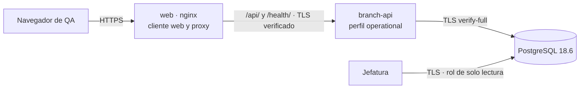

# ADR-22 · Ambientes QA y producción con despliegue manual

**Estado:** decisión del responsable del producto del 17-11-2026, en implementación en [TASK-402](https://github.com/developer-implementos/pos-platform/issues/402), con la PR [pos-platform#408](https://github.com/developer-implementos/pos-platform/pull/408) en revisión. No acredita operación productiva, aceptación de QA ni el cierre de una fase.

**Decisión:** POS Platform tiene dos ambientes desplegados: QA y producción. Ambos ejecutan el mismo artefacto por el mismo camino; los distinguen solo la configuración y los datos. QA vive on-prem, en el servidor del QA del legacy, y se despliega a mano desde GitHub Actions con una versión contenida en `main`.

## Qué resuelve

Jefatura necesita ver el avance de las fases 1 y 2 y hacer QA manual. Para eso hace falta un lugar persistente que ejecute lo mismo que ejecutará una sucursal, con un despliegue que solo publique código revisado en `main` y que no saque los secretos del servidor.

## Ambientes

| Ambiente | Para qué | Dónde | Despliegue | Datos |
| --- | --- | --- | --- | --- |
| QA | Mostrar el avance y hacer QA manual. | Servidor on-prem del QA del legacy, compartido con él. | Manual, con el workflow `Deploy`, desde `main`. | Sin datos personales reales; ver [datos de QA](#datos-de-qa). |
| Producción | Operar las sucursales. | Sucursales. | Por anillos, en el entregable [F06-03](/guide/roadmap/phase-06/#work-f06-03). Este ADR solo reserva el ambiente. | Los de la operación. |

El desarrollo local y la CI son efímeros y no son ambientes: se crean para una tarea o una corrida y no conservan datos entre usos.

## Un solo modo de ejecución

QA ejecuta el mismo artefacto y el mismo camino que producción:

- `branch-api` con el perfil `operational` y `NODE_ENV=production`;
- HTTPS entre el cliente y la API, y TLS hacia la base;
- usuarios, roles y asignaciones propios del POS. La administración vive en la misma app de caja y se habilita según el rol.

Las diferencias entre ambientes son solo de configuración (origen, certificados, secretos y cajas aprovisionadas) y de datos. QA no tiene un modo propio ni atajos de prueba.

Como consecuencia, ningún ambiente usa el perfil de laboratorio ni la demo. Retirarlos del producto es [TASK-406](https://github.com/developer-implementos/pos-platform/issues/406), todavía abierta: hasta que se integre, siguen en el código y en las guías de F01.

## Datos de QA

- QA no contiene datos personales reales.
- Los datos comerciales llegarán por la misma puerta de carga que producción ([TASK-404](https://github.com/developer-implementos/pos-platform/issues/404)). Los extraerá del QA del legacy un extractor que anonimiza a los clientes ([TASK-405](https://github.com/developer-implementos/pos-platform/issues/405)), conforme a la Ley 21.719 de protección de datos personales, vigente desde el 1-12-2026.
- Hasta entonces, QA tiene sucursal, cajas y usuarios, pero no catálogo ni precios.

## Topología de QA

- **Un solo origen.** El cliente web y la API comparten origen detrás de nginx, así que no hay CORS.
- **TLS verificado de punta a punta.** nginx verifica el certificado de la API, y la API el de PostgreSQL con `verify-full`. PostgreSQL 18.6 exige TLS para toda conexión de red.
- **Jefatura solo lee.** Consulta la base con un rol de solo lectura, nunca con la cuenta que migra.
- **Migraciones aparte.** Un contenedor de un solo uso migra, comprueba y aprovisiona con la cuenta propietaria; la API en ejecución nunca recibe esa cuenta, como establece el [ADR-19](postgresql-unit-of-work.md).
- **Certificados.** Mientras infraestructura no entregue el DNS y el certificado corporativos, una CA de QA con `nameConstraints` firma solo los nombres del ambiente: instalarla en un equipo no le permite suplantar otro sitio.
- **Convivencia con el legacy.** QA usa puertos propios y límites de CPU y memoria por contenedor, y no toca los servicios del legacy.

## Despliegue

El workflow `Deploy` del producto se despacha a mano. Quien despacha elige:

- la **versión**: el SHA completo de un commit de `main`;
- las **apps**: `all`, `branch-api` o `pos-web`;
- el **ambiente**: hoy solo `qa`.

| Job | Dónde corre | Qué hace | Qué no puede hacer |
| --- | --- | --- | --- |
| `authorize` | Fleet propio | Va primero y sin `if` de job, porque un job omitido arrastra a los que dependen de él. Valida contra una lista escrita en el workflow a quien despacha y a quien re-ejecuta, que se despacha desde `main` y que el SHA está contenido en `main`. | Cambiar la lista sin una PR. |
| `build` | Fleet propio, sin environment | Compila los artefactos de las apps elegidas. | Leer secretos o usar Docker. |
| `deploy` | Environment `qa`, solo desde `main` | Envía los artefactos al servidor con una llave SSH cuyo `authorized_keys` fuerza el comando de despliegue. | Abrir una consola o ejecutar otro comando. |

El servidor construye las imágenes con las recetas que instaló su preparación desde `main`. Quien tenga la llave puede enviar artefactos, pero no reemplazar esas recetas ni los scripts del servidor. Los secretos del ambiente (contraseñas SQL, llaves TLS y contraseña inicial del administrador) se generan en el servidor y se quedan en él: no pasan por GitHub ni por los registros.

El responsable del producto aprueba los despliegues; hoy es la única persona en la lista.

Reglas del despliegue:

- **Nunca informa un éxito falso.** Si un paso falla, el ambiente queda detenido y el workflow termina en rojo.
- **La API se detiene durante el despliegue,** entre 30 s y 1 min, porque su manifiesto de esquema es exacto y dos versiones no conviven.
- **La base solo avanza.** Volver atrás es desplegar un SHA anterior mientras su esquema siga siendo compatible; si no lo es, se corrige hacia delante o se reinicia el ambiente.

## Riesgos aceptados

El responsable aceptó dos riesgos de seguridad de QA:

- uno sobre la cuenta del servidor;
- otro sobre los runners que ejecutan el job `deploy`, hasta que exista el pool de runners confiables `pos-trusted` ([TASK-207](https://github.com/developer-implementos/pos-platform/issues/207)).

Este repositorio es público: la descripción, el alcance y las mitigaciones de ambos riesgos se conservan en la [guía de operación del producto](https://github.com/developer-implementos/pos-platform/blob/25b28d02499506d89aeb1ebd09b7a3ba290511b6/tools/deploy/README.md#seguridad-del-despliegue).

## Relación con otras decisiones

- En QA se despliegan la API (`branch-api`) y el cliente web (`pos-web`).
- Los clientes de escritorio y móvil del [ADR-14](native-clients.md) se entregan con sus propios artefactos; este ADR no cambia esa entrega.
- El cliente web es el ADR-21, en revisión en [pos-docs#123](https://github.com/developer-implementos/pos-docs/pull/123).
- Producción y sus anillos pertenecen a [F06-03](/guide/roadmap/phase-06/#work-f06-03).

## Verificación

El 17-11-2026, con la rama de [pos-platform#408](https://github.com/developer-implementos/pos-platform/pull/408) (`25b28d0`):

- se preparó el servidor y se desplegó la API de `main` (`0a199cc`) por el comando forzado de la llave: migrate, check y provision terminaron y `/health/ready` respondió 200;
- el rol de jefatura lee con `verify-full` y no puede escribir; se rechazan una conexión sin TLS y la cuenta administradora por red;
- el legacy siguió respondiendo igual.

Esa evidencia no acredita:

- una corrida del workflow `Deploy` desde `main`, que será posible al integrar #408;
- el cliente web en QA, que espera [TASK-403](https://github.com/developer-implementos/pos-platform/issues/403);
- el DNS y el certificado corporativos;
- datos comerciales en QA ni la aceptación de jefatura.

La [guía de operación](https://github.com/developer-implementos/pos-platform/blob/25b28d02499506d89aeb1ebd09b7a3ba290511b6/tools/deploy/README.md) y la [ficha de la tarea](https://github.com/developer-implementos/pos-platform/blob/25b28d02499506d89aeb1ebd09b7a3ba290511b6/odd/tasks/qa-environment.md) del producto conservan el detalle técnico de esa revisión.
