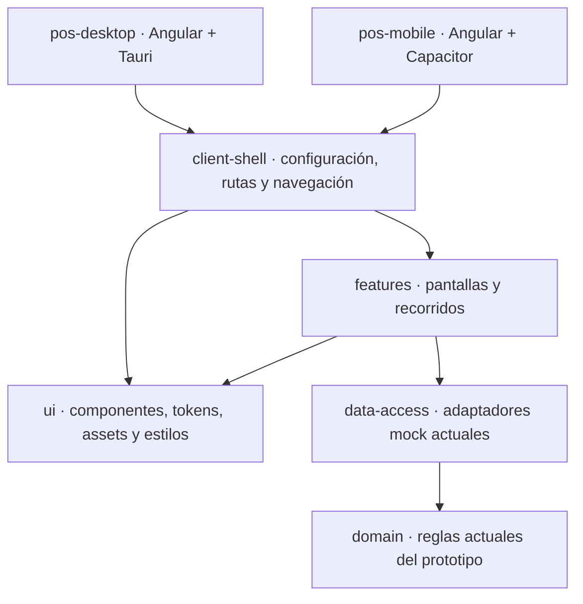

# ADR-14 · Clientes de escritorio y móvil independientes

**Estado:** decisión aceptada el 21 de octubre de 2026. **Alcance:** composición del cliente y artefactos de entrega. No acredita operación productiva ni homologación de sistemas operativos, dispositivos o proveedores.

## Decisión

POS Platform tiene dos aplicaciones cliente: `apps/pos-desktop`, con Angular y Tauri para el puesto de escritorio, y `apps/pos-mobile`, con Angular y Capacitor para Android e iOS. Cada aplicación posee su arranque, configuración del host y build.

El servidor Angular de desarrollo permite trabajar y probar la interfaz. No constituye otro cliente de producto ni una oferta PWA. El sitio Vercel se construye desde el repositorio editorial **pos-docs**: `/` publica el portal de recursos, `/guide/` contiene Starlight y `/presentations/architecture/` aloja la presentación de arquitectura y roadmap.

## Código compartido y dependencias

`libs/client-shell` compone `AppComponent`, `createClientConfig(platform)`, rutas, guards y shell. Tiene tags `type:shell` y `env:browser`. Las aplicaciones eligen su plataforma y arrancan Angular desde sus propios `main.ts`; no importan otra aplicación ni copian el shell.

Las flechas representan imports de código. `libs/ui/assets` y `libs/ui/src/styles.css` sirven a ambos builds. El shell reutiliza las mismas features y adaptadores; no se crean copias de ventas, pagos o permisos por sistema operativo. `libs/client-shell` no es un proceso ni un despliegue adicional. Su composición pertenece al cliente, por eso no se convierte en una biblioteca técnica genérica bajo `shared`.

El código nativo y sus permisos pertenecen al host correspondiente. Una integración de periféricos requiere un contrato de capacidad y un adaptador homologado; añadir Tauri o Capacitor no habilita por sí solo impresoras, lectores ni cobros. Las features compartidas no deben depender directamente de SDK de Tauri o Capacitor.

## Datos y acceso

Los dos clientes consumirán la API autorizada de sucursal; PostgreSQL conserva la autoridad transaccional de la tienda. La interfaz no accede directamente a SQL ni mantiene una base transaccional de ventas por móvil en el perfil de continuidad ante caída de WAN.

El cliente móvil depende de la conectividad autorizada al backend para las operaciones que la requieran. Compartir interfaz no habilita venta fuera de la sucursal, operación sin LAN, acceso remoto público ni permisos adicionales. Esos recorridos necesitan una decisión y pruebas propias.

Actualmente ambos clientes utilizan datos sintéticos y adaptadores mock. La autenticación corporativa, el almacenamiento seguro de credenciales y las operaciones comerciales contra el backend están pendientes. Tauri utiliza el identificador `com.floxcristian.corporatepos`, cuya estabilidad debe respetarse por compatibilidad; Capacitor utiliza `com.implementos.posplatform.mobile`. Sus almacenes locales son independientes: compartir código no sincroniza datos ni sesiones entre dispositivos.

## Entrega y verificación

| Etapa | Qué acredita | Qué queda por comprobar |
| --- | --- | --- |
| Build Angular de cada cliente | Su configuración y bundle se compilan | Ejecución dentro del host nativo |
| Pruebas de navegador | Recorridos compartidos y comportamiento adaptable en el entorno probado | Permisos, ciclo de vida, almacenamiento y APIs del dispositivo |
| Sincronización Capacitor | Copia del bundle y actualización de dependencias del proyecto nativo | Compilación e instalación Android/iOS |
| Empaquetado Tauri o compilación móvil | Generación del artefacto en la plataforma usada | Firma, distribución, instalación, operación y recuperación sobre equipos reales |
| Homologación | Comportamiento observado para el dispositivo, versión y proveedor probados | Plataformas o capacidades fuera de ese alcance |

Las guías de [escritorio](../desktop.md) y [móvil](../mobile.md) mantienen los comandos y prerrequisitos, sin duplicarlos aquí. El [catálogo del monorepo](../monorepo.md) registra seis aplicaciones operativas. La guía Starlight se mantiene por separado en el repositorio editorial [POS Docs](https://github.com/developer-implementos/pos-docs).

## Consecuencias

Esta separación permite evolucionar permisos, integración nativa, empaquetado y distribución por plataforma, conservando una sola implementación de las pantallas compartidas. Exige verificar los dos builds y probar los hosts de manera independiente; el resultado de Windows no certifica Android o iOS.

El shell compartido centraliza la composición de las pantallas y permite mantener reglas, accesibilidad y experiencia comunes. Cada host conserva sus permisos, integración nativa y ciclo de entrega.
