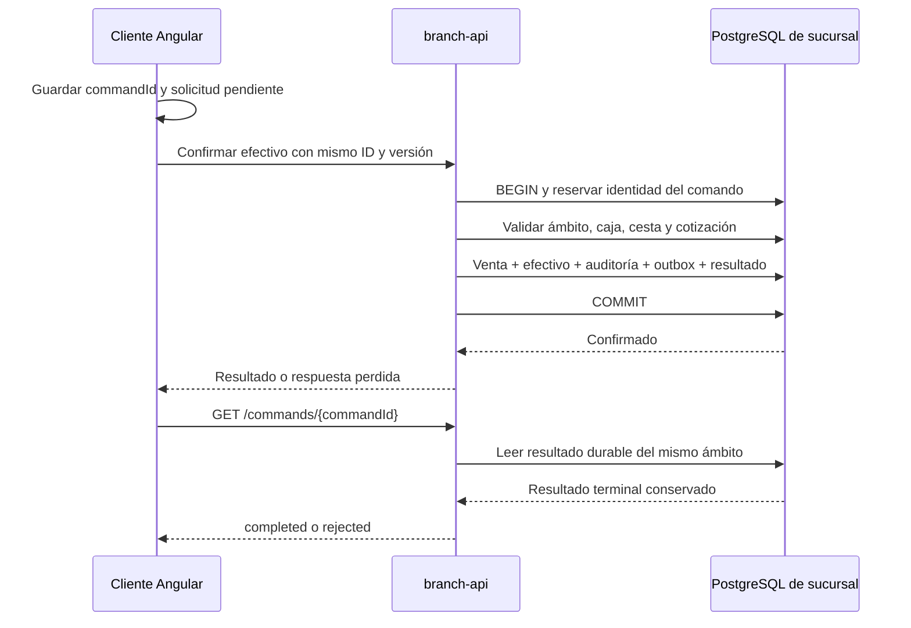

# ADR-19 · PostgreSQL y unidad de trabajo

**Decisión:** PostgreSQL 18.6 y el driver `pg` 8.23.1 para la persistencia de sucursal y país. SQL parametrizado en los adaptadores, una unidad de trabajo explícita y migraciones versionadas con una credencial separada. La implementación de F01 se revisa en laboratorio; esta decisión no acredita una operación productiva ni el cierre de la fase.

## Qué resuelve

Confirmar una venta modifica varias responsabilidades: venta y partidas, cobro en efectivo, movimiento del turno, auditoría, evento pendiente de entrega y resultado del comando. Si cualquiera falla, no deben quedar efectos parciales. Si el cliente pierde la respuesta, necesita consultar la operación original sin generar otra venta.

La sucursal conserva la autoridad transaccional en PostgreSQL. La base de país tiene otro ámbito y otras credenciales; una transacción local no alcanza país, Redis, ERP ni proveedores externos. BullMQ se incorpora en los procesos definidos por el [ADR-18](job-processing.md), con reconstrucción desde registros durables. No participa en el commit local de F01.

## Propiedad y límites del código

| Pieza del producto | Responsabilidad |
| --- | --- |
| `libs/shared/kernel` | Puertos puros `UnitOfWork` y contexto transaccional; sin Nest, `pg` ni SQL |
| `libs/shared/backend/persistence` | Conexión PostgreSQL, unidad de trabajo, migraciones, comprobación de esquema y registro durable de comandos |
| `libs/backend/<context>/infrastructure` | SQL y repositorios del contexto dueño de los datos |
| `libs/backend/<context>/application` | Casos de uso y coordinación mediante puertos públicos |
| `apps/branch-api` y `apps/country-api` | Composición, manifiesto de migraciones y privilegios de su base |
| `libs/shared/backend/testing` | Bases y roles sintéticos aislados para pruebas reales de PostgreSQL |

Los repositorios que intervienen en un caso de uso reciben la misma capacidad transaccional. No abren transacciones anidadas ni conservan conexiones para usarlas después. El callback sólo puede consultar mediante esa capacidad mientras está vigente. Con `pg`, todas las sentencias de una transacción deben usar el mismo cliente adquirido del pool. [Documentación de node-postgres](https://node-postgres.com/features/transactions).

Se usa SQL explícito para hacer revisables locks, versiones, restricciones, permisos y límites de commit. No se incorpora un ORM ni un repositorio genérico que oculte esas reglas. El coste es mantener mapeos y consultas por contexto, validarlos en revisión y probarlos contra PostgreSQL real. Este criterio no autoriza SQL en controladores, dominio o frontend.

## Confirmación e idempotencia

La clave de exclusión es `(branch_id, command_id)`. Antes de reproducir un resultado se comprueban actor, caja, instalación, tipo de comando y hash del contenido normalizado. Reutilizar el ID con otro contenido se rechaza. La normalización contempla UUID y decimales, conservando el orden significativo de las líneas.

| Situación | Resultado durable y acción del cliente |
| --- | --- |
| Operación aceptada | Efectos y recibo `completed` se confirman juntos |
| Rechazo conocido de negocio | Se revierten los efectos hasta un savepoint y se confirma únicamente el recibo `rejected`; ese ID no podrá ejecutarse después |
| Fallo técnico antes del commit | Se revierte la transacción; no se inventa un resultado comercial |
| Respuesta de commit perdida | Se informa resultado incierto; no se vuelve a ejecutar automáticamente el callback |
| Consulta de comando devuelve 404 | No demuestra que jamás se envió; el usuario puede reenviar explícitamente el mismo ID y contenido conservados |
| Dos solicitudes con el mismo ID | Se serializan; obtienen el mismo resultado terminal o un conflicto de identidad/contenido |

Los recibos terminales son inmutables. Una restricción diferida impide confirmar un recibo pendiente. F01 no elimina estos registros: su archivo y retención se deben acordar sin abrir una ventana que permita ejecutar de nuevo una operación antigua. Un recibo de comando no equivale a documento fiscal, envío ERP ni log diagnóstico.

## Importes, conexión y plazos

Los importes usan `numeric` en PostgreSQL y cadenas decimales en los contratos HTTP. La cotización aplica la política de moneda, conversión y redondeo del backend. El precio unitario admite precisión adicional para conversiones; los totales usan la escala de liquidación. No se convierte globalmente `numeric` a `number`. [Tipos numéricos de PostgreSQL](https://www.postgresql.org/docs/18/datatype-numeric.html).

La configuración valida el ámbito de la base, TLS y límites de pool, consulta, espera de locks y duración total. TLS verificable es el modo predeterminado; `disable-local` sólo admite el PostgreSQL de laboratorio en loopback. Al vencer el plazo total se invalida la capacidad y se destruye la conexión para impedir una escritura tardía. Un error SQLSTATE que confirma el rechazo del commit se distingue de una pérdida de transporte cuyo resultado se desconoce.

## Migraciones y privilegios

El despliegue ejecuta migraciones con otra credencial. El runtime no crea tablas, no es dueño de la base y sólo recibe los privilegios explícitos requeridos por cada contexto, incluso por columna cuando corresponde. No se conceden permisos sobre tablas futuras. Los privilegios de PostgreSQL permiten delimitar las operaciones y columnas autorizadas. [Modelo de privilegios](https://www.postgresql.org/docs/18/ddl-priv.html).

El migrador comprueba orden y SHA-256, adquiere un lock y aplica DDL e historial dentro de una transacción. Una migración publicada no se modifica. No hay auto-sync ni rollback destructivo automático. Si se pierde la conexión, se consulta el historial usando el mismo artefacto antes de decidir el siguiente paso.

`platform.database_realm` fija el ámbito de cada base. Readiness compara el ámbito y el conjunto exacto de migraciones/checksums esperado por el artefacto. Una versión desconocida deja la instancia no disponible; no se presume compatibilidad. La base de país tiene su propia sonda y no obtiene por ello recepción de ventas o integración ERP.

## Evidencia necesaria

La aceptación exige comprobar con PostgreSQL real: duplicados concurrentes, rollback de todos los efectos, rechazo terminal durable, recibos inmutables, pérdida del acuse de commit, recuperación por ID, conexión cortada, migradores concurrentes, roles runtime sin DDL y grants por columna. El proxy de pruebas descarta la respuesta de un commit efectuado por PostgreSQL; no simula que la venta se guardó.

Los resultados pertenecen a los checks y PR del producto. La [guía F01](../phase-1-laboratory.md) describe el recorrido de laboratorio y su alcance. El [roadmap](../roadmap.md) conserva los criterios para aceptar el entregable; publicar este ADR no cambia su avance.
