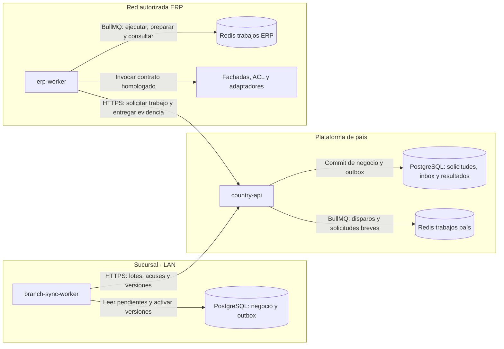

# Trabajos con BullMQ y sincronización durable

**Decisión vigente: BullMQ con Redis exclusivo de trabajos, aceptada para la propuesta; implementación y pruebas pendientes.** El [ADR-18](decisions/job-processing.md) fija responsabilidades, recuperación y aislamiento. Este documento explica los recorridos y su relación con el legado. La documentación no acredita que las colas estén instaladas ni que los adaptadores ERP estén homologados.

## 1. Decisión y alcance

La arquitectura conserva **PostgreSQL + outbox/inbox para la autoridad de negocio**, **HTTPS para cruzar sucursal, país y red ERP**, y **BullMQ + Redis para coordinar trabajos en país y ERP**. RabbitMQ no forma parte del objetivo. No se incorpora un segundo bus para el mismo recorrido.

- `country-api` programa disparos y crea solicitudes breves de publicación fuera de HTTP mediante BullMQ; PostgreSQL conserva calendario, intervalos y solicitudes.
- `erp-worker` ejecuta operaciones ERP, prepara maestros por lotes y consulta/concilia resultados mediante BullMQ. Usa Redis de trabajos en su red autorizada, independiente del Redis de país.
- `branch-sync-worker` entrega outbox y aplica versiones con PostgreSQL de sucursal y HTTPS. No requiere Redis en cada tienda.
- `device-agent` mantiene comandos, intentos y evidencia en SQLite y usa HTTPS LAN. Sus efectos físicos no se convierten en jobs BullMQ.
- Redis de caché sigue siendo opcional y separado de Redis de trabajos. El espejo comercial local sigue en PostgreSQL.

El uso de una biblioteca común reduce diferencias en scheduling, concurrencia, reintentos y operación de jobs; no convierte todos los recorridos en una cola compartida. Cada país y entorno mantiene límites, credenciales y responsables propios. El POS es independiente de Core: sus bibliotecas y servicios son antecedentes, no dependencias del producto.

## 2. Qué sabemos del entorno actual

La [presentación chilena](antecedentes-presentacion-chile.md) identifica WSO2 EI, Carbon/Synapse, DSS, CAR, mediadores Java y Andes AMQP/JMS. Son antecedentes declarados; no acreditan la configuración instalada. La [auditoría del concentrador](analisis-repositorios/mountain-concentrador.md) delimita APIs, transformaciones, lotes y persistencia observados en el repositorio.

El [sincronizador auditado](analisis-repositorios/mountain-sync-sucursal.md) envía transacciones por HTTP, recibe avisos/respuestas por AMQP y descarga datos mediante la API de lectura. Se encontraron ACK antes de esperar persistencia y ventanas de reenvío. Una biblioteca de colas no corrige esos caminos de aplicación. Los [adaptadores .NET](analisis-repositorios/apis-implementos.md) contienen integración WCF/SQL y reglas que ninguna cola reemplaza.

La revisión de [Core](analisis-repositorios/core.md) muestra NestJS/Fastify, Pub/Sub y outbox, además de límites en deduplicación y concurrencia. Sirve como evidencia de comparación; no demuestra operación offline ni integra servicios de Core en POS Platform.

## 3. Separar productos y responsabilidades

| Responsabilidad | Implementación objetivo | Garantía propia del POS |
| --- | --- | --- |
| Negocio y pendientes de sucursal | PostgreSQL y `branch-api` | Venta, auditoría y outbox en la transacción local |
| Entrega entre entornos | HTTPS y contratos de `sync` | Identidad, recepción durable, consulta de estado y reanudación |
| Disparos programados de publicación | BullMQ en `country-api`, Redis de trabajos de país | Calendario e intervalo único persistidos en PostgreSQL |
| Ejecución ERP, lotes y conciliación | BullMQ en `erp-worker`, Redis de trabajos en red ERP | Claims, evidencias, resultados y recuperación mediante API de país |
| Mediación, modelos y protocolos ERP | Fachadas, ACL y adaptadores | Traducción y semántica por sistema, sin filtrar DTO externos al dominio |
| Precios y ofertas offline | Paquetes versionados y PostgreSQL de sucursal | Integridad, vigencia, paridad de cálculo y activación atómica |
| Periféricos | `device-agent`, SQLite y contrato de `devices` | Custodia técnica, exclusión y tratamiento del resultado incierto |

WSO2 combina integración y transporte: sustituir sus colas no implementa automáticamente Synapse, DSS, consultas SQL, transformaciones o adaptación AX. La extracción de cada capacidad necesita inventario, contrato y prueba del efecto. [Perfiles de WSO2 EI](https://wso2.com/library/articles/2017/08/end-to-end-capabilities-of-wso2-enterprise-integrator/).

## 4. Garantías y límites de la implementación elegida

### BullMQ y Redis de trabajos

BullMQ coordina colas y consumidores. Los jobs pueden repetirse después de una interrupción o pérdida de lock; los handlers deben ser idempotentes y consultar el estado durable. El `jobId` no sustituye la identidad histórica de negocio: borrar un job no borra una venta ni habilita repetirla. [Modelo de BullMQ](https://docs.bullmq.io/guide/introduction), [jobs interrumpidos](https://docs.bullmq.io/guide/workers/stalled-jobs), [idempotencia](https://docs.bullmq.io/patterns/idempotent-jobs).

Redis de trabajos requiere persistencia, capacidad, acceso restringido y `maxmemory-policy=noeviction`. Cada instancia es independiente de una caché que pueda descartar entradas por presión de memoria. Los jobs conservan referencias mínimas; no se copian secretos ni documentos sensibles completos. [BullMQ en producción](https://docs.bullmq.io/guide/going-to-production).

La persistencia Redis reduce pérdida de ejecución, pero no reemplaza la recuperación desde PostgreSQL. AOF con fsync periódico puede perder escrituras recientes ante un desastre; por ello una venta aceptada no depende de que ese job sobreviva. [Persistencia Redis](https://redis.io/docs/latest/operate/oss_and_stack/management/persistence/).

### PostgreSQL, outbox y HTTPS

El emisor confirma negocio y outbox en la misma transacción. El receptor confirma inbox, efecto local pactado y outbox antes del ACK de aplicación. Ese efecto es el registro operativo/proyección exigido por el contrato, no la contabilización remota. La [propuesta](propuesta-arquitectura.md#sincronización-y-consistencia) distingue estos acuses.

Un relay lleva los registros confirmados a BullMQ. Encolar y confirmar PostgreSQL no es una operación atómica: se recuperan los pendientes y se toleran duplicados con identidad y transiciones condicionales. `erp-worker` recibe trabajo por HTTPS y lo materializa en su cola local; no abre una conexión WAN a Redis o PostgreSQL de país. Los jobs faltantes se reconstruyen desde trabajo y resultados durables.

### Transporte legacy y fronteras del objetivo

Los mensajes Andes/AMQP observados y Pub/Sub en Core son evidencia de otros sistemas. No se incorporan RabbitMQ ni Pub/Sub al objetivo POS. La coexistencia con el legado, cuando un recorrido la necesite, mantiene un único propietario de cada efecto, identidades preservadas y criterios de retirada comprobados. Un ACK de transporte no acredita el registro ERP.

## 5. Matriz de ejecución por carga de trabajo

| Carga / frontera | Tecnología elegida | Autoridad y recuperación |
| --- | --- | --- |
| Venta y pendientes offline | PostgreSQL de sucursal + outbox | `branch-api` confirma negocio; `branch-sync-worker` reanuda el envío |
| Entrega sucursal–país y descarga | HTTPS + inbox y cursores | Acuse tras commit del contrato; consulta y reenvío por identidad |
| Calendario de publicación | BullMQ + Redis de trabajos de país, en `country-api` | PostgreSQL conserva intervalo único, calendario y solicitud; el reconciliador recupera intervalos pendientes |
| Ejecución ERP | BullMQ + Redis de trabajos en red ERP, en `erp-worker` | Claims y resultados en país por HTTPS; comprobación del estado antes de ejecutar |
| Preparación masiva de maestros | BullMQ en `erp-worker`, con concurrencia propia | Solicitud, manifiesto y porciones durables; reanudar por checkpoint |
| Consulta de resultados inciertos | BullMQ en `erp-worker`, con cola/presupuesto separado | Consultar por identidad o conciliar; nunca repetir un efecto ciegamente |
| Periféricos de puesto | SQLite + HTTPS LAN | Comandos e intentos de `device-agent`; evidencia física y conciliación propias |
| Lecturas aceleradas de país | Redis de caché, opcional y en instancia separada | Datos reconstruibles; fallback limitado a PostgreSQL |

### Criterios de aceptación de la decisión

| Área | Evidencia exigida antes de habilitar el recorrido |
| --- | --- |
| Relay y reconstrucción | Recuperación tras commit sin enqueue, pérdida de respuesta y borrado de Redis; ninguna solicitud aceptada desaparece |
| Calendario | Dos réplicas, zona horaria, reinicio e intervalos atrasados no duplican solicitudes; recuperación con carga limitada |
| Identidad y efectos | Pérdida de lock, reintento y replay manual no generan doble registro/cobro; respuesta incierta deriva a consulta |
| Operación Redis | Persistencia y restauración medidas; memoria sin eviction de jobs; contrapresión, alertas, acceso y capacidad por entorno |
| Aislamiento | Lotes de maestros no agotan el presupuesto financiero; una red ERP no consume Redis de otro entorno |
| Compatibilidad | Versiones BullMQ/NestJS/Redis fijadas, dependencias y artefactos comprobados; actualización y rollback ensayados |
| Sincronización | Caída WAN conserva venta/outbox y descarga reanudable sin Redis en sucursal; activación comercial atómica |

La selección de BullMQ está acordada. Estas pruebas aceptan su implementación y operación; no son una nueva votación entre motores de cola. El [ADR-18](decisions/job-processing.md) detalla las invariantes y el [roadmap](roadmap.md) asigna entregables.

## 6. Topología propuesta

Cada flecha hacia Redis representa el uso de BullMQ por la aplicación; los consumidores corren dentro del ámbito de esa aplicación. El transporte entre entornos es HTTPS, con credenciales y permisos propios. El mapa no añade SQL remoto a país, Redis compartido por WAN ni una dependencia de cola para la venta local.

### Cuatro confirmaciones con significados diferentes

1. **Commit de sucursal:** la operación local y su outbox quedaron conservadas.
2. **ACK de país:** se confirmó inbox, efecto local pactado y siguiente outbox en PostgreSQL.
3. **Estado de job BullMQ:** describe una ejecución técnica; completado no significa por sí solo contabilización ERP.
4. **Resultado del sistema externo:** evidencia del contrato ERP, fiscal o de pago, persistida y conciliable.

Un timeout entre cualquiera de esas fronteras puede dejar incertidumbre. El flujo consulta por identidad, recupera estado y mantiene trazabilidad antes de repetir un efecto.

## 7. Migración incremental desde WSO2/Andes

La transición se planifica por recorrido: inventario de productores, consumidores y efectos; contratos e identidades; implementación de fachada/ACL; pruebas de paridad; piloto; corte con propietario único; y retirada después de conciliar pendientes. Preparar maestros, registrar ventas y consultar estados tienen criterios propios.

No basta con mover mensajes de un broker a Redis. Se deben preservar transformaciones, reglas, referencias remotas, correlación, acuses, errores y recuperación. Las bases de AX permanecen mientras AX las requiera; las funciones de MongoDB de NC solo se retiran después de migrar su autoridad y conciliar saldos, no al crear una cola.

## 8. Pruebas de aceptación y fallos

| Fallo provocado | Resultado requerido |
| --- | --- |
| Caída después del commit y antes de encolar | Relay/reconciliador crea el job pendiente desde la autoridad durable |
| Enqueue correcto y respuesta perdida | Reintento con identidad estable; deduplicación durable impide otro efecto |
| Redis vacío o restaurado a copia anterior | Se reconstruyen pendientes; las operaciones completadas no se ejecutan de nuevo |
| Worker pierde lock o queda detenido | Recuperación y transición condicional; verificar resultado remoto antes de repetir |
| ERP ejecuta pero se pierde respuesta | Estado incierto y consulta/conciliación; no nuevo cobro o documento automático |
| Calendario duplicado en varias réplicas | Una solicitud durable por ámbito/dataset/intervalo |
| Reconexión masiva de sucursales | Límites, backoff y distribución justa sin perder pendientes |
| Preparación de maestros extensa | Recursos y colas aislados; no impide conciliación ni resultados financieros |
| Memoria Redis agotada o disco lleno | Fallo visible y contrapresión; no aceptación silenciosa ni descarte de trabajo |
| WAN/Redis de país indisponibles | La sucursal conserva las operaciones offline autorizadas y recupera envío después |

## 9. Estado y validación pendiente

La decisión es parte de la propuesta, no una certificación productiva. Faltan implementación, contratos externos homologados, versiones fijadas, volúmenes medidos, RPO/RTO, responsables operativos y ensayos de fallos. Ninguna guía de un producto acredita esos resultados por sí sola. Las fuentes técnicas oficiales se usan para definir pruebas, no como evidencia de un despliegue POS existente.
