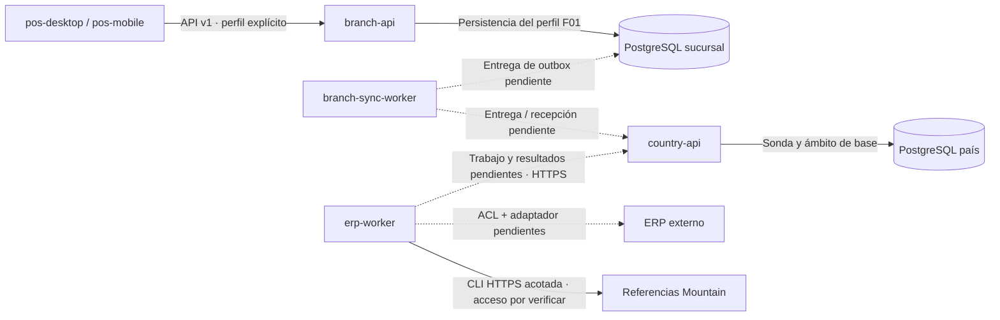

# Monorepo POS Platform

> **Alcance del código integrado en `main`:** **pos-platform** reúne los clientes Angular/PrimeNG para escritorio (Tauri) y móvil (Capacitor), las APIs NestJS/Fastify y sus workers. F01 combina el laboratorio transaccional con un incremento operativo Chile de usuarios/permisos propios POS, provisión persistente y HTTPS. La consulta legacy acotada todavía no alimenta el espejo ni la UI. La documentación se publica en [POS Docs](https://github.com/developer-implementos/pos-docs); la aceptación de los entregables y las capacidades productivas no se deducen del inventario.

POS Platform es la base de un producto corporativo para varios países. El monorepo reúne clientes de escritorio y móvil, backend de sucursal, backend de país y workers con ciclos de ejecución propios. La demostración funcional actual cubre Chile; la estructura multipaís permite organizar la evolución sin afirmar que las reglas fiscales o integraciones de otros países estén implementadas.

`apps/pos-desktop` y `apps/pos-mobile` tienen arranques Angular independientes y comparten `libs/client-shell`, que define configuración por plataforma, rutas, guards y navegación. La [decisión de clientes nativos](decisions/native-clients.md) describe los artefactos Tauri y Capacitor. La API de sucursal está en `apps/branch-api`. Todos se versionan en [pos-platform](https://github.com/developer-implementos/pos-platform), con builds separados: compartir repositorio no implica compartir proceso ni persistencia.

## Nombres de las aplicaciones backend

Las aplicaciones se nombran por ámbito o responsabilidad y tipo de proceso: `branch-api`, `branch-sync-worker`, `country-api` y `erp-worker`. `branch` identifica la sucursal y `country` el ámbito de país; `api` identifica la entrada HTTP y `worker` un proceso de trabajo separado. Los contextos DDD (`sales`, `cash`, `payments`, etc.) conservan sus nombres y límites dentro de las bibliotecas: una aplicación puede componer varios contextos sin convertirlos en microservicios.

La [guía de API](api.md#configuración) detalla los artefactos, prefijos de entorno y configuración de cada aplicación.

## Estructura objetivo acordada

El código transversal se agrupa en `libs/shared/` y los contextos de negocio en `libs/backend/`. Core es una referencia de organización y convenciones; POS Platform es independiente y no consume su código, paquetes ni servicios.

La estructura define siete aplicaciones objetivo y el proyecto de pruebas `pos-clients-e2e`, sin artefacto de despliegue. La documentación se publica desde POS Docs. El [estado de implementación](#estado-de-implementación) indica el alcance disponible.

<!-- monorepo:target:start -->
```text
apps/
  pos-desktop/                  # Aplicación completa: shell Tauri + frontend Angular
  pos-mobile/                   # Aplicación completa: shell Capacitor + frontend Angular
  device-agent/                 # Agente C#/.NET Windows por puesto; red compartida en F06; implementación pendiente
  branch-api/                   # API y composición de negocio de sucursal
  branch-sync-worker/           # Proceso de entrega y recepción de sucursal
  country-api/                  # API de recepción y capacidades de país
  erp-worker/                   # Proceso de integración, traducción y conciliación ERP
libs/
  backend/
    sales/                      # Ventas y documentos comerciales
    cash/                       # Turnos y movimientos de caja
    payments/                   # Intentos, resultados y conciliación de pagos
    collections/                # Cobranzas y anticipos
    returns/                    # Devoluciones y referencias al documento original
    pricing/                    # Evaluación y versiones de precios y promociones
    catalog/                    # Maestros y proyecciones de consulta
    fiscal/                     # Documentos y estados fiscales por país/proveedor
    devices/                    # Contratos y coordinación de periféricos
    sync/                       # Protocolo y progreso de sincronización
    erp/                        # Contratos, ACL y adaptadores ERP
    reporting/                  # Consultas y proyecciones de reportes
    administration/             # Configuración y ámbito organizacional
  client-shell/                 # Composición Angular compartida; no es una aplicación desplegable
  features/                     # Funcionalidades de la interfaz
    branch-operation/           # Login, caja y venta conectados con componentes PrimeNG
  shared/
    frontend/
      ui/                       # Preset, tokens y componentes de presentación
    kernel/                     # Modelo mínimo acordado entre contextos; sin frameworks
    contracts/                  # Sobres y metadatos técnicos comunes; no todos los DTO de negocio
    backend/
      runtime/                  # Bootstrap, configuración, HTTP, observabilidad, sondas y ciclo de vida
      persistence/              # Driver pg, unidad de trabajo, migraciones y comandos durables
      testing/                  # Bases/roles sintéticos para integración real
  country-policies/             # Perfiles nacionales; reglas específicas bajo su contexto
  domain/                       # Reglas puras del prototipo frontend
  data-access/                  # Adaptadores demo y gateway branch-api en proyectos separados
    branch-api/                 # HTTP y estado de la operación conectada
tests/
  pos-clients-e2e/              # Playwright demo y API real; proyecto Nx sin despliegue
    mobile/                     # Suite Angular móvil; no homologa Capacitor
    branch/                     # Recorridos Angular → API → PostgreSQL con recuperación
tools/                          # Herramientas de build, lint y pruebas del producto
.github/
  workflows/                    # Validaciones y entrega
```
<!-- monorepo:target:end -->

`shared/backend/runtime`, `persistence` y `testing` son proyectos con fronteras propias. Los contratos HTTP puros se publican desde cada contexto y pueden ser consumidos por los clientes.

<span id="correspondencia-con-el-checkout-actual"></span>
<span id="inventario-físico-actual"></span>

## Estado de implementación

El producto contiene seis aplicaciones; `apps/device-agent` está acordada y pendiente de implementación. `branch-api` compone identidad, configuración y contextos transaccionales. El perfil `operational` añade usuarios, roles, asignaciones y provisión Chile; el laboratorio prueba catálogo, cestas, cotización y efectivo con datos sintéticos. `country-api` comprueba su PostgreSQL y ámbito sin recibir ventas. Los workers no sincronizan ni registran operaciones ERP; la CLI separada de `erp-worker` consulta referencias Mountain por HTTPS. El [recorrido F01](phase-1-laboratory.md) detalla esos límites.

La [guía de API](api.md), la [guía de pruebas](testing.md) y la [evidencia del producto](product-repository.md) delimitan el código revisado. El árbol conserva el estado pendiente de los componentes futuros; una carpeta no acredita operación o aceptación.

Las bibliotecas se consumen por entradas públicas `@pos-platform/<nombre>`; las pantallas usan `@pos-platform/features/<nombre>`. El grafo Nx y las reglas de importación expresan sus fronteras. Una carpeta no equivale a un servicio desplegado.

## Composición de los clientes

`pos-desktop` y `pos-mobile` son aplicaciones completas: cada una incluye una shell nativa y su frontend Angular/PrimeNG. Tauri aloja el frontend de escritorio y Capacitor el móvil. Cada frontend tiene arranque y build propios; comparten código de interfaz. La [composición de las aplicaciones](decisions/native-clients.md#shell-nativa-y-frontend) muestra qué contiene cada shell. La ejecución nativa y homologación no se deducen de un build Angular.

`libs/client-shell` comparte componente raíz, configuración, rutas, guards y marco de navegación Angular; `libs/features` mantiene las funcionalidades. Esta biblioteca de composición de interfaz se incluye en los bundles Angular, mientras que las shells nativas se configuran en sus respectivas aplicaciones. La composición del producto permanece fuera de la infraestructura genérica de `shared/frontend`.

La UI reutilizable pertenece a `shared/frontend/ui`. Los contratos puros pueden ser consumidos por ambos clientes; las implementaciones Nest, SQL y SDK de servidor permanecen fuera de sus dependencias.

Los perfiles `branch` y `branch-lab` componen `libs/data-access/branch-api` y `libs/features/branch-operation`: gateway tipado, sesión en memoria y stores separados. `branch` usa el perfil API `operational`, administración de usuarios/roles y capacidades efectivas; no habilita caja o cobros sin contratos comerciales verificados. `branch-lab` conserva el recorrido sintético de pruebas. `unconfigured` bloquea login hasta configurar un puesto; `demo` compone sus propios adaptadores y un fallo de API no cambia de perfil. El cliente conserva referencias de operaciones pendientes y muestra los importes del servidor sin asumir autoridad comercial.

## Límites DDD de shared

`shared/` agrupa bibliotecas con responsabilidades independientes. No tiene un barrel `@pos-platform/shared` que exporte todo. Cada proyecto expone una entrada pública y dependencias verificables; un proyecto adicional se justifica por su responsabilidad, consumidores o aislamiento.

| Grupo objetivo | Contenido permitido | Propietario y límite |
| --- | --- | --- |
| `shared/backend` | Arranque, configuración, HTTP, observabilidad y mecanismos técnicos | No conoce reglas comerciales ni importa implementaciones de los contextos |
| `shared/frontend/ui` | Tokens, preset y componentes de presentación | No accede a persistencia ni decide descuentos, permisos comerciales o pagos |
| `shared/kernel` | Conceptos mínimos con semántica e invariantes acordadas entre contextos | TypeScript puro; cambios coordinados con sus consumidores; no un modelo global de entidades |
| `shared/contracts` | Sobres de mensajes y metadatos transversales de intercambio | Sin Nest, Angular ni modelos ORM; no absorbe todos los contratos de negocio |
| `shared/backend/testing` | Fixtures de PostgreSQL, bases y roles aislados para pruebas | Solo consumidores de pruebas; producción no puede importarlo |

Un contrato como `SaleConfirmedV1` pertenece a ventas y se expone desde una entrada pública de contratos del contexto, independiente de Nest y de sus entidades internas. El sobre técnico puede pertenecer a `shared/contracts`. Compartir un contrato no transfiere la propiedad del negocio al grupo compartido.

Un tipo monetario sólo pertenece al kernel cuando sus consumidores comparten semántica. La cotización F01 implementa precisión decimal y política de redondeo en `pricing`, con DTO puros para los consumidores. `Customer`, `Product` y `Sale` no se centralizan por compartir nombres: cada contexto conserva el modelo que necesita.

### Direcciones de dependencia objetivo

- Las apps componen módulos; los controladores delegan casos de uso.
- El dominio de cada contexto depende únicamente de código puro y, cuando proceda, del kernel acordado. No importa infraestructura técnica, Nest, Angular ni ORM.
- Aplicación define los puertos; infraestructura los implementa con mecanismos de `shared/backend`. La composición conecta esas piezas.
- Los contextos colaboran mediante contratos públicos y puertos explícitos; no importan repositorios, tablas ni implementaciones privadas ajenas.
- El frontend consume contratos públicos y presentación; no importa bibliotecas de servidor.
- Las bibliotecas de producción no importan soporte de testing ni proyectos E2E. Las pruebas pueden consumir sus APIs públicas.

Los límites se comprueban mediante tags Nx, restricciones de importación y pruebas de arquitectura. Se separan navegador, servidor, contratos puros, contextos y soporte de pruebas. Una colaboración se habilita mediante el contrato público correspondiente, no por imports de infraestructura ajena.

### Infraestructura y propiedad de datos

F01 incorpora usuarios/permisos propios POS para Chile, provisión operativa segregada del laboratorio, PostgreSQL, migraciones y resultados durables de comandos. La entrega de outbox, recepción de país y jobs externos siguen sus fases. Caché, alertas y controles operativos se incorporan con un consumidor, contrato y criterio de aceptación concretos.

La conexión y el ejecutor técnico de transacciones pueden compartirse; las tablas, repositorios y migraciones de ventas siguen perteneciendo a ventas. La escritura comercial y su outbox deben compartir la transacción correspondiente. Una utilidad de reintentos no decide repetir un pago de resultado desconocido: esa política pertenece a pagos.

## Proyectos de pruebas y herramientas

`tests/pos-clients-e2e/` agrupa Playwright de las interfaces Angular con dependencias explícitas de clientes y `branch-api`. La carpeta `branch/` contiene recorridos contra API y PostgreSQL reales, incluidas respuestas perdidas y aprobación secundaria. Las suites demo y móvil mantienen su composición específica. Es un proyecto de pruebas, sin artefacto de despliegue.

Las pruebas HTTP permanecen junto a cada API; unitarias e integración quedan cerca de su código. `shared/backend/testing` aporta fixtures técnicas; los datos comerciales conservan su contexto dueño. `tools/backend` y los runners de laboratorio son herramientas del workspace, no dependencias del runtime.

Una suite `pos-system-e2e` requerirá un recorrido real sucursal–persistencia–país. `pos-desktop-e2e` se justificará con capacidades nativas de Tauri: probar Angular en Chromium no verifica instalación ni periféricos. Esas suites son futuras y no forman parte del inventario existente. La [guía de pruebas](testing.md) detalla alcances y criterios.

## Aplicaciones y ubicación propuesta

<!-- monorepo:applications:start -->
| Aplicación | Lugar previsto | Responsabilidad | Estado revisado |
| --- | --- | --- | --- |
| `pos-desktop` | Puesto Windows | Aplicación completa: shell nativa Tauri y frontend Angular | Cliente conectado con administración POS, frescura del cliente y recotización con consentimiento; demo y laboratorio explícitos. Paquete Tauri y política embebida pendientes en F01-04 |
| `pos-mobile` | Dispositivo Android/iOS | Aplicación completa: shell nativa Capacitor y frontend Angular | Cliente conectado compartido; dos APK Android y política HTTPS embebida comprobados. Instalación, distribución y capacidades nativas se homologan en sus fases |
| `device-agent` | PC Windows de cada puesto (F02/F05); estación de red compartida posterior (F06) | Agente C#/.NET por puesto; trabajos HTTPS con branch-api y diario SQLite; perfil de red compartido en F06 | Decisión acordada; app, protocolo y adaptadores pendientes de implementación y homologación |
| `branch-api` | Sucursal | API y composición de negocio de sucursal | Identidad y administración POS Chile, configuración compatible, cestas y motor comercial técnicamente verificados con PostgreSQL; pruebas comerciales sintéticas. Precios y cobros operativos sujetos a fuente validada |
| `branch-sync-worker` | Sucursal | Proceso de entrega y recepción de sucursal | Esqueleto local; sin jobs ni sincronización real |
| `country-api` | País | API de recepción y capacidades de país | Base HTTP y PostgreSQL por ámbito con comprobación de esquema; sin recepción comercial |
| `erp-worker` | Red autorizada del ERP | Proceso de integración, traducción y conciliación ERP | CLI de lectura Mountain para productos/clientes con transporte HTTPS acotado; acceso corporativo pendiente, sin publicación de espejos ni procesamiento de jobs |
<!-- monorepo:applications:end -->

Los workers tienen ciclo de vida propio. No se añade un listener HTTP de negocio solo para ejecutar tareas. Un futuro backoffice separado o un worker adicional de país requiere una necesidad concreta; no forma parte de estas siete aplicaciones objetivo. Starlight se compila desde el repositorio editorial POS Docs y no integra el grafo Nx del producto.

## Comandos del workspace

| Comando                   | Alcance                                                                          |
| ------------------------- | -------------------------------------------------------------------------------- |
| `npm start` | Interfaz Angular de escritorio en `http://127.0.0.1:4300` |
| `npm run build` | Compila los bundles Angular de escritorio y móvil secuencialmente |
| `npm run desktop:bundle` | Compila sólo el bundle Angular de escritorio |
| `npm run desktop:dev` | Abre Tauri con servidor de desarrollo |
| `npm run desktop:build` | Empaqueta Tauri, incluido su bundle Angular |
| `npm run mobile:start` | Interfaz Angular móvil en `http://127.0.0.1:4301` |
| `npm run mobile:build` | Compila sólo el bundle Angular móvil |
| `npm run mobile:sync:android` / `mobile:sync:ios` | Construye y sincroniza el proyecto nativo |
| `npm run mobile:android` / `mobile:ios` | Ejecuta el cliente en el entorno nativo disponible |
| `npm run api:dev`         | API de sucursal en `http://127.0.0.1:3000`                                       |
| `npm run country:dev`     | API de país en `http://127.0.0.1:3001`                                           |
| `npm run sync:check`      | Compone y cierra el contexto del worker de sincronización; no ejecuta jobs       |
| `npm run erp:check`       | Compone y cierra el contexto del worker ERP; no envía operaciones                |
| `npm run backend:check`   | Lint, tipos, pruebas y build de proyectos backend y librerías puras del producto |
| `npm run backend:build`   | Genera los artefactos de las cuatro aplicaciones backend                         |
| `npm run backend:smoke`   | Verifica los cuatro artefactos fuera del monorepo con dependencias de producción |
| `npm run structure:check` | Comprueba las reglas arquitectónicas del scaffold                                |
| `npm run graph`           | Muestra el grafo de proyectos Nx                                                 |

Estos comandos se ejecutan desde **pos-platform**. Los comandos `api:*` trabajan únicamente con `branch-api`. Los checks de workers comprueban composición y cierre; no equivalen a tener un consumidor, calendario o cola funcionando. El [mantenimiento de Starlight](../apps/starlight/README.md) describe los comandos independientes que se ejecutan en POS Docs.

## Propiedad de datos por contexto

Esta tabla fija la responsabilidad de los contextos, incluidos los pendientes de fases posteriores. La misma librería puede aportar contratos y casos de uso a más de una app, pero cada operación conserva una autoridad de escritura. El estado implementado se detalla en la guía F01, no se infiere del nombre del contexto.

| Contexto         | Datos y decisiones bajo su responsabilidad                                                     | Frontera que debe conservar                                                                                |
| ---------------- | ---------------------------------------------------------------------------------------------- | ---------------------------------------------------------------------------------------------------------- |
| `sales`          | Venta, líneas, importes y referencias comerciales; versión de precios aplicada                 | El escritor de sucursal confirma la operación; la copia de país no reescribe su historia                   |
| `cash`           | Turno, fondo, movimientos, arqueo, custodia y cierre                                           | Solo el módulo modifica el libro de caja; pagos y ventas aportan hechos mediante contratos                 |
| `payments`       | Intento de pago, referencia externa, resultado confirmado/rechazado/desconocido y conciliación | Un timeout no autoriza un segundo cobro; la evidencia bancaria sigue perteneciendo al proveedor            |
| `collections`    | Aplicaciones de cobros y anticipos, referencias a deuda y reservas autorizadas                 | Leer un saldo no concede exclusividad para consumirlo; se debe acordar la autoridad de reserva             |
| `returns`        | Cantidades devueltas y vínculo con las líneas e importes originales                            | Devolución comercial, documento fiscal y devolución de dinero son operaciones diferentes                   |
| `pricing`        | Espejo versionado, vigencias, reglas, conjunto activo y resultado explicable                   | La sucursal evalúa datos autorizados; no pasa a ser autora del precio corporativo                          |
| `catalog`        | Proyecciones de productos, clientes y maestros necesarios para operar                          | Cada dato conserva su dueño; el stock consultivo de Chile no se modifica al vender                         |
| `fiscal`         | Solicitudes de emisión, referencias y estados del proveedor fiscal                             | El estado local y la impresión no acreditan aceptación fiscal; homologación por país                       |
| `devices`        | Configuración y estado de comandos de periféricos a través de puertos                          | SDK, drivers y capacidades nativas quedan en adaptadores; entregar al spooler no prueba impresión física   |
| `sync`           | Inbox/outbox, cursor, intento, entrega, programación y acuses                                  | Los productores insertan outbox en la transacción de negocio; el worker no escribe tablas ajenas           |
| `erp`            | Traducciones, referencias externas, entrega y resultado del ERP                                | DTO y estados externos quedan detrás de ACL/adaptadores; un acuse de transporte no equivale a registro ERP |
| `reporting`      | Proyecciones y consultas para indicadores, reportes y exportaciones                            | No modifica operaciones de origen; distingue información incompleta o pendiente                            |
| `administration` | Ámbito empresa/país/sucursal/caja, identidad propia POS, roles, políticas y asignaciones       | Autoriza en servidor; un rol o capacidad del cliente no concede acceso                                      |

PostgreSQL de sucursal conserva identidades, configuración y operación de su perfil; una instalación operativa no incorpora semillas comerciales de laboratorio. La base de país tiene ámbito y esquema independientes y sus recepciones comerciales están pendientes. Los clientes no acceden a SQL. La migración usa otro rol y el runtime recibe grants explícitos; el [ADR-19](decisions/postgresql-unit-of-work.md) concreta esa frontera.

BullMQ se integra como mecanismo técnico de `shared/backend` compuesto por `country-api` y `erp-worker`, con puertos y handlers propiedad de sus contextos. Los jobs no contienen reglas comerciales en una biblioteca genérica. `country-api` programa solicitudes breves con Redis de trabajos de país; `erp-worker` ejecuta operaciones, lotes y conciliación con Redis de trabajos en la red ERP. Son instancias separadas y sin conexión Redis/SQL WAN. PostgreSQL conserva autoridad y recuperación; `branch-sync-worker` permanece en PostgreSQL/HTTPS. Este alcance del [ADR-18](decisions/job-processing.md) no acredita nuevos proyectos o dependencias ya instalados.

En la composición objetivo, `country-api` expone trabajo y resultados de integración mediante contratos y casos de uso públicos del contexto `erp`; ese contexto conserva la propiedad de destinos, referencias y estados ERP en PostgreSQL de país. `sync` gobierna el transporte, los acuses y la deduplicación técnica. La ACL y los adaptadores de proveedor se ejecutan dentro de `erp-worker`, que inicia HTTPS autenticado hacia `country-api` desde la red autorizada del ERP. Estos casos de uso y su persistencia están pendientes; el scaffold actual no implementa ese circuito. El [C3 de país y de ERP](c4-arquitectura-propuesta.md#c3-de-país-recepción-consulta-y-entrega-de-trabajo) detalla los límites.

El primer adaptador Mountain vive en `libs/backend/erp` y se ejecuta mediante `legacy-read.js`, entrada separada de `erp-worker`. Consulta exclusivamente búsquedas simples de productos/clientes con credencial técnica propia, origen aprobado y límites. Devuelve referencias observadas, sin precio vendible, versión ERP ni garantía de snapshot. La UI y el espejo no consumen aún estos resultados; su cableado exige contratos y validación propios. Este cliente HTTP no equivale al circuito durable de F03.



Las líneas continuas muestran capacidades implementadas en revisión, limitadas por perfil; las discontinuas, integraciones pendientes. La CLI Mountain tiene pruebas HTTPS locales, no validación del servicio corporativo ni conexión al espejo. La continuidad ante caída de WAN depende de la LAN y del servidor de sucursal. La autonomía ante caída de ambos sería otro perfil con decisiones y pruebas propias.

## Capas y reutilización interna

Los contextos implementados conservan reglas, casos de uso y adaptadores propios. Los contextos pendientes sólo fijan ubicación y propietario; no devuelven éxitos ficticios. La profundidad de las capas sigue la responsabilidad real de cada capacidad.

La organización interna distingue:

- `api`: controladores, DTO y validación del contrato de entrada.
- `contracts`: schemas y puertos públicos puros, utilizables por clientes y otros contextos autorizados.
- `application`: casos de uso, coordinación y puertos requeridos.
- `domain`: reglas e invariantes puras cuando exista dominio que lo justifique.
- `infrastructure`: adaptadores de datos, proveedores o dispositivos.
- `config`: composición y configuración específica del contexto.

Un módulo de consulta simple no necesita fabricar entidades o cinco proyectos Nx separados. Los contextos se comunican por fachadas o interfaces públicas cuando esa interacción exista; no importan repositorios ni modelos privados de otro contexto. `shared/kernel` contiene únicamente conceptos estables compartidos; `shared/contracts` describe intercambios transversales versionados, y `country-policies` contiene perfiles nacionales explícitos. Ninguna de esas tres librerías puras depende de Nest o Angular.

Las aplicaciones Node comparten configuración, HTTP, errores, logging y ciclo de vida. La app compone sus módulos y selecciona su identidad; la infraestructura técnica no conoce reglas comerciales de los contextos.

El logging permanece en Pino mediante `nestjs-pino`. El reporte opcional con Sentry también pertenece a esta frontera técnica y usa un cliente privado por aplicación: DSN vacío y deshabilitado por defecto, sin instrumentación global, captura automática de solicitudes o trazas distribuidas. Los contextos no deben importar el SDK ni duplicar capturas que ya resuelve la frontera HTTP o de proceso. El [contrato de observabilidad](api.md#reporte-opcional-de-errores-con-sentry) describe datos permitidos, exclusiones, cierre y límites de entrega; estas capacidades no reemplazan identidad, persistencia ni auditoría de negocio.

## Compilación y distribución

### Reglas de código y fronteras

ESLint tiene alcances explícitos; una comprobación sintáctica no se presenta como análisis de tipos de todo el frontend.

| Alcance                                                                                                      | Controles                                                                                                                                                                      |
| ------------------------------------------------------------------------------------------------------------ | ------------------------------------------------------------------------------------------------------------------------------------------------------------------------------ |
| Aplicaciones y librerías TypeScript                                                                          | Sin `any` explícito, `console`, `debugger`, evaluación dinámica ni supresiones de tipos sin justificar; imports y variables comprobados                                        |
| Cuatro apps Node, `libs/backend`, `libs/shared/backend/runtime`, `contracts`, `shared-kernel` y `country-policies` | Lint con tipos mediante `tsconfig.eslint.backend.json`, incluyendo sus tests y configuración: promesas, uso inseguro de valores, manejo de errores y exhaustividad de `switch` |
| Aplicaciones y contextos backend                                                                             | Configuración de entorno en la frontera de arranque/configuración; logging por inyección de `nestjs-pino`; sin SDK Sentry ni creación de loggers propios                       |
| Interfaz Angular                                                                                             | Contratos visuales y reglas Angular existentes, junto con las reglas sintácticas comunes; el análisis tipado anterior no cubre el frontend                                     |

Las promesas deben esperarse o manejarse explícitamente: escribir `void` no desactiva la regla. Los tests no deben quedar enfocados u omitidos mediante `only`/`skip`. En backend y librerías puras, `noInlineConfig` impide desactivar reglas con comentarios en el código; las excepciones deben definirse en la configuración central, con alcance preciso y revisión. En el resto del TypeScript, una supresión necesita regla y motivo, y falla si deja de ser necesaria. `@ts-ignore` y `@ts-nocheck` están prohibidos; `@ts-expect-error` exige una descripción de al menos diez caracteres. El bootstrap Angular conserva una excepción acotada para informar un fallo anterior a la inyección mediante `console.error`.

`@nx/enforce-module-boundaries` separa navegador, servidor y librerías puras; también impide que los contextos backend importen otros contextos o que la plataforma técnica dependa de negocio. La app compone módulos. Introducir una futura colaboración requiere definir su contrato y dirección de dependencia; no se habilitan imports internos ni se desactiva el límite por conveniencia. Las pruebas de arquitectura ejercitan la configuración real de ESLint y el grafo Nx.

`npm run lint` comprueba aplicaciones y librerías; `npm run backend:check` incluye los targets de lint del backend. El análisis estático no prueba autorización, atomicidad, privacidad de cualquier texto arbitrario ni corrección comercial; esas garantías requieren contratos y pruebas del comportamiento implementado.

### Artefactos

Las aplicaciones backend consumen librerías fuente del workspace. Rspack y el plugin oficial de Nx empaquetan ese código con SWC y metadata de decoradores; Nest/Fastify y las demás dependencias de runtime se instalan desde el manifiesto y lockfile del artefacto. TSC conserva la comprobación de tipos y Vitest/SWC ejecuta las pruebas. No se publican todas las librerías como paquetes npm solo para desplegar una aplicación.

Cada artefacto debe instalarse y arrancar fuera del monorepo, con sus dependencias declaradas. El empaquetado incluye las bibliotecas internas que necesita la aplicación; la resolución accidental desde el `node_modules` raíz no valida su distribución.

Los clientes tienen bundles Angular independientes y empaquetado nativo por plataforma. POS Docs publica el portal en `/`, Starlight en `/guide/` y las presentaciones en `/presentations/`. Su despliegue en Vercel es independiente del producto.

## Evidencia que orienta los límites

Core se inspeccionó en el commit `b25164a50375845989a671cdc8e13360866c76af`. Las evidencias del legado provienen del [inventario de repositorios](analisis-repositorios/README.md) de la propuesta. Es un análisis de código; no certifica qué artefactos están desplegados. Los enlaces de los repositorios corporativos requieren sus permisos habituales y no incluyen valores de configuración sensibles.

| Fuente y snapshot                                              | Rutas de evidencia                                                                                                                                                                                                                                                                                                                                                                                                                                                       | Decisión que informa                                                                                                                                  |
| -------------------------------------------------------------- | ------------------------------------------------------------------------------------------------------------------------------------------------------------------------------------------------------------------------------------------------------------------------------------------------------------------------------------------------------------------------------------------------------------------------------------------------------------------------ | ----------------------------------------------------------------------------------------------------------------------------------------------------- |
| Core · `b25164a50375845989a671cdc8e13360866c76af`              | [`apps/core-api/src/bootstrap`](https://github.com/developer-implementos/core/tree/b25164a50375845989a671cdc8e13360866c76af/apps/core-api/src/bootstrap), [`apps/core-api/rspack.config.js`](https://github.com/developer-implementos/core/blob/b25164a50375845989a671cdc8e13360866c76af/apps/core-api/rspack.config.js), [`libs/ecommerce-payment`](https://github.com/developer-implementos/core/tree/b25164a50375845989a671cdc8e13360866c76af/libs/ecommerce-payment) | Apps que componen módulos, librerías por contexto y empaquetado de código interno; convenciones de API detalladas en [api.md](api.md#referencia-core) |
| Mountain · `711f97fd7948c696bf45c992c5b121683bdbacd7`          | [`backend/app/Controllers/Http/PuntoDeVentaController.js`](https://github.com/developer-implementos/mountain-implementos/blob/711f97fd7948c696bf45c992c5b121683bdbacd7/backend/app/Controllers/Http/PuntoDeVentaController.js#L152-L233), [`backend/app/Services/ProductosService.js`](https://github.com/developer-implementos/mountain-implementos/blob/711f97fd7948c696bf45c992c5b121683bdbacd7/backend/app/Services/ProductosService.js#L134-L205)                   | Conservar transacción comercial y separar fiscalidad; sustituir dependencia online del cálculo de precio mediante una capacidad local validada        |
| Sincronizador · `540ab9a70e7befbca27a2f7eb88b87b25109e4d1`     | [`app/Services/ColaMensajeService.js`](https://github.com/developer-implementos/mountain-sync-sucursal/blob/540ab9a70e7befbca27a2f7eb88b87b25109e4d1/app/Services/ColaMensajeService.js#L17-L199), [`app/Services/MensajeDetalleService.js`](https://github.com/developer-implementos/mountain-sync-sucursal/blob/540ab9a70e7befbca27a2f7eb88b87b25109e4d1/app/Services/MensajeDetalleService.js#L79-L780)                                                               | Separar entrega, aplicación y confirmación, con recuperación durable y autoridad de cada módulo                                                       |
| APIs corporativas · `8fbe2f1b4d4e464a403aa3daca63ffe712a9dd70` | [`apiMountainPosCaja/Controllers/CajaController.cs`](https://github.com/developer-implementos/apis-implementos/blob/8fbe2f1b4d4e464a403aa3daca63ffe712a9dd70/apiMountainPosCaja/Controllers/CajaController.cs#L164-L304), [`ServiciosAX/mountainPosCajaServices/RespuestaAx.cs`](https://github.com/developer-implementos/apis-implementos/blob/8fbe2f1b4d4e464a403aa3daca63ffe712a9dd70/ServiciosAX/mountainPosCajaServices/RespuestaAx.cs#L9-L50)                      | Mantener traducción semántica de resultados ERP en `erp`, sin exponer `RecId` o resultados por tabla como estados propios del POS                     |

La evaluación de [pagos y notas de crédito](analisis-repositorios/api-pagos-caja.md), snapshot `33cd625f029aa78798f0baf307c41e17ebee92e1`, y la de [impresión/MICR](analisis-repositorios/api-impresion-caja.md), snapshot `2e74b2d64985902f5fdfb52902016a5f65d7b577`, completan los límites de `payments`, `collections`, `returns` y `devices`. La API histórica de pagos es agregadora de datos/estados de NC, no autorización bancaria; el spooler de Windows tampoco acredita la impresión física.

En esta revisión también se contrastó el checkout `desarrollo` del sincronizador (`97e6d59bfe5e529c941baafa351507a93715d712`) con el informe de `master` citado arriba. Para delimitar la recepción de país se revisó el concentrador (`b2fd1ec266d131abb54b7076d41acce30f045119`), especialmente [`api-lectura/app/Controllers/Http/MensajeSalidasController.js`](https://github.com/developer-implementos/mountain-concentrador/blob/b2fd1ec266d131abb54b7076d41acce30f045119/api-lectura/app/Controllers/Http/MensajeSalidasController.js): sus estados de recibido/procesado justifican separar el acuse durable del resultado ERP. Ninguno de estos snapshots acredita la versión desplegada.

## Estado y siguientes incrementos

| Estado       | Alcance                                                                                                                                                    |
| ------------ | ---------------------------------------------------------------------------------------------------------------------------------------------------------- |
| Laboratorio integrado | Angular conectado, identidad y permisos de servidor sintéticos, configuración, caja, catálogo, clientes, cestas, precios y efectivo en PostgreSQL; evidencia técnica por entregable |
| Incremento operativo integrado | Usuarios y roles propios POS Chile, asignaciones, provisión persistente, HTTPS y clientes con origen aprobado; CLI de referencias legacy separada del espejo y la UI |
| Base técnica | HTTP, Pino/Sentry opcional, migraciones, roles separados, unidad de trabajo, artefactos y comprobaciones de ámbito/esquema |
| Pendiente | Contratos comerciales de fuentes reales, enrolamiento de identidades de servicio, capacidades de país, entrega de outbox, jobs, ERP, proveedores, hardware y homologación operativa |

Los [criterios técnicos de la base](implementation-plan.md#organización-y-criterios-de-aceptación) definen las comprobaciones para la estructura y sus dependencias.

Los entregables, dependencias y criterios de aceptación se mantienen en el [roadmap](roadmap.md) y sus fichas de producto. La [guía F01](phase-1-laboratory.md) explica el recorrido disponible. Cada incremento atraviesa contrato, caso de uso, persistencia, interfaz y recuperación cuando corresponde; tener scaffolding o checks no equivale a aceptación de fase.

<span id="nombre-y-compatibilidad"></span>

## Repositorio e identidad de instalación

El repositorio corporativo es [developer-implementos/pos-platform](https://github.com/developer-implementos/pos-platform). El paquete raíz y los aliases usan `pos-platform` y `@pos-platform/*`.

```sh
git clone https://github.com/developer-implementos/pos-platform.git
```

Las claves de almacenamiento de la demostración son `corporate-pos:demo:v1` y `corporate-pos:auth:v1`. El identificador Tauri `com.floxcristian.corporatepos` determina la identidad instalada y el directorio de datos del WebView. Son identificadores técnicos persistentes; cualquier cambio requiere comprobar la compatibilidad de datos y la actualización del instalador en Windows.

## Aplicación nativa de periféricos

`apps/device-agent` compone el host C#/.NET Windows, su diario técnico SQLite y adaptadores privados de impresión/MICR. Se instala inicialmente por puesto (F02/F05); el perfil de red y estación compartida se incorpora después en F06, con la misma aplicación y contratos. `libs/backend/devices` coordina autorización, trabajos y auditoría en `branch-api`; sus contratos de red se validan con esquemas y fixtures comunes a TypeScript y C#. Los sobres técnicos reutilizables corresponden a `shared/contracts`, sin mover los contratos de negocio fuera de su contexto. Nx orquesta build/test/package .NET en Windows; ESLint y las utilidades Pino de Node no se importan en C#. La telemetría conserva los mismos identificadores y restricciones de datos mediante herramientas propias del runtime. Tecnología, instalación y recuperación se definen en [ADR-17](decisions/device-agent.md).
