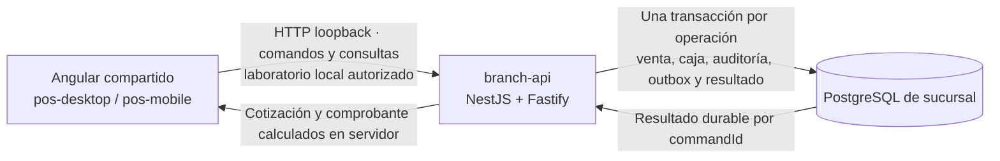

# F01 · Operación incremental de sucursal

El código integrado en `main` conecta Angular, `branch-api` y PostgreSQL real. El incremento para Chile incorpora usuarios y permisos propios del POS, provisión persistente de puestos, HTTPS y administración de accesos. Conserva un laboratorio segregado para validar la venta completa con datos sintéticos. El perfil operativo no habilita cobros, precios no verificados ni emisión fiscal.

La evidencia del código se fija en POS Docs mediante la revisión del producto indicada en la [guía del repositorio](product-repository.md). El [issue de la fase F01](https://github.com/developer-implementos/pos-platform/issues/4) reúne sus entregables: [F01-04](https://github.com/developer-implementos/pos-platform/issues/13) cubre el recorrido integrado y la recuperación visible, [F01-06](https://github.com/developer-implementos/pos-platform/issues/15) la persistencia y [F01-13](https://github.com/developer-implementos/pos-platform/issues/22) la estructura compartida y sus fronteras. Los checks y decisiones se registran en esos issues y sus PR. Esta página no sustituye las fichas F01 ni declara la fase aceptada.

## Incremento operativo integrado

El perfil `operational` de `branch-api` utiliza una base de sucursal aprovisionada con identidades y configuración explícitas. No instala usuarios de demostración ni semillas comerciales. Permite crear y deshabilitar operadores, administrar roles y asignaciones, cambiar contraseñas y revocar sesiones. El servidor controla permisos otorgables, ámbito, versiones y conservación del último administrador. La identidad propia POS es la decisión inicial de Chile; no depende de disponer de un proveedor corporativo de login.

Los puestos se aprovisionan con identidad de caja e instalación. El cliente selecciona un puesto autorizado, no inventa UUID ni utiliza un rol por defecto. Las capacidades efectivas mantienen deshabilitados caja/efectivo y precios sin fuente validada. La captura operativa se limita al presupuesto local, sin transformarlo en venta cobrable.

`erp-worker` incorpora una CLI separada de consultas HTTPS a Mountain para buscar referencias de productos y clientes. Es un adaptador de lectura real con configuración externa, token técnico propio, rutas permitidas y validación de respuesta; **todavía no alimenta el espejo de sucursal ni la UI**. Las pruebas HTTPS locales no acreditan conectividad con la empresa. La ejecución corporativa espera origen aprobado, VPN/DNS/TLS y cuenta restringida; el precio mínimo del resultado no se interpreta como precio de venta.

El código de este incremento está integrado en `main` en la [revisión 2bca6df](https://github.com/developer-implementos/pos-platform/commit/2bca6dff9150a54dcbeb7c72e8744211790af677). La aceptación de los entregables F01 sigue pendiente y se registra por separado; integrar código no habilita una caja productiva.

La [guía de puesta en marcha](../tools/database/README.operational.md) detalla infraestructura, certificados, provisión y registro de puestos. La [matriz del incremento](../delivery/reviews/F01-operational-increment.md) enlaza las pruebas y los pendientes de aceptación. El recorrido automatizado `npm run test:e2e:operational` usa cliente, API HTTPS y PostgreSQL reales con identidades efímeras de prueba: administra un usuario, concede acceso, lo revoca y lo reactiva. No utiliza mocks HTTP ni consulta servicios corporativos.

## Recorrido del laboratorio transaccional



| Paso | Comportamiento verificable |
| --- | --- |
| Acceso | Sesión de operador con caja e instalación; token sólo en memoria, expiración y revocación |
| Configuración | Versión efectiva con procedencia por nivel; permisos y capacidades separados |
| Apertura | Fondo y moneda validados por servidor; un turno vigente por caja; reintento conserva identidad |
| Catálogo | Búsqueda paginada, resolución de códigos y unidades; stock informativo con origen y fecha |
| Cliente | Consulta de maestro y solicitud de alta/actualización; estados pendiente, aprobado, rechazado o conflicto |
| Cesta | Creación, edición con versión esperada, pausa, reapertura y cancelación confirmada por servidor |
| Presupuesto local | Cesta conservada y cotizable; no admite confirmación en efectivo ni reserva stock |
| Documento previsto | Recibo o factura de laboratorio; el perfil valida identidad y domicilio requeridos sin emitir fiscalmente |
| Cotización | Importes decimales, impuestos, promociones, reglas aplicadas/rechazadas y versiones de configuración/política |
| Descuento manual | Credenciales de un segundo supervisor; autorización ligada a cesta, versión, límite y vencimiento |
| Confirmación | Venta, efectivo, movimiento, auditoría, outbox y resultado durable en la misma transacción |
| Recuperación | Consulta por el mismo `commandId`; respuesta perdida y solicitud no recibida siguen caminos explícitos |
| Comprobante | Detalle histórico de productos, cliente, operador, reglas e importes guardados al confirmar |

Cambiar cliente, líneas, documento o reglas invalida la cotización. Una cesta fija la versión de configuración con la que nació: una versión incompatible exige resolver el conflicto, no recalcular silenciosamente. Un cliente solicitado no se convierte automáticamente en maestro aprobado; se consulta el estado y luego se recupera el maestro autorizado.

## Perfiles del cliente

El cliente selecciona una composición explícita:

- `demo`: adaptadores sintéticos del prototipo.
- `branch-lab`: gateway HTTP, sesión y stores de operación contra una URL exacta de `branch-api`.
- `branch`: operación contra el perfil `operational`, con login propio POS, administración y capacidades efectivas del servidor.
- `unconfigured`: estado inicial sin conexión; bloquea login hasta configurar un puesto.

No hay fallback desde un fallo de API a la demostración. Un perfil inválido bloquea el arranque. La URL exige HTTPS salvo loopback local, incluye `/api/v1` y no admite credenciales, query, fragmentos o comodines. CORS de la API y CSP del cliente deben permitir únicamente los orígenes configurados.

La UI conserva el diseño Angular/PrimeNG. Presenta los importes enviados por el servidor; no usa el store mock como autoridad comercial. Los binarios Tauri/Capacitor y la homologación de dispositivos requieren sus pruebas nativas; pasar Playwright en navegador no acredita esas capacidades.

El paquete nativo fija un origen HTTPS permitido mediante su configuración de despliegue. La configuración pública del puesto contiene `mode: branch`, `apiBaseUrl`, `registerId` e `installationId`; no contiene contraseñas ni tokens. Debe coincidir con el origen aprobado del paquete. CSP y la configuración Tauri se generan para ese origen exacto, sin comodines ni proxy que evite la validación TLS.

El laboratorio HTTP permanece en loopback. El perfil operativo requiere TLS explícito, CORS limitado y confianza en el certificado del servidor. Las pruebas de navegador y compilación no acreditan distribución firmada, instalación en terminales, certificados desplegados ni validación de dispositivos.

## Ejecutar las comprobaciones del laboratorio

Utiliza un checkout de la revisión de POS Platform identificada en la [guía del repositorio](product-repository.md), no una versión distinta de `main` por defecto. Publicar esta guía o un resultado de CI no implica que el código ya se haya integrado en esa rama. Se requiere Node compatible con su `engines`, npm 11.6.0 y PostgreSQL 18.6 aislado en loopback. Las URLs administrativas y credenciales se suministran al proceso por un medio local protegido; no se publican ni se copian a ejemplos versionados.

```sh
npm ci
npm run test:e2e:branch
```

El runner recibe `POS_TEST_ADMIN_URL` para un servidor de pruebas aislado. Crea bases y roles sintéticos, construye artefactos, ejecuta migración, seed y comprobación con credenciales separadas, inicia API y cliente, ejecuta Playwright y limpia sus recursos. El seed crea operador y supervisor independientes; sus contraseñas se generan para la ejecución. No apunta a una base de sucursal existente.

Las pruebas de navegador recorren la API y PostgreSQL reales: pérdida de respuesta después del commit, interrupción antes de enviar con reintento idéntico, y descuento autorizado por una segunda persona. Verifican además la consulta del comprobante persistido. Las trazas de Playwright están deshabilitadas en esta suite para no capturar bearer o contraseñas de laboratorio.

El laboratorio incluye un aprovisionador de pruebas y semillas sintéticas. La provisión operativa usa un documento explícito de sucursal/puestos y credenciales externas, separado de las semillas; no convierte una base con datos de laboratorio en una instalación comercial. El CLI de base ejecuta migraciones y comprobaciones con credenciales separadas del runtime. El README del producto conserva los comandos exactos y la configuración del artefacto; esta guía concentra el recorrido y sus límites.

## Resolver un resultado incierto

Antes de enviar una confirmación, el cliente conserva una referencia y la solicitud mínima exacta. Si no puede guardarla, no envía la operación. No conserva tokens, contraseñas ni una copia completa del cliente en ese registro.

| Resultado observado | Acción disponible |
| --- | --- |
| `completed` | Mostrar el resultado y consultar el comprobante de laboratorio |
| `rejected` durable | Mostrar el motivo, liberar el pendiente y revisar la cesta antes de cotizar de nuevo |
| Timeout, desconexión o error temporal | Conservar el ID; consultar el resultado sin generar otra venta |
| `COMMAND_NOT_FOUND` al consultar | Ofrecer reenvío explícito del mismo ID y contenido; no inventar otro comando |
| Permiso o sesión vencida | Recuperar acceso al mismo ámbito antes de resolver la operación |

No se borra un pendiente por un 404 o 403 transitorio. Sólo un resultado terminal durable permite resolverlo. El [ADR-19](decisions/postgresql-unit-of-work.md) explica atomicidad, identidad del comando y commit incierto.

## Límites de F01

`country-api` dispone de base técnica y comprobación PostgreSQL por ámbito; no recibe ventas ni ejecuta consolidación comercial. `branch-sync-worker` no sincroniza y `erp-worker` no procesa trabajos ERP. Su CLI de lectura acotada es independiente de ese circuito; no acredita jobs BullMQ, publicación ni aplicación de maestros. Un evento en outbox no implica entrega al país o al ERP.

Tampoco se ejecutan pagos con tarjeta, emisión fiscal, hardware, cierre de caja completo, devoluciones ni conciliación externa. Sus capacidades se mantienen deshabilitadas hasta las fases correspondientes. El presupuesto y la factura de laboratorio no tienen validez fiscal. El enrolamiento y la rotación de identidades de servicio, las integraciones externas y las homologaciones conservan sus criterios de seguridad y operación.

Para cotizar desde fuentes chilenas deben confirmarse moneda, naturaleza neta/bruta del precio, impuestos, unidades, redondeos, contexto de vendedor/sucursal, vigencia y tratamiento de precio ausente. La fuente legacy puede devolver un importe sustituto ante ausencia de precio: un número positivo no acredita un precio cobrable. No se completa el cálculo con ceros, IVA supuesto o datos sintéticos cuando falla una consulta real.

La estructura y el contrato técnico se describen en [monorepo](monorepo.md) y [API](api.md). El [roadmap](roadmap.md) define el alcance de las siguientes fases; la existencia de archivos, endpoints o pruebas no equivale por sí sola a un porcentaje aceptado.
