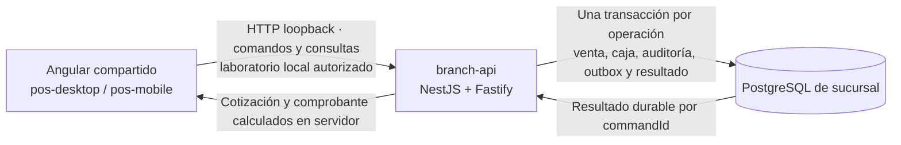

# F01 · Operación de sucursal en laboratorio

La implementación en revisión conecta el frontend Angular de `pos-desktop` y `pos-mobile` con `branch-api` y PostgreSQL real. Permite validar acceso, configuración, apertura de turno, catálogo, clientes, cestas, cotización y confirmación en efectivo con datos sintéticos. No habilita operación comercial real: el perfil de identidad es de laboratorio y el arranque productivo de esta composición está cerrado.

La evidencia del código se fija en POS Docs mediante la revisión del producto indicada en la [guía del repositorio](product-repository.md). El [issue de la fase F01](https://github.com/developer-implementos/pos-platform/issues/4) reúne sus entregables; [F01-06](https://github.com/developer-implementos/pos-platform/issues/15) cubre la persistencia y [F01-13](https://github.com/developer-implementos/pos-platform/issues/22) reúne las pruebas de aceptación. Los checks y decisiones se registran en esos issues y sus PR. Esta página no sustituye las fichas F01 ni declara la fase aceptada.

## Recorrido disponible



| Paso | Comportamiento verificable |
| --- | --- |
| Acceso | Sesión de operador con caja e instalación; token sólo en memoria, expiración y revocación |
| Configuración | Versión efectiva con procedencia por nivel; permisos y capacidades separados |
| Apertura | Fondo y moneda validados por servidor; un turno vigente por caja; reintento conserva identidad |
| Catálogo | Búsqueda paginada, resolución de códigos y unidades; stock informativo con origen y fecha |
| Cliente | Consulta de maestro y solicitud de alta/actualización; estados pendiente, aprobado, rechazado o conflicto |
| Cesta | Creación, edición con versión esperada, pausa, reapertura y cancelación confirmada por servidor |
| Presupuesto local | Cesta conservada y cotizable; no admite confirmación en efectivo ni reserva stock |
| Documento previsto | Recibo o factura de laboratorio; el perfil valida identidad y domicilio requeridos sin emitir fiscalmente |
| Cotización | Importes decimales, impuestos, promociones, reglas aplicadas/rechazadas y versiones de configuración/política |
| Descuento manual | Credenciales de un segundo supervisor; autorización ligada a cesta, versión, límite y vencimiento |
| Confirmación | Venta, efectivo, movimiento, auditoría, outbox y resultado durable en la misma transacción |
| Recuperación | Consulta por el mismo `commandId`; respuesta perdida y solicitud no recibida siguen caminos explícitos |
| Comprobante | Detalle histórico de productos, cliente, operador, reglas e importes guardados al confirmar |

Cambiar cliente, líneas, documento o reglas invalida la cotización. Una cesta fija la versión de configuración con la que nació: una versión incompatible exige resolver el conflicto, no recalcular silenciosamente. Un cliente solicitado no se convierte automáticamente en maestro aprobado; se consulta el estado y luego se recupera el maestro autorizado.

## Perfiles del cliente

`client-profile.json` selecciona una composición explícita:

- `demo`: adaptadores sintéticos del prototipo.
- `branch-lab`: gateway HTTP, sesión y stores de operación contra una URL exacta de `branch-api`.

No hay fallback desde un fallo de API a la demostración. Un perfil inválido bloquea el arranque. La URL exige HTTPS salvo loopback local, incluye `/api/v1` y no admite credenciales, query, fragmentos o comodines. CORS de la API y CSP del cliente deben permitir únicamente los orígenes configurados.

La UI conserva el diseño Angular/PrimeNG. Presenta los importes enviados por el servidor; no usa el store mock como autoridad comercial. Los binarios Tauri/Capacitor y la homologación de dispositivos requieren sus pruebas nativas; pasar Playwright en navegador no acredita esas capacidades.

La API F01 sólo escucha en una dirección literal de loopback (`127.0.0.1` o `::1`). El despliegue HTTPS LAN pertenece al perfil futuro de sucursal y requiere terminación TLS, identidad y controles de operación aprobados; no se acredita con este laboratorio.

## Ejecutar las comprobaciones del laboratorio

Desde el checkout de POS Platform se utiliza Node compatible con su `engines`, npm 11.6.0 y PostgreSQL 18.6 aislado en loopback. Las URLs administrativas y credenciales se suministran al proceso por un medio local protegido; no se publican ni se copian a ejemplos versionados.

```sh
npm ci
npm run test:e2e:branch
```

El runner recibe `POS_TEST_ADMIN_URL` para un servidor de pruebas aislado. Crea bases y roles sintéticos, construye artefactos, ejecuta migración, seed y comprobación con credenciales separadas, inicia API y cliente, ejecuta Playwright y limpia sus recursos. El seed crea operador y supervisor independientes; sus contraseñas se generan para la ejecución. No apunta a una base de sucursal existente.

Las pruebas de navegador recorren la API y PostgreSQL reales: pérdida de respuesta después del commit, interrupción antes de enviar con reintento idéntico, y descuento autorizado por una segunda persona. Verifican además la consulta del comprobante persistido. Las trazas de Playwright están deshabilitadas en esta suite para no capturar bearer o contraseñas de laboratorio.

Para una sesión manual, la composición incluye un aprovisionador local y el CLI de base `database.js` con `migrate`, `seed`, `check` y limpieza de registros de seguridad. El README del producto conserva los comandos exactos y la configuración del artefacto; esta guía concentra el recorrido y sus límites, evitando un segundo procedimiento de despliegue.

## Resolver un resultado incierto

Antes de enviar una confirmación, el cliente conserva una referencia y la solicitud mínima exacta. Si no puede guardarla, no envía la operación. No conserva tokens, contraseñas ni una copia completa del cliente en ese registro.

| Resultado observado | Acción disponible |
| --- | --- |
| `completed` | Mostrar el resultado y consultar el comprobante de laboratorio |
| `rejected` durable | Mostrar el motivo, liberar el pendiente y revisar la cesta antes de cotizar de nuevo |
| Timeout, desconexión o error temporal | Conservar el ID; consultar el resultado sin generar otra venta |
| `COMMAND_NOT_FOUND` al consultar | Ofrecer reenvío explícito del mismo ID y contenido; no inventar otro comando |
| Permiso o sesión vencida | Recuperar acceso al mismo ámbito antes de resolver la operación |

No se borra un pendiente por un 404 o 403 transitorio. Sólo un resultado terminal durable permite resolverlo. El [ADR-19](decisions/postgresql-unit-of-work.md) explica atomicidad, identidad del comando y commit incierto.

## Límites de F01

`country-api` dispone de base técnica y comprobación PostgreSQL por ámbito; no recibe ventas ni ejecuta consolidación comercial. `branch-sync-worker` y `erp-worker` siguen sin trabajos operativos. Un evento en outbox no implica entrega al país o al ERP.

Tampoco se ejecutan pagos con tarjeta, emisión fiscal, hardware, cierre de caja completo, devoluciones ni conciliación externa. Sus capacidades se mantienen deshabilitadas hasta las fases correspondientes. El presupuesto y la factura de laboratorio no tienen validez fiscal. La autenticación corporativa, enrolamiento y homologaciones conservan sus gates de seguridad y operación.

La estructura y el contrato técnico se describen en [monorepo](monorepo.md) y [API](api.md). El [roadmap](roadmap.md) define el alcance de las siguientes fases; la existencia de archivos, endpoints o pruebas no equivale por sí sola a un porcentaje aceptado.
