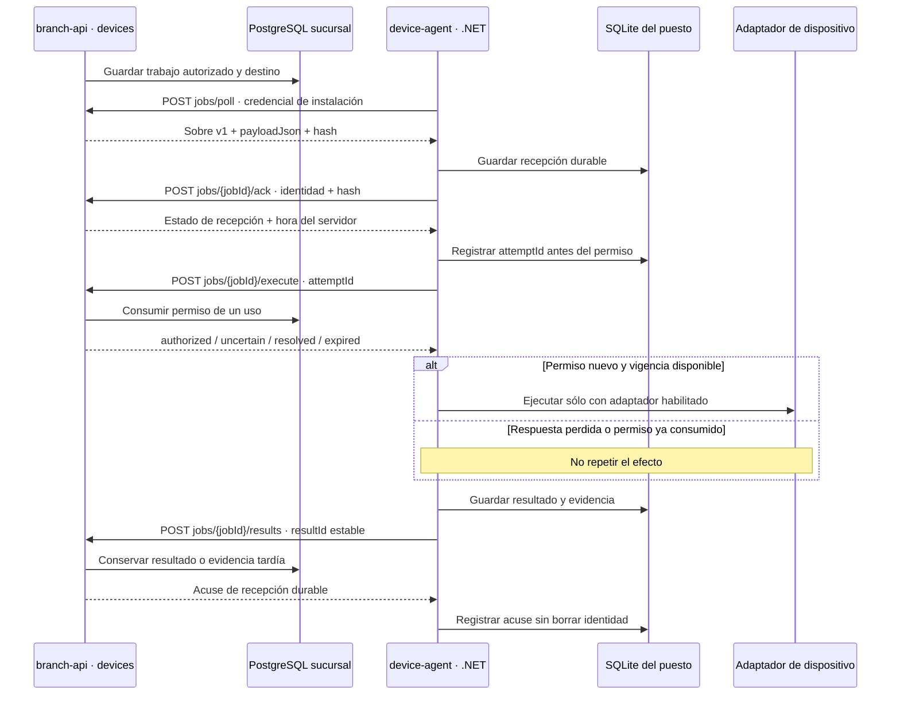

# F02 · Cobros, documentos y dispositivos

**Implementación parcial en revisión.** F02 incorpora persistencia y contratos de pagos, fiscalidad y dispositivos en `branch-api`, y el host nativo `apps/device-agent`. Las pruebas usan PostgreSQL, SQLite y HTTPS reales con datos aislados. Los adaptadores de pago y facturación son exclusivos de pruebas, sin conexión a proveedores; el host publicado no incluye un driver físico habilitado. Este corte no habilita cobros con tarjeta, emisión fiscal ni impresión operativa.

El código de este corte está en la [revisión `2a651af` de POS Platform](https://github.com/developer-implementos/pos-platform/tree/2a651af9b15ffba0ae1f983e55cb4f71f4c722ca), rama `codex/f02-cobro-documento`; esta referencia no afirma integración en `main`. La [matriz técnica de F02](https://github.com/developer-implementos/pos-platform/blob/2a651af9b15ffba0ae1f983e55cb4f71f4c722ca/delivery/reviews/F02-verification.md) conserva las comprobaciones observadas y las pendientes del corte. El avance del portal se calcula con entregables técnicamente verificados y evidencia de una revisión identificada, también cuando esa revisión está en una PR. La integración en `main` y la aceptación humana se informan por separado.

La revisión fijada incorpora el seguimiento conectado, la búsqueda y descarga protegida del original fiscal y el cobro combinado. La [PR #91](https://github.com/developer-implementos/pos-platform/pull/91) reúne las comprobaciones de integración y sus resultados por revisión. Publicar esta guía no acredita por sí solo una ejecución aprobada de CI, el guardado físico de archivos desde una WebView nativa ni la integración del producto.

**Cobro combinado en revisión:** efectivo y transferencia manual, activación explícita de puestos, bandeja de verificación y recuperación del plan. Backend, frontera HTTP y pruebas focales del cliente aprobaron sus comprobaciones. El recorrido E2E con dos operadores también aprobó; su revisión y límites se identifican en la evidencia al final de esta guía.

El [roadmap F02](/guide/roadmap/phase-02/) conserva los catorce entregables y sus criterios. La implementación de un contrato, una prueba o un binario no completa por sí sola toda la fase. La revisión técnica y el avance se registran en POS Platform; la publicación de esta guía no implica aceptación humana.

## Aplicaciones y autoridad

| Pieza | Implementación del corte | Límite |
| --- | --- | --- |
| `branch-api` · `payments` | Intenciones e intentos durables, destino fijo, consulta y compensación separada. El incremento añade plan, asignaciones y verificación manual de transferencias en PostgreSQL | Sin adaptador Transbank operativo; no interpreta una respuesta desconocida como rechazo seguro ni una declaración como dinero confirmado |
| `branch-api` · `fiscal` | Solicitud y fuente inmutable, identidad autorizada, intento de envío, consulta y estados diferenciados | Sin emisor/material fiscal habilitado ni adaptador Acepta/Ingydev operativo; no genera folios ficticios |
| `branch-api` · `devices` | Inscripción y asignación por puesto, trabajos, recepción, permiso de ejecución de un uso y resultados durables | No ejecuta drivers Windows ni convierte un recibo local en documento fiscal |
| `device-agent` | Host C#/.NET independiente del cliente, HTTPS saliente y registro SQLite por instalación | Publicación Windows x64 comprobada; driver runtime no disponible. Instalación como servicio, firma, cuenta y hardware requieren su evidencia |
| `pos-desktop` / `pos-mobile` | Perfiles conectados, seguimiento paginado y detalle. El incremento añade interfaz de efectivo/transferencia y recuperación de comandos | No habilita tarjeta, no completa resolución de excepciones ni acredita entrega nativa de documentos |

`country-api`, los workers, BullMQ y Redis no intervienen en el recorrido local del host. La coordinación del puesto usa HTTPS y persistencia en sucursal; no necesita una cola Redis en el PC. La [decisión de dispositivos](decisions/device-agent.md) fija la ubicación por puesto y la evolución de dispositivos de red en F06.

## Qué conserva cada contexto

**Pagos:** el backend inmoviliza la cesta y la cotización vinculadas al intento, conserva el destino y excluye operaciones incompatibles sobre el mismo terminal. Guarda el intento antes de llamar al proveedor. Una respuesta perdida exige consultar o conciliar el intento original; no permite cobrar con otra clave para salir de la incertidumbre. Si llega evidencia contradictoria después de liberar un rechazo, la cuarentena se conserva tanto para el terminal como para la cesta: liberar el intento anterior no vuelve seguro otro cobro o la confirmación en efectivo. Si la venta ya se confirmó antes de conocer el conflicto, conserva su evidencia; no la borra ni deshace un movimiento externo por cambiar el estado local. La compensación tiene su propia intención, importe reservado, destino e intento. El plan combinado coordina las asignaciones sin habilitar una reversa operativa con un adquirente ausente.

**Fiscalidad:** la solicitud conserva una fuente comercial inmutable y la identidad fiscal autorizada. Los estados del proveedor y de la autoridad tributaria se distinguen. Consultar no vuelve a emitir; la ausencia o vencimiento de identidad impide el envío. Las restricciones locales de unicidad no acreditan numeración legal global ni sustituyen el material fiscal o las reglas del país. La composición actual no habilita un numerador ni un proveedor productivo.

**Dispositivos:** PostgreSQL es la autoridad de asignación, trabajo y permiso de ejecución. SQLite conserva recepción, intento y evidencia pendiente en el puesto. No contiene ventas ni un espejo comercial y no se usa como archivo de logs. Los logs diagnósticos del servicio son separados y no incluyen credenciales o payloads completos.

## Cobro combinado y transferencia manual

La recomendación adoptada permite avanzar con reglas explícitas del primer perfil: **una moneda por plan, importes exactos, vuelto sólo de efectivo y verificación manual autorizada de transferencias**. Implementar y probar esas reglas no queda condicionado a un documento formal de Finanzas. La habilitación de cuentas, permisos y puestos para operar dinero real sigue siendo una decisión de despliegue identificada.

El plan guarda una versión de la cesta, su cotización, configuración y turno. Mientras está abierto, la cesta no se edita, recotiza ni confirma por otra ruta de cobro. Cada asignación distingue importe aplicado, recibido y vuelto. Una transferencia declarada reserva saldo, pero no cuenta como confirmada; una tarjeta incierta tampoco deja ese saldo libre para cobrarlo con otro medio.

Por ejemplo, para un total de **1.190 CLP**, pueden aplicarse **400 CLP en efectivo** y **790 CLP por transferencia verificada**. Si el cajero recibe 500 CLP, el vuelto es 100 CLP y la caja registra 400 CLP. La suma aplicada debe coincidir exactamente con el total; la API no redondea una diferencia para completar el pago. Si todo se paga por transferencia, no se crea un pago ni movimiento ficticio de efectivo.

Confirmar el plan escribe en una sola transacción la venta, sus asignaciones, caja, auditoría y outbox. Los contextos conservan sus datos y se coordinan mediante puertos públicos. El recibo muestra las asignaciones; `SaleConfirmed` v2 las identifica para sincronización, manteniendo lectores compatibles con el evento v1. La venta sigue siendo un comprobante local: pagar no emite automáticamente un documento fiscal ni registra el ERP.

### Quién verifica una transferencia

La cuenta receptora se provisiona fuera del runtime. El cajero elige una cuenta autorizada y registra referencia, importe y moneda; no introduce libremente otra cuenta como destino. El estado inicial es `declared`. Un operador con permiso específico compara los datos observados y confirma o rechaza con motivo. Por defecto debe ser **otro operador**; la cuenta puede admitir el mismo operador sólo por configuración propietaria explícita.

`manually-confirmed` acredita la decisión manual auditada del POS, no una respuesta bancaria. `reconciled` registra la conciliación posterior y no aplica el dinero por segunda vez. Un verificador ausente o una declaración pendiente no se transforman en aprobación por timeout. Las discrepancias conservan lo observado; no se reemplazan por los valores esperados para fabricar una coincidencia.

La referencia normalizada no puede usarse de nuevo en otra venta dentro de la sucursal. La cuenta y su namespace tienen alcance **`branch-exclusive`**: se asignan exclusivamente a esa base de sucursal. Esta garantía no es deduplicación corporativa entre bases desconectadas; no se habilitan cuentas compartidas entre sucursales sin una autoridad común que controle las aplicaciones. La base tampoco identifica por sí sola dos alias bancarios que representan una misma cuenta.

La evidencia estructurada conserva cuenta, referencia, importe, operador, decisión y motivo. El backend incorpora una bandeja de declaraciones por verificar y confirmaciones manuales por conciliar, accesible con el permiso específico aunque el verificador no pueda registrar pagos. Mantiene sucursal, puesto e instalación y paginación vinculada al estado; no restringe la revisión al creador del pago.

La migración 239 conserva un PDF opcional privado de hasta **512 KiB**, con hash y metadatos inmutables en PostgreSQL. Sólo el registrador autorizado puede adjuntarlo; un lector, verificador o conciliador habilitado del ámbito puede consultarlo. El permiso de registrar no concede por sí solo descarga. Un reenvío conserva ID y contenido; adjuntar no confirma ni vuelve a aplicar el pago. Se comprobaron acceso, límites, integridad, inmutabilidad y bytes/cabeceras de descarga mediante PostgreSQL y HTTP; también las reglas del cliente. El archivo se descarga como adjunto y permanece `not-scanned`: no demuestra liquidación ni se presenta la validación de formato como análisis antimalware.

### Recuperación y devolución de efectivo

El cliente conserva el comando pendiente con su ID y payload, separados del token de sesión. Ante respuesta perdida recupera o reenvía explícitamente **el mismo comando**; no genera otra identidad para intentar cobrar de nuevo. La API comprueba permiso y asignación vigentes dentro de la transacción, incluso al recuperar un recibo. Cambiar de sesión limpia los datos visibles sin borrar la identidad del pendiente.

Preparar un plan o añadir dinero exige las capacidades habilitadas. Finalizar fondos ya admitidos, consultar o devolver efectivo no depende de volver a habilitar una capacidad para admitir fondos nuevos; conserva sus permisos y validaciones. Tampoco se recalcula silenciosamente una cotización congelada después de recibir el pago. Si no puede completarse, se mantiene un estado recuperable y la compensación conserva su propio contrato.

Cancelar un aporte de efectivo exige confirmar que se devolvió **todo lo recibido** y registrar el motivo. La devolución queda como evidencia inmutable. Un plan no se cancela para ocultar fondos externos confirmados, declaraciones pendientes o resultados inciertos. La interfaz de este incremento permite efectivo y transferencia; tarjeta continúa deshabilitada hasta contar con su adaptador operativo.

### Activación del puesto

La provisión operativa mantiene sus cuatro capacidades iniciales: `catalog.read`, `customer.read`, `draft.write` y `pricing.quote`. Migrar el esquema no concede por sí solo permisos de cobro. El propietario de despliegue utiliza el CLI separado de la API:

```text
node dist/apps/branch-api/database.js activate-checkout --file "<ruta absoluta del JSON>"
node dist/apps/branch-api/database.js provision-transfer-receiver --file "<ruta absoluta del JSON>"
```

El documento de activación declara `activationId`, `branchId`, `approvedBy`, permisos explícitos para el rol administrador y los puestos afectados. Cada puesto incluye `expectedConfigurationVersion`, capacidades y **todas** sus instalaciones activas con ID, época y capacidades del cliente. El servidor aplica control de versión, comprueba el administrador habilitado, publica una revisión inmutable y revoca las sesiones afectadas. Los roles ordinarios no reciben permisos adicionales por activar el puesto.

Las capacidades adicionales soportadas son `shift.open`, `sale.cash`, `payment.plan` y `payment.transfer.manual`, con sus dependencias. Activarlas no crea maestros ni precios. Los puertos de consulta de catálogo/precios verifican una publicación comercial completa y coherente en el ámbito, moneda y versión requeridos; una fuente ausente conserva `SOURCE_UNAVAILABLE`. El conector legacy y su importación autorizada mantienen su alcance pendiente; las semillas de las pruebas no se cargan en una sucursal operativa.

La cuenta declara `receiverAccountId`, `accountRef`, `bankRef`, `currency`, `scale`, `referenceNamespace` y `referenceScope: "branch-exclusive"`. La provisión exige `exclusiveBranchAcknowledged: true` y usa `requiresIndependentVerifier: true` por defecto. Los JSON se entregan desde archivos externos, sin secretos bancarios en el repositorio; el proceso HTTP no recibe la credencial SQL propietaria.

Las migraciones 235–238 añaden planes/asignaciones, evidencia de transferencia, snapshot congelado de ventas y registro de activación. Conservar respaldos, historial y recibos al actualizar. Ante un fallo se detienen nuevas admisiones y se recuperan los pendientes; no se borran evidencias para volver a cobrar. Un binario anterior que no entiende ventas y eventos v2 no es una reversión compatible después de escribirlos.

## Seguimiento conectado

La ruta `/operations` presenta tres listados independientes: **Pagos**, **Documentos fiscales** y **Dispositivos**. El operador puede filtrar por estado, recorrer páginas y abrir un detalle. El incremento añade la bandeja de revisión de transferencias descrita arriba, con acciones explícitas y permisos propios. La pantalla consulta datos persistidos mediante la API de sucursal; no activa una demo si la consulta falla. Las secciones disponibles dependen de los permisos de la sesión, que la API vuelve a exigir.

| Sección | Consulta y permiso | Ámbito de lectura |
| --- | --- | --- |
| Pagos | `GET /api/v1/payment-intents`, filtro `state`, permiso `payment.read` | Sucursal, puesto e instalación del cliente de la sesión |
| Documentos fiscales | `GET /api/v1/fiscal/documents`, filtros de fecha, cliente, folio, tipo y `status`; permiso `fiscal.read` | Sucursal, entidad legal y país de la sesión; conserva el alcance de la consulta por ID |
| Dispositivos | `GET /api/v1/device-jobs`, filtro `state`, permiso `device.read` | Sucursal, puesto e instalación del cliente de la sesión; no se confunde con la instalación del host |

Los listados admiten hasta 50 registros por página. Ordenan por fecha de creación e identificador descendentes y conservan la precisión temporal de PostgreSQL; el cursor está vinculado al ámbito y al filtro. El detalle usa la consulta autorizada del mismo contexto. Ninguna de estas lecturas invoca al proveedor, concede permisos al host ni ejecuta cobros, emisiones, compensaciones o reimpresiones.

El seguimiento permite conocer el estado persistido, con estos límites:

- **Pago:** el importe mostrado pertenece a la intención original. No representa un saldo neto después de devoluciones ni resume todas las compensaciones. Resolverlas requiere su evidencia y su flujo propio.
- **Documento fiscal:** el estado aceptado o rechazado puede coexistir con evidencia contradictoria posterior. El listado no expone todavía ese historial completo ni acredita que no existan incidentes. Los metadatos y la disponibilidad del PDF original son datos separados; la descarga exige contenido conservado y autorización adicional.
- **Dispositivo:** `spooled` acredita recepción por el spooler, no salida física del papel. Consultar un resultado incierto no vuelve a ejecutar el trabajo.

Este incremento aporta parte de **F02-04** y **F02-12**. Quedan por implementar la vista de excepciones por operación, historial, responsables y acciones permitidas de resolución. La búsqueda y descarga fiscal amplían el software disponible; no acreditan por sí solas un proveedor fiscal operativo ni el guardado del archivo desde las WebView nativas.

### Búsqueda y original fiscal protegido

La consulta fiscal combina un intervalo de **fecha de registro UTC**, cliente del snapshot, folio exacto, tipo exacto y estado. `createdFrom` incluye el instante inicial; `createdBefore` excluye el final. El cliente aplica o limpia los filtros explícitamente y reinicia la paginación. La fecha no se presenta como fecha legal de emisión. La búsqueda de cliente usa nombre o identificador del snapshot inmutable, sin consultar maestros ni completar artificialmente documentos históricos que no guardaban esos datos.

El detalle consulta `GET /api/v1/fiscal/documents/:documentId/representation` con permiso `document.read`. Devuelve hash, MIME, tamaño, versión y `available`. Un documento pendiente o rechazado no permite descargar; una referencia sin bytes conservados informa `available: false`. No se fabrica un PDF vacío para suplir el original.

Cuando existe, `GET /api/v1/fiscal/documents/:documentId/representation/content` entrega el **PDF original** tras volver a comprobar el ámbito y el permiso. Los bytes viven en PostgreSQL, en `fiscal.representation_content.content` (`bytea`), con un máximo de **10 MiB** por original. La migración aditiva `234_fiscal_original_content` impide sustituir o borrar el contenido y comprueba que documento aceptado, referencia, MIME, tamaño y SHA-256 coincidan. Los listados no cargan los bytes. Esta solución usa el respaldo de PostgreSQL para el volumen inicial; la retención regulatoria y su capacidad operativa se validan con el perfil de F05.

La incorporación se realiza mediante el adaptador fiscal autorizado, después de persistir evidencia aceptada. La lectura del proveedor ocurre fuera de la transacción, con plazo, cancelación y límite de bytes; luego se guarda el original validado. Un fallo de archivo no revierte la aceptación fiscal ni provoca otra emisión. La recuperación interna `captureRepresentation` puede conservar ese mismo original después de una interrupción, pero no tiene endpoint público ni un planificador automático. Los GET de metadatos y descarga sólo leen PostgreSQL, incluso después de reiniciar la aplicación.

El servidor valida firma y terminador PDF, tamaño y hash sin modificar el original; no se presenta como análisis antimalware. Lo entrega como `attachment`, con nombre derivado del identificador, `no-store`, `nosniff` y CSP `sandbox`, sin exponer rutas o URLs del proveedor. El cliente comprueba MIME, tamaño y hash antes de preparar la descarga. Descargar, copiar, enviar y reimprimir son acciones diferentes: ninguna lectura crea otro documento fiscal y el envío externo sigue deshabilitado.

La composición de escritorio selecciona un adaptador que entrega los bytes verificados mediante un `Blob` local y una descarga del navegador integrado, un mecanismo soportado por Windows WebView2. La URL temporal se libera al terminar su ventana de uso o al destruir la vista; no incluye credenciales ni una dirección del proveedor. Iniciar la descarga no acredita que el operador haya guardado el archivo: esa comprobación real dentro de Tauri sigue pendiente.

La composición móvil de Capacitor mantiene la exportación **no disponible**. Puede consultar el estado y los metadatos autorizados, pero bloquea la descarga antes del GET de contenido; no descarga bytes para intentar guardarlos por un mecanismo no habilitado. La ausencia de un adaptador también conserva ese bloqueo. Compartir o guardar desde la plataforma móvil exige su adaptador y comprobación propios. F02-12 no se declara completo sólo por disponer del backend binario.

### Migraciones y acceso a las consultas

Las migraciones aditivas `230_payment_lookup_index`, `231_fiscal_document_lookup` y `232_device_job_lookup` incorporan índices de lectura en sus contextos. No reescriben las migraciones anteriores ni modifican estados financieros, documentos o permisos de ejecución.

`233_operation_read_access` añade `payment.read`, `fiscal.read` y `device.read` al rol protegido `branch-administrator` de sucursales operativas cuando faltan. Incrementa la versión de los roles actualizados y revoca sus sesiones activas: el administrador debe autenticarse nuevamente para obtener los permisos efectivos. Los roles ordinarios conservan sus permisos y sesiones. Esta ampliación de lectura no autoriza comandos de cobro, fiscalidad ni dispositivos.

## Recorrido durable del host

El diagrama describe el recorrido de un adaptador habilitado. El runtime actual detecta que no hay driver, registra un resultado conocido sin efecto y consulta el permiso al entregar esa evidencia; no invoca hardware ni finge recorrer la rama física.



El agente consulta trabajos por HTTPS saliente con espera acotada entre ciclos. No abre un servidor HTTP local ni recibe desde Angular rutas, comandos shell o una dirección de impresora arbitraria. El backend construye el payload del recibo existente y valida el ámbito del operador; el host valida contrato, hash, dispositivo, instalación y época de control. El payload actual resume identificadores e importes de un comprobante local: no es una representación fiscal ni la plantilla completa de impresión de F02-10.

La recepción durable no permite ejecutar indefinidamente. El host vuelve a consultar el acuse al recuperar un trabajo y usa la hora del servidor para calcular el presupuesto restante, descontando el tiempo completo de ida y vuelta con un reloj monotónico. Revalida ese presupuesto después de adquirir la exclusión del dispositivo y antes del efecto.

El permiso de ejecución se consume en PostgreSQL **antes** de responder `authorized`. Sólo esa primera respuesta permite ejecutar. Repetir la petición devuelve incertidumbre o resolución, nunca otro permiso. Así, restaurar una SQLite anterior al intento no autoriza una segunda impresión. Si la respuesta se pierde, el host conserva el resultado conocido o la incertidumbre; no deduce que el permiso quedó libre.

## Contrato v1 y estados

Los esquemas públicos TypeScript están en `libs/backend/devices/contracts`; C# valida el mismo formato mediante fixtures compartidos. Las rutas del host tienen prefijo `/api/v1/device-host/`. El transporte permite sólo el origen HTTPS configurado, sin redirecciones y con validación TLS del sistema. La credencial propia de instalación no se sustituye por la sesión de un operador. La autenticación mutua y la rotación previstas por el contrato objetivo no se atribuyen a este primer transporte.

| Intercambio | Contenido y significado |
| --- | --- |
| Trabajo | `jobId`, sucursal, puesto, instalación controladora, época, dispositivo, capacidad, creación y vencimiento |
| Payload | `payloadJson` y SHA-256 de sus bytes UTF-8 exactos; máximo 16 KiB. Plantilla `sale-receipt.v1`, documento, indicador de copia y hasta 40 líneas de 120 escalares Unicode; no admite caracteres de control |
| Recepción | `received`, `expired` o `resolved`, junto con la hora del servidor. Conserva identidad; no confirma papel ni cobro |
| Permiso | `authorized`, `uncertain`, `resolved` o `expired`, con el intento autoritativo. Una respuesta ambigua no habilita hardware |
| Resultado | `resultId`, `jobId`, `attemptId`, época, hash, estado, motivo, hora observada y evidencia cuando corresponda |

Los UUID se expresan en minúsculas, los hashes en hexadecimal y las fechas UTC con milisegundos. El payload se comprueba sobre sus bytes originales; no se vuelve a serializar para calcular su identidad.

`jobId` identifica el trabajo autorizado; `attemptId`, el intento que puede producir el efecto; `resultId`, una observación durable de ese intento. Reenviar una observación conserva su `resultId`. Cambiar esos identificadores para salir de una espera rompería la recuperación y no está permitido.

| Resultado | Qué acredita |
| --- | --- |
| `failed` | Fallo conocido sin efecto, como driver no disponible, vencimiento o cancelación anterior a la ejecución |
| `uncertain` | No hay evidencia suficiente para resolver el efecto; un reinicio durante el intento conserva este estado |
| `spooled` | El spooler aceptó el trabajo y existe evidencia de esa recepción; no demuestra salida física |
| `succeeded` | El adaptador aporta evidencia del efecto físico exigida por su contrato |

El resultado y su intento permanecen correlacionados. Evidencia tardía más débil del mismo intento se conserva sin hacer retroceder el estado. El acuse del resultado significa recepción durable, no que ese resultado haya reemplazado la evidencia más fuerte. Un intento distinto no puede apropiarse del trabajo. Si el servidor ya resolvió el intento o reconoce otro intento autoritativo, el host conserva su evidencia como superada por la resolución remota, sin fingir un acuse de entrega.

`occurredAt` describe la observación del host; la admisión y las transiciones se deciden con el permiso, el ámbito y el estado durable del servidor. El reloj del puesto no convierte evidencia en autorización ni invalida por sí solo un reporte ya conservado.

## Host, almacenamiento y entrega

El SDK está fijado a **.NET 10.0.403**, con dependencias y lockfiles versionados. El ejecutable publicado para Windows x64 depende del runtime .NET 10. Nx coordina los comandos; no convierte el host en una aplicación NestJS. La configuración pública y el archivo de credencial permanecen fuera del artefacto, en rutas locales protegidas por la cuenta de servicio.

SQLite usa WAL, sincronización `FULL` y transacciones breves. La identidad de la base está vinculada al origen, sucursal, puesto, instalación, época y dispositivos configurados: cambiar ese ámbito no reasigna silenciosamente una base existente. Una exclusión del proceso protege la instancia; la base impide dos intentos en ejecución para el mismo dispositivo. El código no mantiene una transacción SQL abierta mientras espera red o hardware.

Los comandos reproducibles están en POS Platform: `npm run device:restore`, `npm run device:check`, `npm run device:publish` y `npm run device:interop`. La [guía del host](https://github.com/developer-implementos/pos-platform/blob/2a651af9b15ffba0ae1f983e55cb4f71f4c722ca/apps/device-agent/README.md) define configuración y límites. Publicar el binario y validar su configuración no acredita instalación SCM, privilegios de servicio, actualización, firma o recuperación de un driver real.

## Evidencia observada y pendientes

La revisión del corte observa pruebas C# sobre SQLite real, caídas abruptas de procesos, duplicados, respuesta perdida, permiso consumido, presupuesto monotónico y restauración de copias antiguas. Los fixtures comunes incluyen trabajo, resultado, recepción y permiso. La prueba TLS negativa rechaza un certificado no confiable antes de transmitir la credencial.

La interoperabilidad ejecuta el host de pruebas contra **Nest/Fastify con HTTPS y PostgreSQL aislado**, usando los mismos transporte, coordinador y journal del producto. Dos trabajos terminan `failed / DRIVER_UNAVAILABLE`; sus recepciones, permisos, intentos y resultados quedan correlacionados. Un segundo proceso sobre la misma SQLite no produce trabajos ni reportes adicionales. Este resultado demuestra el protocolo entre procesos, no impresión física.

Los criterios técnicos de **F02-09** están cubiertos por ese recorrido y las pruebas de contrato, autorización, vigencia y recuperación. La dependencia de perfiles/destinos se satisface mediante su contrato estable; eso no completa la matriz de proveedores de F02-07. La verificación técnica debe conservar su revisión y evidencia, separada de la aceptación humana. La instalación productiva del servicio, el driver y el hardware pertenecen a sus respectivos entregables.

La ampliación fiscal tiene 33 pruebas focales aprobadas, junto con 39 del frontend, 93 de runtime y 23 de la API integrada. Se comprobaron la actualización de la migración 070 a la 234 y los parámetros binarios con offsets, además del contenido exacto descargado, los permisos y los archivos ausentes o alterados. El primer intento HTTP agotó la espera de disponibilidad bajo carga local; la repetición aislada pasó sin relajar las pruebas ni sus tiempos. La matriz técnica conserva estas evidencias por corte; las nuevas regresiones E2E y los checks alojados se consultan en la PR, sin atribuirles resultados de una revisión anterior.

Para cerrar los entregables restantes se necesitan los adaptadores y contratos operativos, la matriz de modelos/SDK, instalación y cuenta del host, las interfaces de cobro y excepciones, plantillas completas y pruebas de proveedor/hardware. `api-impresion-caja` aporta evidencia de compatibilidad a analizar; sus dependencias .NET Framework, x86 y `System.Drawing.Printing` no se trasladan a un servicio moderno sin validación. El detalle permanece en el [ADR de dispositivos](decisions/device-agent.md) y la [matriz de extensibilidad](extensibilidad-proveedores-dispositivos.md).

El incremento de **F02-05/06** tiene 18 pruebas PostgreSQL de planes/evidencia, 8 de finalización de venta, 4 HTTP integradas y 47 focales del cliente aprobadas. Incluyen la resolución autorizada de transferencias existentes después de deshabilitar nuevas declaraciones. La compatibilidad de la API reúne 141 casos, incluidos los anteriores que pertenecen a esa suite, y la de configuración/dispositivos 11; no se suman ejecuciones solapadas como pruebas diferentes. El recorrido ampliado E2E aprobó **1/1** sobre `dacccc0ee40ab759595494a823ccda7ed43e122f`, con árbol limpio y revisión estable: dos operadores, bytes del PDF, verificación manual, efectivo, recuperación tras recargar, finalización y comprobante. La corrección del exportador aprobó además 5 pruebas focales. Es una prueba de navegador sobre HTTPS y PostgreSQL reales con datos aislados; no acredita guardado nativo en WebView, recepción bancaria ni hardware. Los resultados se atribuyen a sus revisiones comprobadas, sin trasladarlos a una fuente anterior. Los criterios financieros del plan pueden comprobarse con contratos estables y un proveedor exclusivo de pruebas; eso no acredita la tarjeta real de F02-01. Las cuentas compartidas entre sucursales y otros vouchers conservan contratos y validaciones propios. Estos límites no se sustituyen por un bloqueo genérico de Finanzas ni convierten toda la fase en completa.

La guía [F01](phase-1-laboratory.md) sigue describiendo la administración operativa y el laboratorio comercial existentes. F02 los complementa; no activa automáticamente tarjetas, fiscalidad o periféricos por compilar nuevos módulos.
