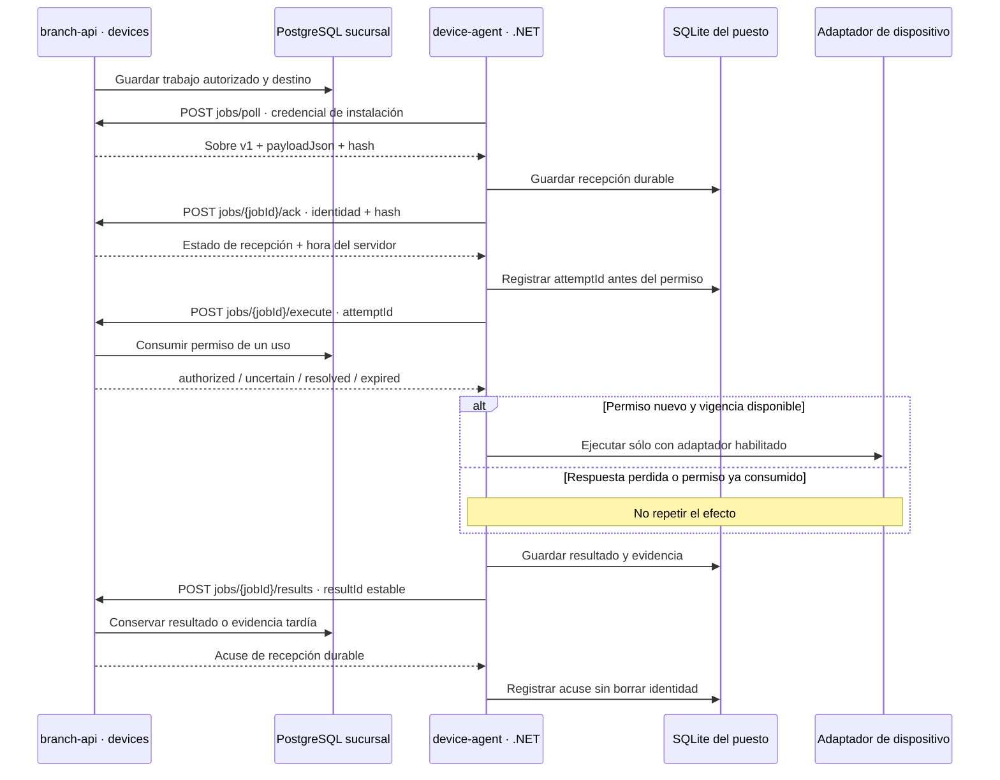

# F02 · Cobros, documentos y dispositivos

**Implementación parcial integrada en `main`.** F02 incorpora persistencia y contratos de pagos, fiscalidad y dispositivos en `branch-api`, y el host nativo `apps/device-agent`. Las pruebas usan PostgreSQL, SQLite y HTTPS reales con datos aislados. Los adaptadores de pago y facturación son exclusivos de pruebas, sin conexión a proveedores; el host publicado no incluye un driver físico habilitado. Este corte no habilita cobros con tarjeta, emisión fiscal ni impresión operativa.

El código de este corte está integrado en `main`, en la [revisión `98f8987` de POS Platform](https://github.com/developer-implementos/pos-platform/tree/98f8987bfa8764ab77f6a55a7686f2ed7884d541). La [matriz técnica de F02](https://github.com/developer-implementos/pos-platform/blob/98f8987bfa8764ab77f6a55a7686f2ed7884d541/delivery/reviews/F02-verification.md) conserva las comprobaciones de la base y sus pendientes; el [informe de F02-13](https://github.com/developer-implementos/pos-platform/blob/98f8987bfa8764ab77f6a55a7686f2ed7884d541/delivery/reviews/F02-13-verification.md) acredita la recuperación comercial incorporada después. El avance se consulta en el [panel del proyecto](/project/), con su revisión de producto identificada. La aceptación humana y la habilitación operativa se informan por separado.

La revisión fijada incorpora el seguimiento conectado, la búsqueda y descarga protegida del original fiscal, el cobro combinado y la recuperación comercial. Las PR enlazadas conservan las comprobaciones y resultados de cada incremento. Publicar esta guía no acredita por sí solo una ejecución aprobada de CI, el guardado físico de archivos desde una WebView nativa ni la habilitación operativa del producto.

**Cobro combinado integrado:** efectivo y transferencia manual, activación explícita de puestos, bandeja de verificación y recuperación del plan. Backend, frontera HTTP y pruebas focales del cliente aprobaron sus comprobaciones. El recorrido E2E con dos operadores también aprobó; su revisión y límites se identifican en la evidencia al final de esta guía.

El [roadmap F02](/guide/roadmap/phase-02/) conserva los catorce entregables y sus criterios. La implementación de un contrato, una prueba o un binario no completa por sí sola toda la fase. La revisión técnica y el avance se registran en POS Platform; la publicación de esta guía no implica aceptación humana.

**Ampliación implementada y en revisión:** [TASK-110](https://github.com/developer-implementos/pos-platform/issues/110) reúne la evidencia por operación y se revisa en la [PR #117](https://github.com/developer-implementos/pos-platform/pull/117). [TASK-114](https://github.com/developer-implementos/pos-platform/issues/114) añade expedientes con responsables y cierre documentado; su issue conserva el estado de revisión. La integración de ambos incrementos en `main` está pendiente: no pertenecen al corte integrado citado arriba ni completan por sí solos [F02-04](https://github.com/developer-implementos/pos-platform/issues/26). La aceptación humana conserva su registro independiente.

La ampliación corresponde a la [revisión `74a864a`](https://github.com/developer-implementos/pos-platform/tree/74a864a332b509e7d4f9832505dc8757d7e74b0b). Su [recorrido conectado de expedientes](https://github.com/developer-implementos/pos-platform/blob/74a864a332b509e7d4f9832505dc8757d7e74b0b/tests/pos-clients-e2e/operational/operation-cases.spec.ts) verifica dos supervisores, respuesta perdida después de persistir, recuperación del mismo comando y conflicto de versión; el [recorrido de evidencia](https://github.com/developer-implementos/pos-platform/blob/74a864a332b509e7d4f9832505dc8757d7e74b0b/tests/pos-clients-e2e/operational/operation-evidence.spec.ts) cubre estados independientes, paginación y fallo de consulta. Ambos usan API HTTPS y PostgreSQL aislados con datos sintéticos, sin operar proveedores ni hardware reales.

## Incrementos integrados

Los siguientes incrementos están integrados en `main`, hasta la [revisión `23a1cb8`](https://github.com/developer-implementos/pos-platform/tree/23a1cb80c3db4ac010ce7aba93132da3025c3877). El avance del portal procede de su snapshot de producto; integrar una PR parcial no verifica automáticamente su entregable.

| Incremento | Revisión de producto | Resultado acotado |
| --- | --- | --- |
| F02-07 · Admisión de proveedores | [PR #93](https://github.com/developer-implementos/pos-platform/pull/93), commit [`1350ad6`](https://github.com/developer-implementos/pos-platform/commit/1350ad626d0acb3dacc576aa8378fff5ab6fad42) | Rechazar perfiles incompatibles antes de reservar saldo, conservando el destino de los pagos pendientes |
| F02-12 · Exportación de originales en Windows | [PR #94](https://github.com/developer-implementos/pos-platform/pull/94), commit [`d5d5e5f`](https://github.com/developer-implementos/pos-platform/commit/d5d5e5f30fe44f2c2c64fec3e45ba3fe7e3b6d01) | Guardado mediante un comando Tauri restringido y un diálogo del sistema, con resultados de guardado y cancelación diferenciados |
| F02-13 · Historial y consulta de compensaciones | [PR #95](https://github.com/developer-implementos/pos-platform/pull/95), commit [`afdd23b`](https://github.com/developer-implementos/pos-platform/commit/afdd23b0e52cd205ea16bc0b39f6bd557dc79e02) | Consultar el historial y recuperar el resultado de una compensación existente sin volver a despacharla |
| F02-13 · Recuperación comercial y revisión durable | [PR #96](https://github.com/developer-implementos/pos-platform/pull/96), commit [`23a1cb8`](https://github.com/developer-implementos/pos-platform/commit/23a1cb80c3db4ac010ce7aba93132da3025c3877) | Completar la venta existente, reservar y ejecutar por separado una compensación o registrar revisión operativa sin duplicar efectos |

Las PR conservan sus comprobaciones y límites. Las pruebas del código nativo, la verificación del artefacto y el recorrido dentro de Tauri conservan evidencia separada; no se deducen de las pruebas del frontend. F02-07 y F02-12 mantienen los pendientes descritos en esta guía. F02-13 cuenta con la verificación de sus cuatro criterios de software; no acredita homologación bancaria ni aceptación humana.

## Aplicaciones y autoridad

| Pieza | Implementación del corte | Límite |
| --- | --- | --- |
| `branch-api` · `payments` | Intenciones e intentos durables, destino fijo, consulta y compensación separada. El incremento añade plan, asignaciones y verificación manual de transferencias en PostgreSQL | Sin adaptador Transbank operativo; no interpreta una respuesta desconocida como rechazo seguro ni una declaración como dinero confirmado |
| `branch-api` · `fiscal` | Solicitud y fuente inmutable, identidad autorizada, intento de envío, consulta y estados diferenciados | Sin emisor/material fiscal habilitado ni adaptador Acepta/Ingydev operativo; no genera folios ficticios |
| `branch-api` · `devices` | Inscripción y asignación por puesto, trabajos, recepción, permiso de ejecución de un uso y resultados durables | No ejecuta drivers Windows ni convierte un recibo local en documento fiscal |
| `device-agent` | Host C#/.NET independiente del cliente, HTTPS saliente y registro SQLite por instalación | Publicación Windows x64 comprobada; driver runtime no disponible. Instalación como servicio, firma, cuenta y hardware requieren su evidencia |
| `pos-desktop` / `pos-mobile` | Perfiles conectados, seguimiento paginado y detalle. El incremento añade interfaz de efectivo/transferencia y recuperación de comandos | No habilita tarjeta, no completa resolución de excepciones ni acredita entrega nativa de documentos |

`country-api`, los workers, BullMQ y Redis no intervienen en el recorrido local del host. La coordinación del puesto usa HTTPS y persistencia en sucursal; no necesita una cola Redis en el PC. La [decisión de dispositivos](decisions/device-agent.md) fija la ubicación por puesto y la evolución de dispositivos de red en F06.

## Qué conserva cada contexto

### Historial de evidencia por operación

**TASK-110 · implementación en revisión, aún no integrada en `main`.**

Desde **Seguimiento de operaciones**, el detalle reúne la evidencia de la venta, los pagos, los documentos fiscales y la impresión. Cada efecto conserva su estado: un pago aprobado puede coexistir con fiscalidad pendiente o una impresión incierta. El panel no resume esa combinación como un éxito global.

`reporting` compone consultas públicas de los contextos propietarios dentro de una lectura consistente de PostgreSQL. No crea una segunda autoridad financiera, no consulta proveedores y no vuelve a ejecutar comandos. El permiso del registro seleccionado permite entrar a su detalle; cada efecto adicional exige su propio permiso y ámbito. La vista distingue registros disponibles, ausencia de registros vinculados, falta de permiso y relación que no puede establecerse. Un error de consulta tampoco se presenta como ausencia de evidencia.

El historial usa hechos que ya se conservaron: creación, intentos, observaciones, confirmación local y recepción o resultado de dispositivos. No reconstruye transiciones inexistentes. Ordena por la hora registrada en sucursal y una identidad estable; cuando existe una hora observada por el proveedor o el dispositivo, la muestra por separado. El estado actual aparece en su propio resumen, no como si hubiera sido el resultado original de todos los eventos anteriores.

La paginación conserva una revisión del conjunto autorizado. Si cambia la evidencia mientras se recorren sus páginas, el cliente solicita actualizarla en lugar de mezclar versiones. Un fallo de red conserva los registros ya consultados con un aviso; un cambio de sesión o de permisos limpia la vista. La consulta tiene límites explícitos por operación y falla de forma visible si se exceden, sin presentar un historial truncado como completo.

Esta lectura sólo ofrece actualizar la evidencia. Los controles de recuperación existentes conservan sus permisos y confirmaciones propios. La [historia TASK-110](https://github.com/developer-implementos/pos-platform/issues/110) concentra su seguimiento; su entrega no completa por sí sola la resolución integral de excepciones de F02-04. El [catálogo HTTP](/guide/api/pos-platform/) publica contratos de una revisión identificada; sólo describe esta ampliación cuando esa revisión la incluya.

### Autoridad del seguimiento de excepciones

**TASK-114 · implementación en revisión, aún no integrada en `main`.**

El perfil inicial reserva la asignación y el cierre de expedientes a supervisores con permisos explícitos. Un expediente conserva una conclusión operativa y su evidencia; cerrarlo no aprueba un pago, no libera una reserva, no emite un documento ni confirma una impresión. La solicitud original de revisión de pago conserva su identidad e inmutabilidad.

La [historia TASK-114](https://github.com/developer-implementos/pos-platform/issues/114) implementa ese seguimiento sobre el historial común. Los permisos se habilitan de forma expresa y se asignan mediante roles; el nombre «supervisor» por sí solo no concede facultades. Las reglas de Tesorería y fiscalidad del piloto mantienen sus validaciones específicas.

| Acción | Permiso explícito | Información conservada |
| --- | --- | --- |
| Consultar expedientes y su historial | `operation.case.read` y permisos sobre la evidencia original | Operación, evidencia de apertura, responsable, estado y decisiones de seguimiento |
| Abrir un expediente o cambiar su responsable | `operation.case.assign`, además de consulta | Motivo, identidad del supervisor, responsable habilitado y versión del expediente |
| Registrar una conclusión y cerrar el expediente | `operation.case.resolve`, además de consulta | Conclusión, referencia de evidencia y autor; los estados del pago, documento e impresión permanecen a cargo de sus contextos |

El expediente pertenece al ámbito de sucursal, puesto e instalación. Cada incidente se identifica por la operación y el evento que motivó su apertura: repetir ese mismo incidente no crea otro expediente, incluso después de cerrarlo. Una nueva evidencia permite abrir otro seguimiento. El historial conserva los hechos originales de apertura, asignación y cierre; no permite reescribirlos ni borrar un expediente cerrado.

El directorio ofrece personas activas del ámbito con permisos de expediente. Antes de asignar, el servidor comprueba además que el destinatario pueda consultar el ancla y la evidencia original; no basta tener un rol de supervisor. Una fuente de venta reservada a su autor no se vuelve visible por asignar un expediente. Si el destinatario no tiene acceso, la asignación se rechaza sin cambiar al responsable anterior. Las consultas, comandos y recuperación de respuestas vuelven a comprobar los permisos vigentes y la visibilidad de la evidencia, incluida la utilizada para cerrar.

Dos supervisores pueden consultar el mismo expediente, pero sus cambios llevan la versión que leyeron. Si uno lo modifica antes, el otro debe actualizar la consulta; no se sobrescribe su decisión. Si se pierde una respuesta, el cliente conserva la identidad del comando pendiente y recupera ese mismo resultado, sujeto nuevamente a autorización. No genera otra asignación ni otro cierre como sustituto silencioso.

`reporting` es propietario de estas decisiones operativas durables. Sus proyecciones de lectura pueden reconstruirse; el historial de expedientes debe conservarse y respaldarse. El [diccionario de datos](/guide/api/data-model/) y el catálogo HTTP muestran exclusivamente lo exportado desde su revisión de producto identificada; esta ampliación requiere actualizar ese artefacto. Este seguimiento no sustituye la revisión de Tesorería ni habilita proveedores.

**Pagos:** el backend inmoviliza la cesta y la cotización vinculadas al intento, conserva el destino y excluye operaciones incompatibles sobre el mismo terminal. Guarda el intento antes de llamar al proveedor. Una respuesta perdida exige consultar o conciliar el intento original; no permite cobrar con otra clave para salir de la incertidumbre. Si llega evidencia contradictoria después de liberar un rechazo, la cuarentena se conserva tanto para el terminal como para la cesta: liberar el intento anterior no vuelve seguro otro cobro o la confirmación en efectivo. Si la venta ya se confirmó antes de conocer el conflicto, conserva su evidencia; no la borra ni deshace un movimiento externo por cambiar el estado local. La compensación tiene su propia intención, importe reservado, destino e intento. El plan combinado coordina las asignaciones sin habilitar una reversa operativa con un adquirente ausente.

**Fiscalidad:** la solicitud conserva una fuente comercial inmutable y la identidad fiscal autorizada. Los estados del proveedor y de la autoridad tributaria se distinguen. Consultar no vuelve a emitir; la ausencia o vencimiento de identidad impide el envío. Las restricciones locales de unicidad no acreditan numeración legal global ni sustituyen el material fiscal o las reglas del país. La composición actual no habilita un numerador ni un proveedor productivo.

**Dispositivos:** PostgreSQL es la autoridad de asignación, trabajo y permiso de ejecución. SQLite conserva recepción, intento y evidencia pendiente en el puesto. No contiene ventas ni un espejo comercial y no se usa como archivo de logs. Los logs diagnósticos del servicio son separados y no incluyen credenciales o payloads completos.

### Admisión de proveedores

La [PR #93](https://github.com/developer-implementos/pos-platform/pull/93) comprueba que el perfil de un pago nuevo coincida con un adaptador compuesto en **proveedor, versión de adaptador y versión de contrato**. Exige cobro habilitado y los métodos de consulta o compensación que el perfil declara. Lo hace antes de reservar el presupuesto del plan o la venta y antes de crear la intención. Una configuración por sí sola no instala un adaptador; la composición operativa de `branch-api` mantiene el registro bancario vacío.

Si la combinación no está soportada, devuelve `PROVIDER_CAPABILITY_UNAVAILABLE` y el diario conserva el rechazo sin intención ni saldo reservado. Repetir ese `commandId` devuelve el mismo rechazo, incluso después de corregir la composición. Un nuevo intento de admisión necesita un comando nuevo y explícito. Esta regla no autoriza repetir un cobro externo incierto.

Un recibo de admisión anterior mantiene su resultado. Consultar o recuperar un pago pendiente utiliza su **snapshot original**, incluidas cuenta, terminal, versión y referencia de credencial; no lo redirige al perfil de reemplazo ni vuelve a aplicarle los controles de admisión del perfil nuevo. El proceso necesita conservar el adaptador correspondiente para ejecutar esa consulta.

Esta comprobación es local: no llama al proveedor, no prueba conectividad o credenciales y no homologa la semántica de un método por el hecho de existir. La matriz de proveedores, sus contratos y los canales de evidencia restantes conservan su alcance en F02-07.

## Cobro combinado y transferencia manual

La recomendación adoptada permite avanzar con reglas explícitas del primer perfil: **una moneda por plan, importes exactos, vuelto sólo de efectivo y verificación manual autorizada de transferencias**. Implementar y probar esas reglas no queda condicionado a un documento formal de Finanzas. La habilitación de cuentas, permisos y puestos para operar dinero real sigue siendo una decisión de despliegue identificada.

El plan guarda una versión de la cesta, su cotización, configuración y turno. Mientras está abierto, la cesta no se edita, recotiza ni confirma por otra ruta de cobro. Cada asignación distingue importe aplicado, recibido y vuelto. Una transferencia declarada reserva saldo, pero no cuenta como confirmada; una tarjeta incierta tampoco deja ese saldo libre para cobrarlo con otro medio.

Por ejemplo, para un total de **1.190 CLP**, pueden aplicarse **400 CLP en efectivo** y **790 CLP por transferencia verificada**. Si el cajero recibe 500 CLP, el vuelto es 100 CLP y la caja registra 400 CLP. La suma aplicada debe coincidir exactamente con el total; la API no redondea una diferencia para completar el pago. Si todo se paga por transferencia, no se crea un pago ni movimiento ficticio de efectivo.

Confirmar el plan escribe en una sola transacción la venta, sus asignaciones, caja, auditoría y outbox. Los contextos conservan sus datos y se coordinan mediante puertos públicos. El recibo muestra las asignaciones; `SaleConfirmed` v2 las identifica para sincronización, manteniendo lectores compatibles con el evento v1. La venta sigue siendo un comprobante local: pagar no emite automáticamente un documento fiscal ni registra el ERP.

### Quién verifica una transferencia

La cuenta receptora se provisiona fuera del runtime. El cajero elige una cuenta autorizada y registra referencia, importe y moneda; no introduce libremente otra cuenta como destino. El estado inicial es `declared`. Un operador con permiso específico compara los datos observados y confirma o rechaza con motivo. Por defecto debe ser **otro operador**; la cuenta puede admitir el mismo operador sólo por configuración propietaria explícita.

`manually-confirmed` acredita la decisión manual auditada del POS, no una respuesta bancaria. `reconciled` registra la conciliación posterior y no aplica el dinero por segunda vez. Un verificador ausente o una declaración pendiente no se transforman en aprobación por timeout. Las discrepancias conservan lo observado; no se reemplazan por los valores esperados para fabricar una coincidencia.

La referencia normalizada no puede usarse de nuevo en otra venta dentro de la sucursal. La cuenta y su namespace tienen alcance **`branch-exclusive`**: se asignan exclusivamente a esa base de sucursal. Esta garantía no es deduplicación corporativa entre bases desconectadas; no se habilitan cuentas compartidas entre sucursales sin una autoridad común que controle las aplicaciones. La base tampoco identifica por sí sola dos alias bancarios que representan una misma cuenta.

La evidencia estructurada conserva cuenta, referencia, importe, operador, decisión y motivo. El backend incorpora una bandeja de declaraciones por verificar y confirmaciones manuales por conciliar, accesible con el permiso específico aunque el verificador no pueda registrar pagos. Mantiene sucursal, puesto e instalación y paginación vinculada al estado; no restringe la revisión al creador del pago.

La migración 239 conserva un PDF opcional privado de hasta **512 KiB**, con hash y metadatos inmutables en PostgreSQL. Sólo el registrador autorizado puede adjuntarlo; un lector, verificador o conciliador habilitado del ámbito puede consultarlo. El permiso de registrar no concede por sí solo descarga. Un reenvío conserva ID y contenido; adjuntar no confirma ni vuelve a aplicar el pago. Se comprobaron acceso, límites, integridad, inmutabilidad y bytes/cabeceras de descarga mediante PostgreSQL y HTTP; también las reglas del cliente. El archivo se descarga como adjunto y permanece `not-scanned`: no demuestra liquidación ni se presenta la validación de formato como análisis antimalware.

### Recuperación y devolución de efectivo

El cliente conserva el comando pendiente con su ID y payload, separados del token de sesión. Ante respuesta perdida recupera o reenvía explícitamente **el mismo comando**; no genera otra identidad para intentar cobrar de nuevo. La API comprueba permiso y asignación vigentes dentro de la transacción, incluso al recuperar un recibo. Cambiar de sesión limpia los datos visibles sin borrar la identidad del pendiente.

Preparar un plan o añadir dinero exige las capacidades habilitadas. Finalizar fondos ya admitidos, consultar o devolver efectivo no depende de volver a habilitar una capacidad para admitir fondos nuevos; conserva sus permisos y validaciones. Tampoco se recalcula silenciosamente una cotización congelada después de recibir el pago. Si no puede completarse, se mantiene un estado recuperable y la compensación conserva su propio contrato.

Cancelar un aporte de efectivo exige confirmar que se devolvió **todo lo recibido** y registrar el motivo. La devolución queda como evidencia inmutable. Un plan no se cancela para ocultar fondos externos confirmados, declaraciones pendientes o resultados inciertos. La interfaz de este incremento permite efectivo y transferencia; tarjeta continúa deshabilitada hasta contar con su adaptador operativo.

### Activación del puesto

La provisión operativa mantiene sus cuatro capacidades iniciales: `catalog.read`, `customer.read`, `draft.write` y `pricing.quote`. Migrar el esquema no concede por sí solo permisos de cobro. El propietario de despliegue utiliza el CLI separado de la API:

```text
node dist/apps/branch-api/database.js activate-checkout --file "<ruta absoluta del JSON>"
node dist/apps/branch-api/database.js provision-transfer-receiver --file "<ruta absoluta del JSON>"
```

El documento de activación declara `activationId`, `branchId`, `approvedBy`, permisos explícitos para el rol administrador y los puestos afectados. Cada puesto incluye `expectedConfigurationVersion`, capacidades y **todas** sus instalaciones activas con ID, época y capacidades del cliente. El servidor aplica control de versión, comprueba el administrador habilitado, publica una revisión inmutable y revoca las sesiones afectadas. Los roles ordinarios no reciben permisos adicionales por activar el puesto.

Las capacidades adicionales soportadas son `shift.open`, `sale.cash`, `payment.plan` y `payment.transfer.manual`, con sus dependencias. Activarlas no crea maestros ni precios. Los puertos de consulta de catálogo/precios verifican una publicación comercial completa y coherente en el ámbito, moneda y versión requeridos; una fuente ausente conserva `SOURCE_UNAVAILABLE`. El conector legacy y su importación autorizada mantienen su alcance pendiente; las semillas de las pruebas no se cargan en una sucursal operativa.

La cuenta declara `receiverAccountId`, `accountRef`, `bankRef`, `currency`, `scale`, `referenceNamespace` y `referenceScope: "branch-exclusive"`. La provisión exige `exclusiveBranchAcknowledged: true` y usa `requiresIndependentVerifier: true` por defecto. Los JSON se entregan desde archivos externos, sin secretos bancarios en el repositorio; el proceso HTTP no recibe la credencial SQL propietaria.

Las migraciones 235–238 añaden planes/asignaciones, evidencia de transferencia, snapshot congelado de ventas y registro de activación. Conservar respaldos, historial y recibos al actualizar. Ante un fallo se detienen nuevas admisiones y se recuperan los pendientes; no se borran evidencias para volver a cobrar. Un binario anterior que no entiende ventas y eventos v2 no es una reversión compatible después de escribirlos.

## Seguimiento conectado

La ruta `/operations` presenta tres listados independientes: **Pagos**, **Documentos fiscales** y **Dispositivos**. El operador puede filtrar por estado, recorrer páginas y abrir un detalle. El incremento añade la bandeja de revisión de transferencias descrita arriba, con acciones explícitas y permisos propios. La pantalla consulta datos persistidos mediante la API de sucursal; no activa una demo si la consulta falla. Las secciones disponibles dependen de los permisos de la sesión, que la API vuelve a exigir.

| Sección | Consulta y permiso | Ámbito de lectura |
| --- | --- | --- |
| Pagos | `GET /api/v1/payment-intents`, filtro `state`, permiso `payment.read` | Sucursal, puesto e instalación del cliente de la sesión |
| Documentos fiscales | `GET /api/v1/fiscal/documents`, filtros de fecha, cliente, folio, tipo y `status`; permiso `fiscal.read` | Sucursal, entidad legal y país de la sesión; conserva el alcance de la consulta por ID |
| Dispositivos | `GET /api/v1/device-jobs`, filtro `state`, permiso `device.read` | Sucursal, puesto e instalación del cliente de la sesión; no se confunde con la instalación del host |

Los listados admiten hasta 50 registros por página. Ordenan por fecha de creación e identificador descendentes y conservan la precisión temporal de PostgreSQL; el cursor está vinculado al ámbito y al filtro. El detalle usa la consulta autorizada del mismo contexto. Ninguna de estas lecturas invoca al proveedor, concede permisos al host ni ejecuta cobros, emisiones, compensaciones o reimpresiones.

El seguimiento permite conocer el estado persistido, con estos límites:

- **Pago:** el importe mostrado pertenece a la intención original. No representa un saldo neto después de devoluciones ni resume todas las compensaciones. Resolverlas requiere su evidencia y su flujo propio.
- **Documento fiscal:** el estado aceptado o rechazado puede coexistir con evidencia contradictoria posterior. El listado no expone todavía ese historial completo ni acredita que no existan incidentes. Los metadatos y la disponibilidad del PDF original son datos separados; la descarga exige contenido conservado y autorización adicional.
- **Dispositivo:** `spooled` acredita recepción por el spooler, no salida física del papel. Consultar un resultado incierto no vuelve a ejecutar el trabajo.

Este incremento integrado aporta parte de **F02-04** y **F02-12**. El [historial por operación](#historial-de-evidencia-por-operación) y los [expedientes con responsables](#autoridad-del-seguimiento-de-excepciones) ya tienen implementación nueva en revisión. **F02-04 sigue incompleto:** además de integrar y verificar esos incrementos, necesita completar las acciones de recuperación por efecto que exigen sus criterios y comprobar los runbooks de resultado desconocido, rechazo, fallo conocido y pérdida de LAN en el entorno acordado. Cerrar un expediente no ejecuta esas acciones. La aceptación humana se registra por separado; la búsqueda y descarga fiscal tampoco acreditan un proveedor fiscal operativo ni el guardado desde las WebView nativas.

### Historial de compensaciones y consulta del resultado

**Incremento integrado de [F02-13](https://github.com/developer-implementos/pos-platform/issues/35), relacionado con [F02-04](https://github.com/developer-implementos/pos-platform/issues/26).** Amplía el detalle de un pago en `/operations` con sus anulaciones y reembolsos registrados. La lectura funciona aunque el adaptador del proveedor no esté disponible. La creación y ejecución tienen contratos separados, descritos en el incremento de recuperación comercial; consultar no acredita una integración bancaria operativa.

La [PR #95](https://github.com/developer-implementos/pos-platform/pull/95), integrada en [`afdd23b`](https://github.com/developer-implementos/pos-platform/commit/afdd23b0e52cd205ea16bc0b39f6bd557dc79e02), conserva la evidencia de cliente, arquitectura, tipos, compilación, PostgreSQL y recorridos integrados. Estas comprobaciones no se presentan como una verificación completa de F02-13. El proveedor de las pruebas es contractual y aislado: no acredita un adquirente real.

| Acción del operador | Contrato y permiso | Qué hace |
| --- | --- | --- |
| Abrir el historial, actualizar o cargar otra página | `GET /api/v1/payment-intents/:paymentIntentId/compensations`, `payment.read` | Lee PostgreSQL sin llamar al proveedor. Devuelve compensaciones, acciones disponibles y motivos de indisponibilidad. |
| Consultar resultado al proveedor | `POST /api/v1/payment-compensations/:compensationId/reconcile`, `payment.reconcile` | Consulta la compensación original por su identidad; no vuelve a enviarla ni crea otra devolución. |
| Recuperar una consulta cuya respuesta no llegó | El mismo POST, con el mismo `commandId`, compensación y `expectedVersion` | Recupera la solicitud durable sin sustituirla por una nueva identidad. Requiere autorización vigente. |

Cada registro muestra tipo, importe, estado, fecha, identificador y referencia confirmada cuando existe. El importe del pago original permanece separado: una página de compensaciones no permite calcular un saldo neto. Este historial reúne **compensaciones**, no todas las observaciones o intentos internos del proveedor.

El servidor ofrece `inquire` sólo para estados `dispatching`, `uncertain` o `reconciliation-required`, con permiso efectivo y consulta por `operation-key` declarada en el contrato original. También exige que esté registrado el adaptador de ese proveedor con las mismas versiones de adaptador y contrato, y que implemente la consulta. El POST vuelve a comprobar estas condiciones y la versión del registro: `allowedActions` describe la disponibilidad al leer, no es una autorización que pueda reutilizarse indefinidamente. Cambiar el perfil vigente no cambia el destino de una compensación existente.

| Estado mostrado | Interpretación operativa |
| --- | --- |
| Pendiente de envío | La compensación está reservada; consultar su historial no la despacha. La ejecución requiere el flujo explícito de recuperación. |
| Envío en curso / Resultado desconocido | No hay confirmación suficiente para afirmar que se devolvió dinero. Consultar sólo cuando el servidor lo permita. |
| Anulación confirmada / Reembolso confirmado | Existe evidencia confirmada de esa compensación; no implica una nueva venta ni una nota de crédito. |
| Rechazada por el proveedor | Se conserva el rechazo registrado, separado del estado del pago original. |
| Requiere conciliación | Existe un conflicto que mantiene la cuarentena. Una consulta puede añadir evidencia, pero no levanta esa cuarentena automáticamente. |

**Recuperación:** ante una respuesta perdida, el operador puede actualizar los registros o recuperar explícitamente la misma consulta. El cliente conserva sólo la referencia mínima del comando, aislada por API, usuario, puesto, instalación y pago; no almacena token, credenciales ni respuesta del proveedor. Bloquea otra consulta del mismo pago mientras el pendiente no se recupere. Una recarga no ejecuta POST automáticamente. Los cambios de selección, sesión o permisos invalidan respuestas tardías y limpian los datos visibles; la API sigue siendo la autoridad de acceso y estado.

Si falta permiso, capacidad de consulta o adaptador, el historial explica el motivo. No ofrece un botón que marque manualmente dinero devuelto. Si la consulta devuelve incertidumbre o falla la actualización del historial, no se presenta una confirmación ficticia. El índice aditivo `240_compensation_lookup_index` permite recorrer las compensaciones por pago, fecha e identificador; el cursor mantiene la precisión temporal de PostgreSQL y queda ligado al pago y al ámbito autorizado. La migración no cambia estados ni concede permisos.

**Despliegue y reversión:** programar una ventana controlada y pausar nuevas admisiones durante la actualización. Ejecutar primero el migrador con el rol propietario y el manifiesto de la nueva versión; después iniciar `branch-api` compatible y comprobar su readiness antes de reabrir el tráfico. La 240 usa `CREATE INDEX` dentro de la transacción de migración, sin `CONCURRENTLY`, y puede bloquear escrituras de compensaciones mientras se construye. Este procedimiento no acredita una actualización gradual sin interrupción. La sonda exige coincidencia exacta de IDs y checksums de todas las migraciones: el binario anterior cuyo manifiesto termina en la 239 no queda listo sobre esa base actualizada. Para retirar el comportamiento nuevo se necesita una compilación de reversión que conserve el manifiesto hasta la 240 y los contratos ya persistidos. No borrar el registro de la migración, alterar checksums ni eliminar evidencia para forzar la aceptación de un binario antiguo.

La recuperación comercial reutiliza `finalize`, recibos durables de comando y la transacción que confirma venta y outbox. El incremento siguiente reúne la prueba conjunta de tarjeta aprobada, fallo real de finalización y reinicio, y el flujo del operador para recuperar, compensar o solicitar revisión aunque el pago todavía no tenga compensaciones registradas.

La homologación del adquirente es una condición operativa separada; no sustituye la prueba de recuperación ni justifica duplicar los mecanismos existentes. La vista integral de incidentes fiscales/dispositivos conserva su propio alcance. Las devoluciones comerciales de ventas finalizadas y sus notas de crédito pertenecen a **F04**. La verificación de F02-13 reúne este historial con el flujo y la evidencia descritos a continuación.

### Recuperación de venta y compensación explícita

**Implementación integrada y técnicamente verificada de [F02-13](https://github.com/developer-implementos/pos-platform/issues/35).** Amplía el detalle del pago con un flujo para completar la venta existente o solicitar y ejecutar una compensación autorizada. La aprobación del cobro y la confirmación de la venta siguen siendo hechos diferentes. Las devoluciones de una venta ya confirmada pertenecen a F04.

La [PR #96](https://github.com/developer-implementos/pos-platform/pull/96), integrada en [`23a1cb8`](https://github.com/developer-implementos/pos-platform/commit/23a1cb80c3db4ac010ce7aba93132da3025c3877), contiene este incremento y su [informe de verificación](https://github.com/developer-implementos/pos-platform/blob/23a1cb80c3db4ac010ce7aba93132da3025c3877/delivery/reviews/F02-13-verification.md). La evidencia incluye composición sobre PostgreSQL, concurrencia, respuesta perdida, reinicio, permisos y navegador conectado. La [PR #97](https://github.com/developer-implementos/pos-platform/pull/97) registra la verificación contra ese commit integrado, mantiene la aceptación humana en `null` y alimenta el snapshot publicado desde `98f8987`. La homologación del proveedor permanece separada.

| Acción del operador | Contrato y permiso | Resultado |
| --- | --- | --- |
| Consultar recuperación | `GET /api/v1/payment-intents/:paymentIntentId/recovery`, `payment.read` | Lee plan, versiones, importes y decisiones disponibles sin ejecutar efectos. |
| Completar venta | `POST /api/v1/payment-plans/:planId/finalize`, `sale.confirm` | Reutiliza el plan y los fondos confirmados; confirma venta y outbox en la misma transacción sin realizar otro cobro. |
| Reservar compensación | `POST /api/v1/payment-intents/:paymentIntentId/compensations`, `payment.compensate` | Persiste tipo, importe, motivo y destino original. Todavía no envía la anulación o el reembolso al proveedor. |
| Revisar una reserva | `GET /api/v1/payment-compensations/:compensationId/execution-options`, `payment.read` | Consulta si la reserva sigue pendiente de envío y puede ejecutarse. No despacha dinero. |
| Ejecutar compensación | `POST /api/v1/payment-compensations/:compensationId/execute`, `payment.compensate` | Despacha la reserva tras otra confirmación explícita del operador y una nueva validación del servidor. |
| Solicitar revisión operativa | `POST /api/v1/payment-intents/:paymentIntentId/recovery-review`, `payment.reconcile` | Conserva una solicitud por pago con motivo y evidencia calculada por el servidor; no devuelve dinero ni libera reservas. |

El cliente exige también lectura del pago para operar este panel. Las consultas revalidan la autorización vigente y devuelven motivos cuando una decisión no está disponible. Un operador puede consultar pagos del mismo puesto e instalación, pero el plan comercial de otro operador permanece oculto y sus acciones bloqueadas; el permiso de compensación no elimina la propiedad del plan. Un pago histórico sin plan no adquiere un contexto comercial por inferencia.

El saldo ofrecido para reservar procede del agregado completo en PostgreSQL, descontando compensaciones pendientes o confirmadas; no se calcula con la página visible del historial. Antes de una reserva nueva se comprueban el adaptador exacto del destino original, las capacidades y las restricciones de importe, tipo de tarjeta y lote. La referencia de un lote no demuestra que siga abierto: el adaptador debe verificar la condición del proveedor al ejecutar. Cambiar el perfil vigente no redirige un pago o una reserva anteriores.

**Reservar y ejecutar son dos decisiones distintas.** Cada una requiere revisar la información y confirmar expresamente. Cerrar el diálogo no cancela una reserva durable. Si después falta el adaptador, la reserva permanece y el saldo no queda disponible para otra devolución. Este corte no implementa cancelación de reservas anteriores al envío ni marca una devolución manual para desbloquearlas. La finalización y la reserva se serializan mediante el plan: una reserva pendiente impide completar la venta y una venta finalizada rechaza la compensación F02.

**Respuesta perdida:** el cliente conserva el comando completo necesario para recuperarlo, incluido el motivo cuando corresponde, aislado por API, usuario, puesto, instalación y pago. No conserva credenciales ni respuestas del proveedor. El operador recupera explícitamente la misma identidad y payload; recargar o consultar no envía un comando automáticamente ni borra un pendiente. Si la venta ya figura confirmada, todavía puede recuperarse el recibo del comando original. Los errores de lectura bloquean acciones basadas en una consulta anterior y los cambios de sesión o selección invalidan respuestas tardías.

Las pruebas de composición de este incremento unen propietarios reales de identidad, pagos, planes, ventas y outbox sobre PostgreSQL. Incluyen cobro aprobado, fallo después de escribir el outbox y reinicio, pérdida real del acuse de `COMMIT`, carrera entre finalización y reserva y recuperación de la reserva antes de ejecutar. El proveedor externo usado para esas pruebas es un simulador contractual aislado; no se instala en la API operativa ni acredita homologación bancaria.

Si el proveedor no permite compensar o consultar, se mantienen el pago y la evidencia originales sin afirmar que se devolvió dinero. El operador puede registrar una **solicitud de revisión operativa** con motivo. El servidor conserva identidad, pago, plan, solicitante y fecha, junto con el estado, importes, destino original y decisiones disponibles en ese momento. La solicitud es inmutable y única por pago; se puede consultar después de recargar y recuperar con el mismo comando si se pierde la respuesta. El cliente no puede aportar ni sobrescribir esa evidencia.

Registrar la revisión no modifica estados financieros, ni marca dinero devuelto ni cancela una reserva. Tampoco impide completar después una venta que vuelva a cumplir sus condiciones; la solicitud conserva su evidencia histórica y no pasa por ello a presentarse como resuelta. La solicitud de pago no asigna responsables ni tiene un ciclo de cierre propio: [TASK-114](#autoridad-del-seguimiento-de-excepciones) incorpora ese seguimiento en un expediente separado, actualmente en revisión. No implementa asignación automática, SLA ni todas las acciones de recuperación de F02-04.

La migración aditiva `241_payment_recovery_review_requests` conserva esas solicitudes en `payments.payment_recovery_review_request`, con unicidad por pago, protección contra actualización y borrado y permisos runtime de lectura/inserción. Ejecutar el migrador propietario y comprobar la API con manifiesto compatible antes de desplegar el cliente; conservar la ventana controlada indicada arriba. El manifiesto exacto también exige una compilación compatible con la 241 para revertir comportamiento. No se eliminan comandos, solicitudes, reservas ni evidencia para permitir otra operación. La verificación técnica y el porcentaje siguen el registro del producto, sin aceptación humana implícita.

### Búsqueda y original fiscal protegido

La consulta fiscal combina un intervalo de **fecha de registro UTC**, cliente del snapshot, folio exacto, tipo exacto y estado. `createdFrom` incluye el instante inicial; `createdBefore` excluye el final. El cliente aplica o limpia los filtros explícitamente y reinicia la paginación. La fecha no se presenta como fecha legal de emisión. La búsqueda de cliente usa nombre o identificador del snapshot inmutable, sin consultar maestros ni completar artificialmente documentos históricos que no guardaban esos datos.

El detalle consulta `GET /api/v1/fiscal/documents/:documentId/representation` con permiso `document.read`. Devuelve hash, MIME, tamaño, versión y `available`. Un documento pendiente o rechazado no permite descargar; una referencia sin bytes conservados informa `available: false`. No se fabrica un PDF vacío para suplir el original.

Cuando existe, `GET /api/v1/fiscal/documents/:documentId/representation/content` entrega el **PDF original** tras volver a comprobar el ámbito y el permiso. Los bytes viven en PostgreSQL, en `fiscal.representation_content.content` (`bytea`), con un máximo de **10 MiB** por original. La migración aditiva `234_fiscal_original_content` impide sustituir o borrar el contenido y comprueba que documento aceptado, referencia, MIME, tamaño y SHA-256 coincidan. Los listados no cargan los bytes. Esta solución usa el respaldo de PostgreSQL para el volumen inicial; la retención regulatoria y su capacidad operativa se validan con el perfil de F05.

La incorporación se realiza mediante el adaptador fiscal autorizado, después de persistir evidencia aceptada. La lectura del proveedor ocurre fuera de la transacción, con plazo, cancelación y límite de bytes; luego se guarda el original validado. Un fallo de archivo no revierte la aceptación fiscal ni provoca otra emisión. La recuperación interna `captureRepresentation` puede conservar ese mismo original después de una interrupción, pero no tiene endpoint público ni un planificador automático. Los GET de metadatos y descarga sólo leen PostgreSQL, incluso después de reiniciar la aplicación.

El servidor valida firma y terminador PDF, tamaño y hash sin modificar el original; no se presenta como análisis antimalware. Lo entrega como `attachment`, con nombre derivado del identificador, `no-store`, `nosniff` y CSP `sandbox`, sin exponer rutas o URLs del proveedor. El cliente comprueba MIME, tamaño y hash antes de preparar la descarga. Descargar, copiar, enviar y reimprimir son acciones diferentes: ninguna lectura crea otro documento fiscal y el envío externo sigue deshabilitado.

En navegador, el adaptador de escritorio inicia una descarga mediante un `Blob` local. La URL temporal se libera al terminar su ventana de uso o al destruir la vista; no incluye credenciales ni una dirección del proveedor. Iniciar esa descarga no acredita que el operador haya guardado el archivo. El host Tauri usa el guardado nativo explícito descrito a continuación.

La composición móvil de Capacitor mantiene la exportación **no disponible**. Puede consultar el estado y los metadatos autorizados, pero bloquea la descarga antes del GET de contenido; no descarga bytes para intentar guardarlos por un mecanismo no habilitado. La ausencia de un adaptador también conserva ese bloqueo. Compartir o guardar desde la plataforma móvil exige su adaptador y comprobación propios. **Móvil queda fuera de las aplicaciones de F02-12**, cuya ficha comprende `pos-desktop` y `branch-api`; no se añade como requisito artificial para cerrar ese entregable.

### Guardado nativo en Windows

La [PR #94](https://github.com/developer-implementos/pos-platform/pull/94), integrada en [`d5d5e5f`](https://github.com/developer-implementos/pos-platform/commit/d5d5e5f30fe44f2c2c64fec3e45ba3fe7e3b6d01), compone `save_protected_pdf` en el host Tauri de **POS Desktop para Windows**. El frontend obtiene el original mediante la API autorizada y transmite bytes binarios, un nombre sugerido limitado y SHA-256. Rust vuelve a comprobar la envoltura PDF, el hash y el máximo de **10 MiB** antes de abrir el diálogo. No recibe una ruta elegida por JavaScript ni credenciales de sesión o del proveedor. La prueba de interacción dentro de la aplicación nativa conserva su estado pendiente; los builds y las pruebas automáticas no la sustituyen.

El operador elige el destino mediante el diálogo de Windows. La creación del archivo impide sobrescribir un destino existente, incluso si aparece entre la elección y la escritura. El host devuelve `saved` únicamente después de escribir y sincronizar el contenido; cerrar el diálogo devuelve `cancelled`. Un error se muestra como error, sin anunciar que el PDF quedó guardado. Estas comprobaciones preservan el original y no sustituyen un análisis antimalware.

| Entorno o resultado | Qué puede afirmar la interfaz |
| --- | --- |
| Tauri · `saved` | El host completó la escritura y sincronización del archivo elegido |
| Tauri · `cancelled` | El operador canceló el diálogo; el guardado no se realizó |
| Navegador · `started` | Se inició la descarga; el navegador no confirma al POS que el archivo se guardó |
| Error o capacidad ausente | La entrega no se confirma; no se usa una descarga del navegador como fallback de un fallo nativo |

El permiso se limita a ese comando y a la ventana local `main`. El frontend no recibe una API genérica de archivos, shell o apertura automática. La exclusión en el cliente y el host evita diálogos simultáneos. Después de una respuesta tardía, el store vuelve a comprobar la vista, sesión y permiso antes de actualizar mensajes o datos visibles. Esa comprobación de interfaz **no cancela una escritura nativa ya iniciada**.

El vínculo con la venta original se conserva en la fuente fiscal inmutable. **La relación con correcciones posteriores sigue pendiente**: el flujo de devolución y sus efectos fiscales corresponde a F04. Mostrar que esa capacidad no está disponible no acredita ese vínculo ni completa literalmente el criterio de F02-12. Descargar, enviar, reimprimir y corregir conservan acciones y permisos diferentes.

### Migraciones y acceso a las consultas

Las migraciones aditivas `230_payment_lookup_index`, `231_fiscal_document_lookup` y `232_device_job_lookup` incorporan índices de lectura en sus contextos. No reescriben las migraciones anteriores ni modifican estados financieros, documentos o permisos de ejecución.

`233_operation_read_access` añade `payment.read`, `fiscal.read` y `device.read` al rol protegido `branch-administrator` de sucursales operativas cuando faltan. Incrementa la versión de los roles actualizados y revoca sus sesiones activas: el administrador debe autenticarse nuevamente para obtener los permisos efectivos. Los roles ordinarios conservan sus permisos y sesiones. Esta ampliación de lectura no autoriza comandos de cobro, fiscalidad ni dispositivos.

## Recorrido durable del host

El diagrama describe el recorrido de un adaptador habilitado. El runtime actual detecta que no hay driver, registra un resultado conocido sin efecto y consulta el permiso al entregar esa evidencia; no invoca hardware ni finge recorrer la rama física.



El agente consulta trabajos por HTTPS saliente con espera acotada entre ciclos. No abre un servidor HTTP local ni recibe desde Angular rutas, comandos shell o una dirección de impresora arbitraria. El backend construye el payload del recibo existente y valida el ámbito del operador; el host valida contrato, hash, dispositivo, instalación y época de control. El payload actual resume identificadores e importes de un comprobante local: no es una representación fiscal ni la plantilla completa de impresión de F02-10.

La recepción durable no permite ejecutar indefinidamente. El host vuelve a consultar el acuse al recuperar un trabajo y usa la hora del servidor para calcular el presupuesto restante, descontando el tiempo completo de ida y vuelta con un reloj monotónico. Revalida ese presupuesto después de adquirir la exclusión del dispositivo y antes del efecto.

El permiso de ejecución se consume en PostgreSQL **antes** de responder `authorized`. Sólo esa primera respuesta permite ejecutar. Repetir la petición devuelve incertidumbre o resolución, nunca otro permiso. Así, restaurar una SQLite anterior al intento no autoriza una segunda impresión. Si la respuesta se pierde, el host conserva el resultado conocido o la incertidumbre; no deduce que el permiso quedó libre.

## Contrato v1 y estados

Los esquemas públicos TypeScript están en `libs/backend/devices/contracts`; C# valida el mismo formato mediante fixtures compartidos. Las rutas del host tienen prefijo `/api/v1/device-host/`. El transporte permite sólo el origen HTTPS configurado, sin redirecciones y con validación TLS del sistema. La credencial propia de instalación no se sustituye por la sesión de un operador. La autenticación mutua y la rotación previstas por el contrato objetivo no se atribuyen a este primer transporte.

| Intercambio | Contenido y significado |
| --- | --- |
| Trabajo | `jobId`, sucursal, puesto, instalación controladora, época, dispositivo, capacidad, creación y vencimiento |
| Payload | `payloadJson` y SHA-256 de sus bytes UTF-8 exactos; máximo 16 KiB. Plantilla `sale-receipt.v1`, documento, indicador de copia y hasta 40 líneas de 120 escalares Unicode; no admite caracteres de control |
| Recepción | `received`, `expired` o `resolved`, junto con la hora del servidor. Conserva identidad; no confirma papel ni cobro |
| Permiso | `authorized`, `uncertain`, `resolved` o `expired`, con el intento autoritativo. Una respuesta ambigua no habilita hardware |
| Resultado | `resultId`, `jobId`, `attemptId`, época, hash, estado, motivo, hora observada y evidencia cuando corresponda |

Los UUID se expresan en minúsculas, los hashes en hexadecimal y las fechas UTC con milisegundos. El payload se comprueba sobre sus bytes originales; no se vuelve a serializar para calcular su identidad.

`jobId` identifica el trabajo autorizado; `attemptId`, el intento que puede producir el efecto; `resultId`, una observación durable de ese intento. Reenviar una observación conserva su `resultId`. Cambiar esos identificadores para salir de una espera rompería la recuperación y no está permitido.

| Resultado | Qué acredita |
| --- | --- |
| `failed` | Fallo conocido sin efecto, como driver no disponible, vencimiento o cancelación anterior a la ejecución |
| `uncertain` | No hay evidencia suficiente para resolver el efecto; un reinicio durante el intento conserva este estado |
| `spooled` | El spooler aceptó el trabajo y existe evidencia de esa recepción; no demuestra salida física |
| `succeeded` | El adaptador aporta evidencia del efecto físico exigida por su contrato |

El resultado y su intento permanecen correlacionados. Evidencia tardía más débil del mismo intento se conserva sin hacer retroceder el estado. El acuse del resultado significa recepción durable, no que ese resultado haya reemplazado la evidencia más fuerte. Un intento distinto no puede apropiarse del trabajo. Si el servidor ya resolvió el intento o reconoce otro intento autoritativo, el host conserva su evidencia como superada por la resolución remota, sin fingir un acuse de entrega.

`occurredAt` describe la observación del host; la admisión y las transiciones se deciden con el permiso, el ámbito y el estado durable del servidor. El reloj del puesto no convierte evidencia en autorización ni invalida por sí solo un reporte ya conservado.

## Host, almacenamiento y entrega

El SDK está fijado a **.NET 10.0.403**, con dependencias y lockfiles versionados. El ejecutable publicado para Windows x64 depende del runtime .NET 10. Nx coordina los comandos; no convierte el host en una aplicación NestJS. La configuración pública y el archivo de credencial permanecen fuera del artefacto, en rutas locales protegidas por la cuenta de servicio.

SQLite usa WAL, sincronización `FULL` y transacciones breves. La identidad de la base está vinculada al origen, sucursal, puesto, instalación, época y dispositivos configurados: cambiar ese ámbito no reasigna silenciosamente una base existente. Una exclusión del proceso protege la instancia; la base impide dos intentos en ejecución para el mismo dispositivo. El código no mantiene una transacción SQL abierta mientras espera red o hardware.

Los comandos reproducibles están en POS Platform: `npm run device:restore`, `npm run device:check`, `npm run device:publish` y `npm run device:interop`. La [guía del host](https://github.com/developer-implementos/pos-platform/blob/a98f08e3223abe95f12a4ea4f0de9bcde5c15865/apps/device-agent/README.md) define configuración y límites. Publicar el binario y validar su configuración no acredita instalación SCM, privilegios de servicio, actualización, firma o recuperación de un driver real.

## Evidencia observada y pendientes

La revisión del corte observa pruebas C# sobre SQLite real, caídas abruptas de procesos, duplicados, respuesta perdida, permiso consumido, presupuesto monotónico y restauración de copias antiguas. Los fixtures comunes incluyen trabajo, resultado, recepción y permiso. La prueba TLS negativa rechaza un certificado no confiable antes de transmitir la credencial.

La interoperabilidad ejecuta el host de pruebas contra **Nest/Fastify con HTTPS y PostgreSQL aislado**, usando los mismos transporte, coordinador y journal del producto. Dos trabajos terminan `failed / DRIVER_UNAVAILABLE`; sus recepciones, permisos, intentos y resultados quedan correlacionados. Un segundo proceso sobre la misma SQLite no produce trabajos ni reportes adicionales. Este resultado demuestra el protocolo entre procesos, no impresión física.

Los criterios técnicos de **F02-09** están cubiertos por ese recorrido y las pruebas de contrato, autorización, vigencia y recuperación. La dependencia de perfiles/destinos se satisface mediante su contrato estable; eso no completa la matriz de proveedores de F02-07. La verificación técnica debe conservar su revisión y evidencia, separada de la aceptación humana. La instalación productiva del servicio, el driver y el hardware pertenecen a sus respectivos entregables.

La ampliación fiscal tiene 33 pruebas focales aprobadas, junto con 39 del frontend, 93 de runtime y 23 de la API integrada. Se comprobaron la actualización de la migración 070 a la 234 y los parámetros binarios con offsets, además del contenido exacto descargado, los permisos y los archivos ausentes o alterados. El primer intento HTTP agotó la espera de disponibilidad bajo carga local; la repetición aislada pasó sin relajar las pruebas ni sus tiempos. La matriz técnica conserva estas evidencias por corte; las nuevas regresiones E2E y los checks alojados se consultan en la PR, sin atribuirles resultados de una revisión anterior.

Para cerrar los entregables restantes se necesitan los adaptadores y contratos operativos, la matriz de modelos/SDK, instalación y cuenta del host, las interfaces de cobro y excepciones, plantillas completas y pruebas de proveedor/hardware. `api-impresion-caja` aporta evidencia de compatibilidad a analizar; sus dependencias .NET Framework, x86 y `System.Drawing.Printing` no se trasladan a un servicio moderno sin validación. El detalle permanece en el [ADR de dispositivos](decisions/device-agent.md) y la [matriz de extensibilidad](extensibilidad-proveedores-dispositivos.md).

El incremento de **F02-05/06** tiene 18 pruebas PostgreSQL de planes/evidencia, 8 de finalización de venta, 4 HTTP integradas y 47 focales del cliente aprobadas. Incluyen la resolución autorizada de transferencias existentes después de deshabilitar nuevas declaraciones. La compatibilidad de la API reúne 141 casos, incluidos los anteriores que pertenecen a esa suite, y la de configuración/dispositivos 11; no se suman ejecuciones solapadas como pruebas diferentes. El recorrido ampliado E2E aprobó **1/1** sobre `dacccc0ee40ab759595494a823ccda7ed43e122f`, con árbol limpio y revisión estable: dos operadores, bytes del PDF, verificación manual, efectivo, recuperación tras recargar, finalización y comprobante. La corrección del exportador aprobó además 5 pruebas focales. Es una prueba de navegador sobre HTTPS y PostgreSQL reales con datos aislados; no acredita guardado nativo en WebView, recepción bancaria ni hardware. Los resultados se atribuyen a sus revisiones comprobadas, sin trasladarlos a una fuente anterior. Los criterios financieros del plan pueden comprobarse con contratos estables y un proveedor exclusivo de pruebas; eso no acredita la tarjeta real de F02-01. Las cuentas compartidas entre sucursales y otros vouchers conservan contratos y validaciones propios. Estos límites no se sustituyen por un bloqueo genérico de Finanzas ni convierten toda la fase en completa.

### Evidencia de los incrementos en revisión

La admisión de proveedores de la [PR #93, revisión `b3aae07`](https://github.com/developer-implementos/pos-platform/pull/93) aprobó typecheck, lint con fronteras Nx, **14 pruebas unitarias y 30 sobre PostgreSQL real aislado**, junto con la [CI del producto](https://github.com/developer-implementos/pos-platform/actions/runs/41480315534) y la [política de PR](https://github.com/developer-implementos/pos-platform/actions/runs/41480315709). El caso concurrente envía doce solicitudes con siete comandos distintos: no crea intenciones ni reservas, conserva siete rechazos y sólo permite una admisión posterior con configuración compatible y un comando nuevo. Otro caso reemplaza el perfil por versiones no registradas y recupera el pago incierto mediante el destino original, sin repetir el cargo. El simulador contractual queda exclusivamente en pruebas; esta evidencia no corresponde a Transbank ni a hardware.

La exportación Windows de la [PR #94, revisión `7f09c63`](https://github.com/developer-implementos/pos-platform/commit/7f09c635ecbdaeb0dd6501e5d05fdf0e0a02aa79) aprobó **14 pruebas Rust con archivos reales en Windows**, Clippy en release con `-D warnings` y la compilación release. La inspección con Node 22.23.3 comprobó formato PE, arquitectura, assets incorporados, CSP e identificador de revisión incorporado. El ejecutable verificado tiene **4.340.736 bytes** y SHA-256 `3f4790b77c2b9e7e9612ec12832e0e5d4a511740afbf9c8a63df92d3d14fe010`; su revisión declarada coincide con `7f09c63`, aunque la inspección por sí sola no certifica el origen del binario. **La prueba de interfaz nativa sigue pendiente**: inspeccionar ese binario no acredita haber utilizado el diálogo real ni guardado desde WebView2. Su resultado se incorpora sólo con la revisión y evidencia correspondientes.

La guía [F01](phase-1-laboratory.md) sigue describiendo la administración operativa y el laboratorio comercial existentes. F02 los complementa; no activa automáticamente tarjetas, fiscalidad o periféricos por compilar nuevos módulos.
