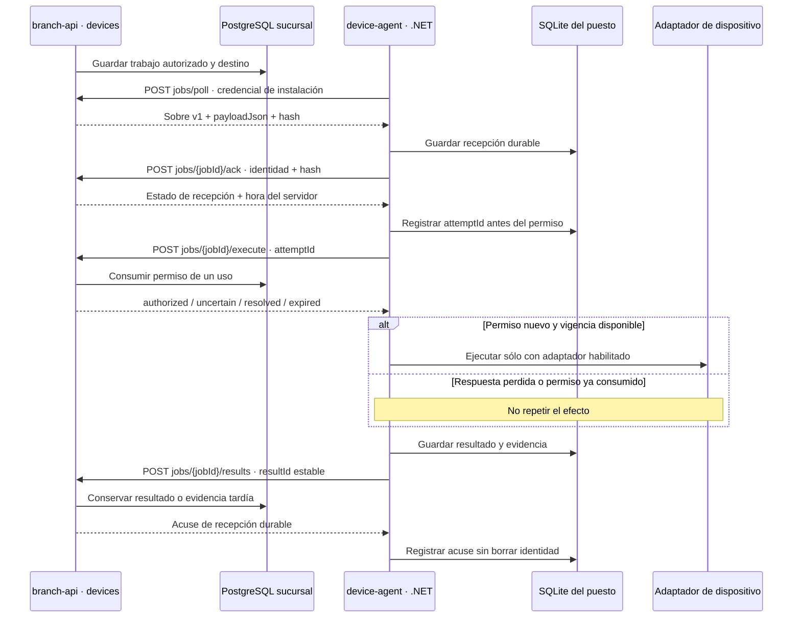

# F02 · Cobros, documentos y dispositivos

**Implementación parcial en revisión.** F02 incorpora persistencia y contratos de pagos, fiscalidad y dispositivos en `branch-api`, y el host nativo `apps/device-agent`. Las pruebas usan PostgreSQL, SQLite y HTTPS reales con datos aislados. Los proveedores de pago y facturación de esas pruebas son controlados; el host publicado no incluye un driver físico habilitado. Este corte no habilita cobros con tarjeta, emisión fiscal ni impresión operativa.

El código de este corte está en la [revisión `c23f1e4` de POS Platform](https://github.com/developer-implementos/pos-platform/tree/c23f1e4cb692c3640d78f017aad1122435ed37f1), rama `codex/f02-cobro-documento`; esta referencia no afirma integración en `main`. La [matriz técnica de F02](https://github.com/developer-implementos/pos-platform/blob/c23f1e4cb692c3640d78f017aad1122435ed37f1/delivery/reviews/F02-verification.md) conserva las comprobaciones observadas y las pendientes del corte. El avance del portal mantiene su snapshot publicado hasta completar la revisión e integración correspondientes.

El [roadmap F02](/guide/roadmap/phase-02/) conserva los catorce entregables y sus criterios. La implementación de un contrato, una prueba o un binario no completa por sí sola toda la fase. La revisión técnica y el avance se registran en POS Platform; la publicación de esta guía no implica aceptación humana.

## Aplicaciones y autoridad

| Pieza | Implementación del corte | Límite |
| --- | --- | --- |
| `branch-api` · `payments` | Intenciones e intentos durables, destino fijo, consulta, evidencia y compensación separada en PostgreSQL | Sin adaptador Transbank operativo ni UX completa de cobro; no interpreta una respuesta desconocida como rechazo seguro |
| `branch-api` · `fiscal` | Solicitud y fuente inmutable, identidad autorizada, intento de envío, consulta y estados diferenciados | Sin emisor/material fiscal habilitado ni adaptador Acepta/Ingydev operativo; no genera folios ficticios |
| `branch-api` · `devices` | Inscripción y asignación por puesto, trabajos, recepción, permiso de ejecución de un uso y resultados durables | No ejecuta drivers Windows ni convierte un recibo local en documento fiscal |
| `device-agent` | Host C#/.NET independiente del cliente, HTTPS saliente y registro SQLite por instalación | Publicación Windows x64 comprobada; driver runtime no disponible. Instalación como servicio, firma, cuenta y hardware requieren su evidencia |
| `pos-desktop` / `pos-mobile` | Conservan los perfiles conectados de F01 y sus capacidades efectivas | Las vistas de cobro, resolución de excepciones y entrega de documentos de F02 aún no están completas |

`country-api`, los workers, BullMQ y Redis no intervienen en el recorrido local del host. La coordinación del puesto usa HTTPS y persistencia en sucursal; no necesita una cola Redis en el PC. La [decisión de dispositivos](decisions/device-agent.md) fija la ubicación por puesto y la evolución de dispositivos de red en F06.

## Qué conserva cada contexto

**Pagos:** el backend inmoviliza la cesta y la cotización vinculadas al intento, conserva el destino y excluye operaciones incompatibles sobre el mismo terminal. Guarda el intento antes de llamar al proveedor. Una respuesta perdida exige consultar o conciliar el intento original; no permite cobrar con otra clave para salir de la incertidumbre. Si llega evidencia contradictoria después de liberar un rechazo, la cuarentena debe conservarse tanto para el terminal como para la cesta: liberar el intento anterior no vuelve seguro otro cobro o la confirmación en efectivo. La compensación tiene su propia intención, importe reservado, destino e intento. Esto todavía no implementa pagos combinados ni una reversa operativa con un adquirente.

**Fiscalidad:** la solicitud conserva una fuente comercial inmutable y la identidad fiscal autorizada. Los estados del proveedor y de la autoridad tributaria se distinguen. Consultar no vuelve a emitir; la ausencia o vencimiento de identidad impide el envío. Las restricciones locales de unicidad no acreditan numeración legal global ni sustituyen el material fiscal o las reglas del país. La composición actual no habilita un numerador ni un proveedor productivo.

**Dispositivos:** PostgreSQL es la autoridad de asignación, trabajo y permiso de ejecución. SQLite conserva recepción, intento y evidencia pendiente en el puesto. No contiene ventas ni un espejo comercial y no se usa como archivo de logs. Los logs diagnósticos del servicio son separados y no incluyen credenciales o payloads completos.

## Recorrido durable del host

El diagrama describe el recorrido de un adaptador habilitado. El runtime actual detecta que no hay driver, registra un resultado conocido sin efecto y consulta el permiso al entregar esa evidencia; no invoca hardware ni finge recorrer la rama física.

El agente consulta trabajos por HTTPS saliente con espera acotada entre ciclos. No abre un servidor HTTP local ni recibe desde Angular rutas, comandos shell o una dirección de impresora arbitraria. El backend construye el payload del recibo existente y valida el ámbito del operador; el host valida contrato, hash, dispositivo, instalación y época de control. El payload actual resume identificadores e importes de un comprobante local: no es una representación fiscal ni la plantilla completa de impresión de F02-10.

La recepción durable no permite ejecutar indefinidamente. El host vuelve a consultar el acuse al recuperar un trabajo y usa la hora del servidor para calcular el presupuesto restante, descontando el tiempo completo de ida y vuelta con un reloj monotónico. Revalida ese presupuesto después de adquirir la exclusión del dispositivo y antes del efecto.

El permiso de ejecución se consume en PostgreSQL **antes** de responder `authorized`. Sólo esa primera respuesta permite ejecutar. Repetir la petición devuelve incertidumbre o resolución, nunca otro permiso. Así, restaurar una SQLite anterior al intento no autoriza una segunda impresión. Si la respuesta se pierde, el host conserva el resultado conocido o la incertidumbre; no deduce que el permiso quedó libre.

## Contrato v1 y estados

Los esquemas públicos TypeScript están en `libs/backend/devices/contracts`; C# valida el mismo formato mediante fixtures compartidos. Las rutas del host tienen prefijo `/api/v1/device-host/`. El transporte permite sólo el origen HTTPS configurado, sin redirecciones y con validación TLS del sistema. La credencial propia de instalación no se sustituye por la sesión de un operador. La autenticación mutua y la rotación previstas por el contrato objetivo no se atribuyen a este primer transporte.

| Intercambio | Contenido y significado |
| --- | --- |
| Trabajo | `jobId`, sucursal, puesto, instalación controladora, época, dispositivo, capacidad, creación y vencimiento |
| Payload | `payloadJson` y SHA-256 de sus bytes UTF-8 exactos; máximo 16 KiB. Plantilla `sale-receipt.v1`, documento, indicador de copia y hasta 40 líneas de 120 escalares Unicode; no admite caracteres de control |
| Recepción | `received`, `expired` o `resolved`, junto con la hora del servidor. Conserva identidad; no confirma papel ni cobro |
| Permiso | `authorized`, `uncertain`, `resolved` o `expired`, con el intento autoritativo. Una respuesta ambigua no habilita hardware |
| Resultado | `resultId`, `jobId`, `attemptId`, época, hash, estado, motivo, hora observada y evidencia cuando corresponda |

Los UUID se expresan en minúsculas, los hashes en hexadecimal y las fechas UTC con milisegundos. El payload se comprueba sobre sus bytes originales; no se vuelve a serializar para calcular su identidad.

`jobId` identifica el trabajo autorizado; `attemptId`, el intento que puede producir el efecto; `resultId`, una observación durable de ese intento. Reenviar una observación conserva su `resultId`. Cambiar esos identificadores para salir de una espera rompería la recuperación y no está permitido.

| Resultado | Qué acredita |
| --- | --- |
| `failed` | Fallo conocido sin efecto, como driver no disponible, vencimiento o cancelación anterior a la ejecución |
| `uncertain` | No hay evidencia suficiente para resolver el efecto; un reinicio durante el intento conserva este estado |
| `spooled` | El spooler aceptó el trabajo y existe evidencia de esa recepción; no demuestra salida física |
| `succeeded` | El adaptador aporta evidencia del efecto físico exigida por su contrato |

El resultado y su intento permanecen correlacionados. Evidencia tardía más débil del mismo intento se conserva sin hacer retroceder el estado. El acuse del resultado significa recepción durable, no que ese resultado haya reemplazado la evidencia más fuerte. Un intento distinto no puede apropiarse del trabajo. Si el servidor ya resolvió el intento o reconoce otro intento autoritativo, el host conserva su evidencia como superada por la resolución remota, sin fingir un acuse de entrega.

`occurredAt` describe la observación del host; la admisión y las transiciones se deciden con el permiso, el ámbito y el estado durable del servidor. El reloj del puesto no convierte evidencia en autorización ni invalida por sí solo un reporte ya conservado.

## Host, almacenamiento y entrega

El SDK está fijado a **.NET 10.0.403**, con dependencias y lockfiles versionados. El ejecutable publicado para Windows x64 depende del runtime .NET 10. Nx coordina los comandos; no convierte el host en una aplicación NestJS. La configuración pública y el archivo de credencial permanecen fuera del artefacto, en rutas locales protegidas por la cuenta de servicio.

SQLite usa WAL, sincronización `FULL` y transacciones breves. La identidad de la base está vinculada al origen, sucursal, puesto, instalación, época y dispositivos configurados: cambiar ese ámbito no reasigna silenciosamente una base existente. Una exclusión del proceso protege la instancia; la base impide dos intentos en ejecución para el mismo dispositivo. El código no mantiene una transacción SQL abierta mientras espera red o hardware.

Los comandos reproducibles están en POS Platform: `npm run device:restore`, `npm run device:check`, `npm run device:publish` y `npm run device:interop`. La [guía del host](https://github.com/developer-implementos/pos-platform/blob/c23f1e4cb692c3640d78f017aad1122435ed37f1/apps/device-agent/README.md) define configuración y límites. Publicar el binario y validar su configuración no acredita instalación SCM, privilegios de servicio, actualización, firma o recuperación de un driver real.

## Evidencia observada y pendientes

La revisión del corte observa pruebas C# sobre SQLite real, caídas abruptas de procesos, duplicados, respuesta perdida, permiso consumido, presupuesto monotónico y restauración de copias antiguas. Los fixtures comunes incluyen trabajo, resultado, recepción y permiso. La prueba TLS negativa rechaza un certificado no confiable antes de transmitir la credencial.

La interoperabilidad ejecuta el host de pruebas contra **Nest/Fastify con HTTPS y PostgreSQL aislado**, usando los mismos transporte, coordinador y journal del producto. Dos trabajos terminan `failed / DRIVER_UNAVAILABLE`; sus recepciones, permisos, intentos y resultados quedan correlacionados. Un segundo proceso sobre la misma SQLite no produce trabajos ni reportes adicionales. Este resultado demuestra el protocolo entre procesos, no impresión física.

Para cerrar los entregables restantes se necesitan los adaptadores y contratos operativos, la matriz de modelos/SDK, instalación y cuenta del host, las interfaces de cobro y excepciones, plantillas completas y pruebas de proveedor/hardware. `api-impresion-caja` aporta evidencia de compatibilidad a analizar; sus dependencias .NET Framework, x86 y `System.Drawing.Printing` no se trasladan a un servicio moderno sin validación. El detalle permanece en el [ADR de dispositivos](decisions/device-agent.md) y la [matriz de extensibilidad](extensibilidad-proveedores-dispositivos.md).

La guía [F01](phase-1-laboratory.md) sigue describiendo la administración operativa y el laboratorio comercial existentes. F02 los complementa; no activa automáticamente tarjetas, fiscalidad o periféricos por compilar nuevos módulos.
