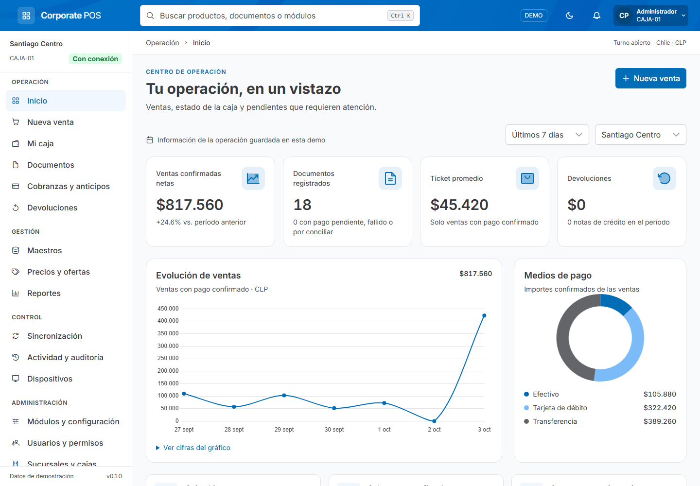

# POS Platform

Esta página es una síntesis editorial del repositorio del producto, mantenida en POS Docs. La evidencia de código se identifica en `apps/starlight/src/data/product-evidence.json`; la revisión de esta guía es independiente de esa revisión de POS Platform. Los comandos de desarrollo de esta página se ejecutan en un checkout del producto, salvo la sección de documentación técnica.

Plataforma POS corporativa preparada para evolucionar a varios países: monorepo Nx con clientes de escritorio y móvil, backend de sucursal, backend de país y workers. El incremento operativo de Chile está integrado en `main`: conecta Angular, NestJS/Fastify y PostgreSQL real para administrar usuarios, roles y asignaciones propios de POS mediante HTTPS. También conserva una demostración sintética y el recorrido F01 de laboratorio. Conserva el lenguaje visual de **prime-showcase** (PrimeNG, Aura corporativo, Inter, tablas y navegación). La integración no implica aceptación de fase ni habilitación de una caja productiva.

Producto y repositorio: [POS Platform](https://github.com/developer-implementos/pos-platform). Los aliases internos usan `@pos-platform/*`. La [guía del monorepo](monorepo.md) explica aplicaciones, propietarios de datos, estructura por contexto y configuración del workspace.

## Repositorio del producto

Los clientes Angular con PrimeNG para escritorio (Tauri) y móvil (Capacitor) y la base del backend se mantienen en **pos-platform**. La guía Starlight, sus fuentes y diagramas pertenecen al repositorio editorial [POS Docs](https://github.com/developer-implementos/pos-docs).

| Ubicación | Responsabilidad y estado |
| --- | --- |
| `apps/pos-desktop` | Cliente Angular propio para escritorio, alojado en Tauri |
| `apps/pos-mobile` | Cliente Angular propio para Android/iOS, alojado en Capacitor |
| `libs/client-shell` | Composición Angular compartida: rutas, configuración y shell |
| `apps/branch-api` | Identidad y administración POS Chile mediante HTTPS/PostgreSQL; motor comercial en validación |
| `apps/device-agent` | Host .NET 10 por puesto, recepción e intentos en SQLite; protocolo en revisión F02 y driver físico pendiente |
| `apps/country-api` | Base HTTP y sonda de PostgreSQL por ámbito; sin recepción comercial |
| `apps/branch-sync-worker`, `apps/erp-worker` | Composición de workers; CLI ERP de lectura independiente, procesamiento de jobs pendiente |
| `libs/` | Features del frontend, contextos del backend y contratos compartidos, con límites de importación |

Las aplicaciones comparten repositorio y contratos, con builds independientes. El cliente normal comienza en `unconfigured` y bloquea el acceso hasta recibir la configuración del puesto para el origen HTTPS autorizado en su paquete. `branch` usa el perfil operativo con identidad y permisos del servidor; `branch-lab` mantiene las pruebas sintéticas y `demo` se selecciona explícitamente. Ningún fallo de conexión o configuración activa la demostración. La [guía F01](phase-1-laboratory.md) distingue el incremento operativo integrado del recorrido de laboratorio y enlaza sus instrucciones de aprovisionamiento.

El [corte F02 en revisión](phase-2-payments-documents.md) incorpora persistencia de pagos/fiscalidad y el host de dispositivos con protocolo HTTPS y SQLite reales. La compilación y las pruebas no habilitan proveedores, numeración fiscal o hardware: esas capacidades conservan su homologación y entrega pendientes.



## Iniciar la demostración

Requiere Node.js 22.19 o posterior en la rama 22, o Node.js 24, y npm 11.6.0.

Si tu instalación usa otra versión de npm, instala las dependencias con `npx --yes npm@11.6.0 ci`.

```sh
git clone https://github.com/developer-implementos/pos-platform.git
cd pos-platform
npm ci
npm run demo:start
```

Abre **http://127.0.0.1:4300** para desarrollar la interfaz demo del cliente de escritorio. Este servidor local no es una aplicación web independiente ni un despliegue público. `npm start`, `npm run desktop:dev` y `npm run mobile:start` conservan el comportamiento normal sin configurar; no seleccionan la demo. La [decisión de clientes nativos](decisions/native-clients.md) explica la separación y los límites.

 La pantalla de acceso permite iniciar sesión con cuentas de demostración. Puedes completar el formulario desde **Accesos de demostración** o usar `admin@example.test` y la contraseña pública `Demo123!`. También están disponibles `supervisor@example.test`, `caja@example.test` y `auditor@example.test`, con la misma contraseña.

Hay una caja abierta con datos de ejemplo. El menú de usuario permite cambiar el perfil de demostración, simular desconexión, cambiar el tema y **Cerrar sesión**. La sesión se conserva en la pestaña; **Mantener sesión en este equipo** permite restaurarla al volver a abrir el navegador. Cerrar sesión elimina ese acceso, sin cerrar el turno ni borrar la venta en curso. Para comenzar de nuevo con los datos de ejemplo: **Módulos y configuración → Demostración → Restablecer**.

En este perfil todos los RUT, clientes, usuarios y operaciones son sintéticos; los permisos y efectos se simulan en el cliente. No hay cargos bancarios, DTE válidos ni conexiones corporativas. Los perfiles operativo y de laboratorio tienen accesos propios validados por el servidor; no usan las cuentas demo.

## API de sucursal

```sh
npm run api:dev
```

La API requiere un perfil explícito y PostgreSQL migrado con su rol de ejecución. El perfil `operational` de Chile incorpora cuentas POS, roles y asignaciones persistidos, con HTTPS y orígenes de cliente autorizados individualmente. El perfil `laboratory` conserva el recorrido sintético en loopback. La API publica contratos en `/api/v1`, sondas en `/health/live` y `/health/ready`, y OpenAPI JSON en `/api/openapi.json` cuando está habilitado. La [guía F01](phase-1-laboratory.md) distingue ambos perfiles y enlaza el procedimiento de configuración; `api:dev` no crea una base ni usuarios automáticamente.

Los nombres backend expresan ámbito y proceso: `branch-api`, `branch-sync-worker`, `country-api` y `erp-worker`. La [configuración de las aplicaciones](api.md#configuración) identifica sus rutas, artefactos y variables de entorno. Los comandos `api:*` operan sobre la API de sucursal; `sync:check` verifica la composición y cierre del worker de sincronización.

La base sigue las convenciones verificadas de **Core**: composición de arranque separada, configuración tipada e inyectable, logging unificado con `nestjs-pino`, errores HTTP con contrato estable, versionado URI y pruebas Vitest/SWC. La [guía de la API](api.md#referencia-core) identifica el commit de referencia y las decisiones adaptadas al backend de sucursal.

El reporte de errores con Sentry es opcional y está deshabilitado en los ejemplos, con DSN vacío. Cada aplicación tiene un cliente privado que captura fallos en fronteras explícitas y admite solo metadatos técnicos y frames reducidos; no envía datos de clientes, cuerpos de operaciones ni logs completos. Consulta el [alcance de captura y configuración](api.md#reporte-opcional-de-errores-con-sentry). No se ha conectado un proyecto real de Sentry.

La [decisión BullMQ + Redis de trabajos](decisions/job-processing.md) pertenece a la arquitectura objetivo: programación breve en `country-api` y ejecución/lotes/conciliación en `erp-worker`. El snapshot no acredita su instalación ni funcionamiento; los Redis de trabajos por entorno y la recuperación desde PostgreSQL siguen pendientes de implementar y probar.

Las apps backend comparten `libs/shared/backend/runtime`; la persistencia transaccional pertenece a `libs/shared/backend/persistence` y el negocio a sus contextos. `country-api` tiene base y sonda propias. `branch-sync-worker` y `erp-worker` conservan su composición sin trabajos operativos. El conector de lectura ERP es independiente: su contrato no acredita que los maestros o precios ya estén publicados en el POS ni que exista sincronización de extremo a extremo. Rspack/SWC empaqueta las apps Node y TSC comprueba tipos.

```sh
npm run api:check
npm run api:build
npm run api:smoke
```

Para comprobar el scaffold completo: `npm run backend:check`, `npm run backend:smoke` y `npm run structure:check`. `npm run country:dev` inicia la API de país en el puerto 3001; `npm run sync:check` y `npm run erp:check` verifican la composición y cierre de los workers sin ejecutar jobs. Consulta todos los [comandos del workspace](monorepo.md#comandos-del-workspace).

El backend y las librerías puras tienen lint con información de tipos para detectar promesas sin manejar y usos inseguros, además de fronteras Nx verificadas. Las [reglas y su alcance](monorepo.md#reglas-de-código-y-fronteras) distinguen esos controles de los del frontend; no sustituyen pruebas de comportamiento ni los requisitos pendientes de producción.

El incremento operativo permite gestionar cuentas, permisos y puestos en la sucursal, con autorización del servidor y PostgreSQL real; readiness comprueba conexión, ámbito y esquema. Catálogo, clientes y presupuestos permanecen sujetos a las capacidades informadas por el backend: sin maestros y publicación de precios verificados no se habilita cotización ni se sustituyen datos por fixtures. La entrega de outbox, contabilización ERP, fiscalidad, tarjetas y hardware siguen pendientes. Consulta [configuración, contratos y límites de la API](api.md).

## Publicar la documentación en Vercel

La configuración `vercel.json` del repositorio **pos-docs** publica el portal de recursos en `/`, la guía Starlight en `/guide/` y las presentaciones en `/presentations/`. Los clientes y el backend tienen sus artefactos y entregas en POS Platform. Consulta la [guía de publicación documental](vercel.md).

## Recorridos de demostración

| Área              | Qué puedes probar                                                                                                                                                                              |
| ----------------- | ---------------------------------------------------------------------------------------------------------------------------------------------------------------------------------------------- |
| Inicio            | Indicadores por período y sucursal, gráficos, ranking y pendientes derivados de las operaciones                                                                                                |
| Venta             | Productos y códigos de barra, cantidades, descuentos y ofertas, cliente express, boleta/factura, despacho, pagos mixtos, vuelto y ventas pausadas; órdenes de venta con condiciones protegidas |
| Pagos             | Efectivo, débito/crédito, transferencia, cheques con Orsan, crédito cliente, NC y USD; escenario de pago incierto con conciliación sin volver a cobrar                                         |
| Mi caja           | Apertura, ingresos/egresos, custodia, conteo por denominación, arqueo, diferencias con motivo, cierre, cambio de cajero y confirmación de depósitos de custodia                                |
| Documentos        | Búsqueda y filtros, detalle, estados local/pago/fiscal/ERP separados, emisión simulada y representación imprimible                                                                             |
| Cobranzas         | Saldos y documentos pendientes, convenios en cuotas, cobro y anticipos aplicables a ventas sin cobrar de nuevo                                                                                 |
| Devoluciones      | Nota de crédito por cantidades, emisión fiscal simulada y devolución de dinero como acciones distintas                                                                                         |
| Maestros          | Productos, clientes, bancos, plazas, motivos de NC y vendedores; edición validada y exportación                                                                                                |
| Precios y ofertas | Cambio de precio, condiciones por cliente/volumen, descuentos por producto y vigencia, habilitación y auditoría                                                                                |
| Reportes          | Ventas, pagos, caja, cobranzas, devoluciones y pendientes fiscal/ERP; filtros y CSV                                                                                                            |
| Sincronización    | Flujos de subida/bajada, ejecución manual, horarios e intervalos por día, errores simulados, reintentos, cola de salida e historial                                                            |
| Control           | Logs con correlación, auditoría por actor/acción y diagnóstico descargable                                                                                                                     |
| Administración    | Módulos y políticas, usuarios/permisos, sucursales/cajas, dispositivos e integraciones, recorrido de actualización mock                                                                        |

El inventario consultivo no cambia al vender: la caja de Chile no es la autoridad de stock. Los temporizadores de sincronización funcionan mientras la aplicación está abierta; no son un servicio de Windows.

## Arquitectura

Lo transversal se agrupa en `libs/shared/`, el negocio en `libs/backend/` y las pruebas de cliente en `tests/pos-clients-e2e`. El árbol conserva explícitamente los componentes futuros. La [guía del monorepo](monorepo.md#estado-de-implementación) delimita sus responsabilidades y estado.

<!-- monorepo:target:start -->
```text
apps/
  pos-desktop/                  # Aplicación completa: shell Tauri + frontend Angular
  pos-mobile/                   # Aplicación completa: shell Capacitor + frontend Angular
  device-agent/                 # Host .NET 10/SQLite por puesto; driver físico pendiente; red compartida en F06
  branch-api/                   # API y composición de negocio de sucursal
  branch-sync-worker/           # Proceso de entrega y recepción de sucursal
  country-api/                  # API de recepción y capacidades de país
  erp-worker/                   # Proceso de integración, traducción y conciliación ERP
libs/
  backend/
    sales/                      # Ventas y documentos comerciales
    cash/                       # Turnos y movimientos de caja
    payments/                   # Intentos, resultados y conciliación de pagos
    collections/                # Cobranzas y anticipos
    returns/                    # Devoluciones y referencias al documento original
    pricing/                    # Evaluación y versiones de precios y promociones
    catalog/                    # Maestros y proyecciones de consulta
    fiscal/                     # Documentos y estados fiscales por país/proveedor
    devices/                    # Contratos y coordinación de periféricos
    sync/                       # Protocolo y progreso de sincronización
    erp/                        # Contratos, ACL y adaptadores ERP
    reporting/                  # Consultas y proyecciones de reportes
    administration/             # Configuración y ámbito organizacional
  client-shell/                 # Composición Angular compartida; no es una aplicación desplegable
  features/                     # Funcionalidades de la interfaz
    branch-operation/           # Login, caja y venta conectados con componentes PrimeNG
  shared/
    frontend/
      ui/                       # Preset, tokens y componentes de presentación
    kernel/                     # Modelo mínimo acordado entre contextos; sin frameworks
    contracts/                  # Sobres y metadatos técnicos comunes; no todos los DTO de negocio
    backend/
      runtime/                  # Bootstrap, configuración, HTTP, observabilidad, sondas y ciclo de vida
      persistence/              # Driver pg, unidad de trabajo, migraciones y comandos durables
      testing/                  # Bases/roles sintéticos para integración real
  country-policies/             # Perfiles nacionales; reglas específicas bajo su contexto
  domain/                       # Reglas puras del prototipo frontend
  data-access/                  # Adaptadores demo y gateway branch-api en proyectos separados
    branch-api/                 # HTTP y estado de la operación conectada
tests/
  device-agent/                 # Pruebas .NET/SQLite, recuperación y helper de interoperabilidad HTTPS
  pos-clients-e2e/              # Playwright demo y API real; proyecto Nx sin despliegue
    mobile/                     # Suite Angular móvil; no homologa Capacitor
    branch/                     # Recorridos Angular → API → PostgreSQL con recuperación
tools/                          # Herramientas de build, lint y pruebas del producto
.github/
  workflows/                    # Validaciones y entrega
```
<!-- monorepo:target:end -->

Core es solo referencia de organización y convenciones; no es dependencia ni servicio del POS. Las bibliotecas backend no importan Angular ni los adaptadores mock. Las carpetas compartidas conservan responsabilidades independientes y entradas públicas explícitas.

En `demo`, las features consumen `PosStore`; no escriben en `localStorage`. Los permisos y módulos se validan en rutas **y comandos**. El estado se publica como snapshots inmutables. Las transacciones guardan primero el snapshot y publican el resultado solo si la persistencia tuvo éxito. Las ventas y eventos conservan identificadores para evitar duplicados. Pago, fiscalidad y ERP tienen ciclos separados.

En la demostración, la identidad de acceso se guarda por ID de usuario en `corporate-pos:auth:v1`, separada de los datos de negocio y del turno de caja. Usa `sessionStorage` o `localStorage` según la opción de permanencia; nunca guarda la contraseña. Son controles locales del perfil demo. El cliente `branch` utiliza cuentas y asignaciones propias de POS comprobadas por el servidor, mantiene el token sólo en memoria y conserva únicamente la configuración pública del puesto para el siguiente inicio.

Los límites de importación se verifican con Nx/ESLint. Se usan Angular con detección de cambios OnPush y signals, TypeScript estricto, carga diferida por área y componentes PrimeNG. La tipografía y los iconos se sirven localmente. No se utilizan `patch-package`, dependencias privadas de fuentes, telemetría ni servicios del proyecto de referencia.

## Validación

```sh
npm run lint
npm test
npm run build
npx playwright install chromium
npm run test:e2e
npm run desktop:info
```

Las pruebas cubren políticas, montos, persistencia, permisos, reintentos, calendarios y recorridos de navegador. La verificación de la demo se solicita explícitamente; los builds normales conectados comienzan sin configurar cuando no reciben una política de despliegue. CI comprueba compilación y empaquetado nativo, sin acreditar por ello instalación, firma de distribución ni aceptación operativa. Las acciones de CI están fijadas por commit y tienen permisos de lectura.

Validación tras la revisión de calidad (3 de octubre de 2026): **144 pruebas de lógica e infraestructura y 37 recorridos de navegador pasan**, junto con lint, formato y compilación web de producción. Los recorridos ejecutan el bundle productivo con la CSP de Tauri, incluyen tamaños de 375 y 1440 px y verifican controles de prime-showcase y accesibilidad del dashboard/reportes en claro y oscuro. El [informe de revisión](quality-review.md) detalla correcciones y condiciones pendientes para producción.

Las comprobaciones de CI se consultan en [Actions de pos-platform](https://github.com/developer-implementos/pos-platform/actions). El instalador se puede generar con `npm run desktop:build`.

## Clientes nativos

```sh
npm run desktop:dev
npm run desktop:build
```

El escritorio necesita Rust, MSVC/Windows SDK y WebView2. Consulta [preparación de Tauri](desktop.md). Para Android/iOS consulta [preparación de Capacitor](mobile.md); su compilación Angular no acredita apertura, permisos, periféricos ni distribución nativa. `npm run build` compila los dos clientes Angular secuencialmente; `desktop:build` empaqueta Tauri y los comandos móviles sincronizan o ejecutan sus proyectos nativos. La [guía F01](phase-1-laboratory.md) enlaza la preparación del paquete con su origen HTTPS exacto y el registro público del puesto. El contenedor no tiene comandos para cobrar, imprimir físicamente o acceder libremente al sistema; no se acredita una distribución firmada para operación productiva.

## De maqueta a producto

El perfil demo valida UX con datos sintéticos; el laboratorio F01 verifica operación y recuperación con API y PostgreSQL reales. El incremento operativo de Chile añade administración de identidad propia de POS y configuración segura del cliente, integrado en `main` y pendiente de aceptación. **Estos estados no acreditan una caja habilitada para producción ni aceptación del roadmap.** Permanecen pendientes la integración verificada de maestros y precios, la contabilización ERP, conciliación bancaria, homologación fiscal, hardware y aceptación operativa. Los límites se describen en [arquitectura](architecture.md), [seguridad](security.md), [API](api.md) y [guía F01](phase-1-laboratory.md).

La cobertura de Chile y las referencias revisadas están en [inventario de la caja actual](audit-chile-for-product.md). Ese inventario distingue la funcionalidad de referencia, la simulación y lo que necesita integración real.

## Documentación técnica

La guía Starlight pertenece a [**POS Docs**](https://github.com/developer-implementos/pos-docs): aplicación `apps/starlight`, fuentes en `docs/` y herramientas de diagramas en `tools/diagrams/`. Su catálogo identifica la revisión de POS Platform que describe. [Mantenimiento y publicación](../apps/starlight/README.md).

```sh
git clone https://github.com/developer-implementos/pos-docs.git
cd pos-docs
npm --prefix apps/starlight ci
npm --prefix apps/starlight run dev
```

En **pos-docs**, `npm --prefix apps/starlight run build` produce el sitio estático en `dist/`, con `/guide/`, las descargas documentales y el snapshot público. La presentación existente consume un derivado fijado por revisión editorial; conserva su repositorio y no mantiene otra fuente editable de la guía.
